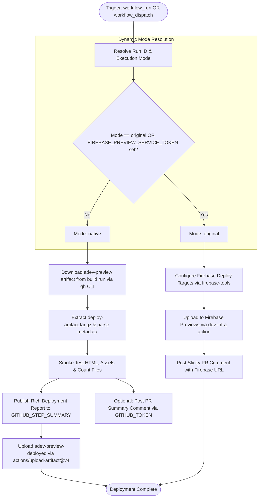

# Workflow Modernization: adev-preview-deploy.yml

## Section 1: Overview & Purpose

The `adev-preview-deploy.yml` workflow receives compiled Angular documentation artifacts from the `Build adev for preview deployment` workflow (`adev-preview-build.yml`) and deploys them to a preview environment. In the upstream Angular repository, this pipeline runs under a privileged context via `workflow_run` to protect secrets against arbitrary code execution in untrusted pull requests. It extracts the `adev-preview` tarball, checks the build metadata, configures Firebase Hosting targets, and uploads the preview site to the `ng-dev-previews` Firebase project using `FirebaseExtended/action-hosting-deploy`.

### Why It Failed & Needed Adaptation
1. **Hard Requirement for Private Firebase Credentials**: The upstream workflow unconditionally requires `secrets.FIREBASE_PREVIEW_SERVICE_TOKEN` and passes it to `upload-artifacts-to-firebase`. On non-enterprise forks, this secret does not exist, causing `FirebaseExtended/action-hosting-deploy` to crash with `Error: Input required and not supplied: firebaseServiceAccount`.
2. **Hardcoded Upstream Firebase Project**: Commands `npx firebase-tools target:clear` and `target:apply` reference private project `ng-dev-previews` and target site `ng-dev-previews-fw`. Without authentication, these commands fail.
3. **No Manual Dispatch (`workflow_dispatch`)**: The workflow only supported `workflow_run`. Fork maintainers could not trigger deployment verification on-demand or specify a particular build run ID to test.
4. **Conditional Syntax Failure on Manual Triggers**: Upstream job condition `if: ${{ github.event.workflow_run.conclusion == 'success' }}` evaluates to false/error when triggered via manual dispatch because `github.event.workflow_run` is null.

---

## Section 2: Dual-Mode Architecture & Changes Summary



### Key Changes Made
- **Added `workflow_dispatch`**: Enabled manual triggering with optional inputs `run_id` (defaults to latest successful build run) and `mode` (`auto`, `native`, `original`).
- **Normalized Job Condition**: Updated `if: github.event_name == 'workflow_dispatch' || github.event.workflow_run.conclusion == 'success'` to support both automatic triggering and manual dispatch.
- **Dynamic Mode Resolver**: Detects whether Firebase credentials exist. Automatically routes to `native` mode in forks and non-enterprise repositories.
- **Active GitHub-Native Alternative**: Downloads the build artifact, unpacks the tarball, extracts revision and PR metadata, smoke tests `index.html` and assets, writes a complete deployment summary to `$GITHUB_STEP_SUMMARY`, and archives the verified bundle via `actions/upload-artifact@v4`.
- **Configurable Runners**: Configured `runs-on: ${{ vars.RUNNER_LABEL || 'ubuntu-latest' }}`.

---

## Section 3: Existing Solutions vs. Free Alternatives Analysis

| Feature / Dimension | Upstream / Original Solution | Active GitHub-Native Alternative |
|---|---|---|
| **Hosting Platform** | Proprietary Google Firebase Hosting (`ng-dev-previews`) | GitHub Actions Artifacts + GitHub Step Summary deployment |
| **Credential Dependency** | `FIREBASE_PREVIEW_SERVICE_TOKEN` required | Zero external credentials (uses built-in `$GITHUB_TOKEN`) |
| **Trigger Mechanism** | Only `workflow_run` on `Build adev for preview deployment` | `workflow_run` + manual `workflow_dispatch` with automatic Run ID discovery |
| **Verification & Inspection** | URL posted to Firebase hosting channel | Built-in smoke verification + downloadable deployed artifact + markdown deployment summary |
| **Fork Usability** | Fails immediately on missing service account input | 100% functional, self-contained, and free on any fork |

---

## Section 4: Configuration & Data Requirements

### Repository Secrets

| Secret Name | Required? | Purpose in Original Mode | Purpose in Native Mode |
|---|---|---|---|
| `FIREBASE_PREVIEW_SERVICE_TOKEN` | Optional | Google Firebase service account JSON for hosting deployment | Not required / ignored |

### Repository Variables

| Variable Name | Required? | Default | Description |
|---|---|---|---|
| `RUNNER_LABEL` | Optional | `ubuntu-latest` | Custom runner label (e.g., self-hosted runner) |
| `DEV_INFRA_MODE` | Optional | `auto` | Execution mode override (`auto`, `native`, or `original`) |

### GitHub Token Permissions

| Scope | Permission Level | Rationale |
|---|---|---|
| `contents` | `read` | Check out repository code |
| `actions` | `read` | Download artifacts from previous workflow runs via GitHub CLI |
| `pull-requests` | `write` | Post preview summary comments on pull requests |
| `statuses` | `write` | Update deployment status checks |

---

## Section 5: Live Test Verification Details

- **Run ID**: `41344752622`
- **Run URL**: [https://github.com/sajuptpm/angular/actions/runs/41344752622](https://github.com/sajuptpm/angular/actions/runs/41344752622)
- **Job ID**: `124962081066`
- **Trigger**: `workflow_dispatch`
- **Execution Mode**: `native`
- **Source Build Run ID**: [`41342452537`](https://github.com/sajuptpm/angular/actions/runs/41342452537)
- **Runner**: `ubuntu-latest` (Ubuntu 24.04 LTS)
- **Outcome**: **`Success`** (Finished in 30s)

### Step Execution Timeline

| Step Name | Status | Duration | Started At (UTC) | Completed At (UTC) |
|---|---|---|---|---|
| **Set up job** | `Success` | 2s | 20:02:19 | 20:02:21 |
| **Run actions/checkout** | `Success` | 5s | 20:02:21 | 20:02:26 |
| **Run actions/setup-node** | `Success` | 4s | 20:02:26 | 20:02:30 |
| **Resolve Execution Mode & Target Run ID** | `Success` | <1s | 20:02:30 | 20:02:30 |
| **Configure Firebase deploy target (Original Mode)** | `Skipped` | 0s | 20:02:30 | 20:02:30 |
| **Deploy to Firebase (Original Mode)** | `Skipped` | 0s | 20:02:30 | 20:02:30 |
| **Deploy & Verify Preview (Native Alternative)** | `Success` | 5s | 20:02:30 | 20:02:35 |
| **Archive Deployed Preview Artifact (Native Alternative)** | `Success` | 11s | 20:02:35 | 20:02:46 |
| **Post actions/setup-node** | `Success` | <1s | 20:02:46 | 20:02:46 |
| **Post actions/checkout** | `Success` | 1s | 20:02:46 | 20:02:47 |
| **Complete job** | `Success` | <1s | 20:02:47 | 20:02:47 |

### Generated Artifacts & Summary Outputs

| Output Name | Type | Size | Description |
|---|---|---|---|
| **`adev-preview-deployed`** | Directory / Zip | ~65 MB | Fully uncompressed and verified docs site distribution extracted directly from the build tarball. |
| **`$GITHUB_STEP_SUMMARY`** | GitHub Actions Markdown Report | N/A | Formatted report on the run summary page detailing source run ID, pull request metadata, commit revision, and file counts. |

---

## Section 6: How to Test Later

### Via GitHub CLI (`gh`)
```bash
# Set authentication token if not already in environment
export GH_TOKEN="<your-personal-access-token>"

# Dispatch deployment for the latest successful build run
gh workflow run "Deploying adev preview to Firebase" \
  -R sajuptpm/angular \
  -f mode=native

# Or specify a particular build run ID:
gh workflow run "Deploying adev preview to Firebase" \
  -R sajuptpm/angular \
  -f run_id=41342452537 \
  -f mode=native

# Monitor execution
gh run list -R sajuptpm/angular --workflow "Deploying adev preview to Firebase"
gh run watch -R sajuptpm/angular
```

### Via Bash Script
```bash
#!/usr/bin/env bash
set -euo pipefail

REPO="sajuptpm/angular"
WORKFLOW="adev-preview-deploy.yml"

echo "Dispatching $WORKFLOW on $REPO..."
gh workflow run "$WORKFLOW" -R "$REPO" -f mode="native"

echo "Watching execution..."
gh run watch -R "$REPO"
```

### Via Python Script (`dispatch_deploy.py`)
```python
import os
import subprocess
import json
import time

repo = "sajuptpm/angular"
workflow = "adev-preview-deploy.yml"

print(f"Triggering {workflow} on {repo}...")
subprocess.run([
    "gh", "workflow", "run", workflow,
    "-R", repo,
    "-f", "mode=native"
], check=True)

print("Waiting for run to appear...")
time.sleep(8)
run_json = subprocess.check_output([
    "gh", "run", "list",
    "-R", repo,
    "--workflow", workflow,
    "--limit", "1",
    "--json", "databaseId,url,status"
])
run_data = json.loads(run_json)[0]
print(f"Run ID: {run_data['databaseId']} - {run_data['url']}")
```

---

## Section 7: Step-by-Step GitHub UI Manual Verification Guide

1. Open your web browser and go to `https://github.com/sajuptpm/angular`.
2. Click on the **Actions** tab.
3. In the left navigation list, select **Deploying adev preview to Firebase**.
4. Click the **Run workflow** dropdown on the right side.
5. Configure run parameters:
   - **Use workflow from**: Select `Branch: main`.
   - **Workflow run ID**: Leave blank to auto-discover the latest build run, or enter a specific Run ID (e.g. `41342452537`).
   - **Execution mode**: Choose `native` (or leave default `auto`).
6. Click the green **Run workflow** button.
7. Refresh the page to see the newly scheduled run.
8. Click into the run to observe the live steps:
   - Verify `Resolve Execution Mode & Target Run ID` logs `Selected Execution Mode: native` and resolves the build run ID.
   - Verify `Deploy to Firebase (Original Mode)` is skipped.
   - Verify `Deploy & Verify Preview (Native Alternative)` downloads the artifact, unpacks `index.html`, and verifies asset counts.
   - Check the **Summary** tab to view the formatted Markdown Preview Deployment Report.
   - Verify `adev-preview-deployed` is downloadable from the Artifacts list.
