# Angular Architecture & Tooling Breakdown (Before Code Change)

> **Context**: This architecture breakdown reflects the **upstream Angular framework monorepo (`angular/angular`)** exactly as configured **BEFORE ANY CODE CHANGES IN THE WORKFLOWS**. It documents every piece of Infrastructure, GitHub Native Tool, and Third-Party Tool/Library, verified against original codebase evidence and workflow configurations.

---

## Architecture Overview (Upstream Reference Model)

```mermaid
flowchart TD
    subgraph INFRA["1. INFRASTRUCTURE & COMPUTE (Before Code Change)"]
        GCP_RBE["Google Cloud Platform (GCP)<br/>Remote Build Execution (RBE)"]
        LARGER_RUNNERS["GitHub Larger Runners<br/>ubuntu-latest-8core"]
        STD_RUNNERS["GitHub Standard Runners<br/>ubuntu-latest"]
        DEV_VM["Developer VM / Workstation<br/>Node 24 + Bazel 8 + pnpm 11"]
        FIREBASE_INFRA["Google Firebase Hosting<br/>Project: ng-dev-previews"]
        GCP_TELEMETRY["Google Cloud BigQuery & GCS<br/>Project: internal-200822"]
        GCP_WIF["Google Cloud WIF<br/>Workload Identity Federation"]
        G3_TAP["Google Internal Monorepo<br/>google3 / TAP Presubmit Sync"]
    end

    subgraph GITHUB_TOOLS["2. GITHUB TOOLS (Before Code Change)"]
        GH_REPO["Public GitHub Repository<br/>angular/angular"]
        GH_ACTIONS["GitHub Actions<br/>11 Native Push/PR Workflows"]
        GH_ROBOT["Angular Robot GitHub App<br/>Triage, Gating & Cherry-picking"]
        GH_SECRETS["GitHub Secrets<br/>Production Tokens & Private Keys"]
        GH_STATUS["GitHub Commit Status API<br/>mergeability & google-internal-tests"]
        GH_ARTIFACTS["GitHub Actions Artifacts<br/>adev-preview & rbe-grpc.log"]
        GH_RELEASES["GitHub Releases & Snapshots<br/>reusable-release & snapshot-builds"]
        GH_SECURITY["Dependabot & Security Advisories<br/>Dependency Vulnerability Alerts"]
        GH_CODEQL["CodeQL (GitHub Advanced Security)<br/>Static Application Security Testing"]
    end

    subgraph TOOLS_3P["3. 3P TOOLS (Before Code Change)"]
        BAZEL["Bazel / Bazelisk 8.8.1<br/>Build Orchestration & Cache"]
        NODE["Node.js v24.21.0<br/>Hermetic JavaScript Runtime"]
        PNPM["pnpm 11.27.1<br/>Monorepo Package Manager"]
        TS["TypeScript (tsc)<br/>Static Type Checking & APF"]
        NG_DEV["@angular/ng-dev<br/>Release, Branch & Formatting CLI"]
        JASMINE["Jasmine 6.3.0<br/>BDD Unit Testing Framework"]
        KARMA["Karma + Launchers<br/>Browser DOM Testing Runner"]
        PLAYWRIGHT["Playwright / Chromium / Firefox<br/>Headless E2E Integration"]
        BUNDLERS["esbuild + Rollup + Terser<br/>FESM Bundling & Minification"]
        LINTERS["Prettier + tslint + Buildifier<br/>Monorepo Code Formatting"]
        TSEC["tsec (Trusted Types)<br/>SAST DOM-XSS Security Tool"]
        QA_TOOLS["Karma-Coverage + Api-Golden<br/>Coverage & Public API Verification"]
        CLOUD_SERVICES["npm Registry + Algolia + Gemini + SauceLabs<br/>External Services & APIs"]
    end

    INFRA --> GITHUB_TOOLS
    GITHUB_TOOLS --> TOOLS_3P
```

---

## 1. INFRA (Infrastructure & Compute - Before Code Change)

| Infra | Purpose | Codebase Evidence (Before Code Change) |
| :--- | :--- | :--- |
| **Google Cloud Platform (GCP) – Remote Build Execution (RBE)** | Cloud-distributed Bazel compilation, remote action caching, and parallel build acceleration across hundreds of cloud worker nodes | `.github/workflows/pr.yml` (L31: `Setup Bazel RBE`, L69: `Setup Bazel Remote Caching`), `.github/workflows/ci.yml` (L39, L78), `.github/workflows/adev-preview-build.yml` (L27), `.github/workflows/benchmark-compare.yml` (L77); GCP Project `internal-200822`; Secret `RBE_TRUSTED_BUILDS_USER`; Log `/tmp/rbe-grpc.log` |
| **GitHub Larger Runners (`ubuntu-latest-8core`)** | High-performance compute VMs (8 vCPU, 32 GB RAM) provisioned upstream to prevent OOM errors during heavy Bazel compilation and documentation builds | `.github/workflows/adev-preview-build.yml` (L44: `runs-on: ubuntu-latest-8core`), `.github/workflows/ci.yml` (L195: `adev-deploy` job, `runs-on: ubuntu-latest-8core`) |
| **GitHub Standard Runners (`ubuntu-latest`)** | Standard Linux compute VMs (2 vCPU, 7 GB RAM) for unit testing, linting, release coordination, and issue triage | `.github/workflows/pr.yml` (L19, L53, L73), `.github/workflows/ci.yml` (L21, L65, L85), `.github/workflows/perf.yml` (L17, L46), `.github/workflows/dev-infra.yml`, `google-internal-tests.yml`, `assistant-to-the-branch-manager.yml`, `benchmark-compare.yml`, `cross-repo-adev-docs.yml` |
| **Developer Workstation / Local VM** | Local developer environment for code authoring, interactive debugging, unit test execution, and Bazel building | `.bazelrc`, `.bazelversion` (8.8.1), `.nvmrc` (v24.21.0), `pnpm-lock.yaml` (pnpm 11.27.1), `contributing-docs/building-and-testing-angular.md` |
| **Google Firebase Hosting & Preview Channels** | Production hosting platform for `angular.dev` and dynamic pull request preview deployment environments | `.github/workflows/adev-preview-deploy.yml` (L24–27: Project `ng-dev-previews`, hosting `angular-docs`), `.github/workflows/ci.yml` (L212–218: `Deploy to firebase`, `configPath: 'adev/firebase.json'`), Secret `FIREBASE_PREVIEW_SERVICE_TOKEN`, `ANGULAR_DEV_SITE_DEPLOY` |
| **Google Cloud BigQuery & Cloud Storage (GCS)** | Enterprise telemetry data warehouse and metric storage for tracking historical bundle sizes, build durations, and benchmark regressions | `.github/workflows/perf.yml` (L46–54: `project_id: internal-200822`, `service_account: measures-uploader@internal-200822.iam.gserviceaccount.com`), `pnpm ng-dev perf workflows upload-metrics` |
| **Google Cloud Workload Identity Federation (WIF)** | Keyless OIDC authentication infrastructure connecting GitHub Actions runner identity tokens directly to GCP IAM | `.github/workflows/perf.yml` (L48: `workload_identity_provider: projects/823469418460/locations/global/workloadIdentityPools/measurables-tracking/providers/angular`), Action `google-github-actions/auth@v3` |
| **Google Internal Monorepo Infrastructure (Google3 / TAP / Piper)** | Google-internal monorepo sync infrastructure and presubmit regression testing suite (TAP - Test Automation Platform) | `.github/workflows/google-internal-tests.yml` (L17–21: `run-tests-guide-url: http://go/angular-g3sync-start`, `sync-config: ./.ng-dev/google-sync-config.json`), Action `angular/dev-infra/github-actions/google-internal-tests` |

---

## 2. GITHUB TOOLS (GitHub Native Platform - Before Code Change)

| Tool | Purpose | Codebase Evidence (Before Code Change) |
| :--- | :--- | :--- |
| **Public GitHub Repository (`angular/angular`)** | Source Control, Branch Protection, Issue Tracking, and Pull Request Collaboration | Upstream repository `angular/angular`, `.github/ISSUE_TEMPLATE/` (bug reports, feature requests), `.github/PULL_REQUEST_TEMPLATE.md`, `assistant-to-the-branch-manager.yml` (L49: `if: github.event.repository.fork == false`), `cross-repo-adev-docs.yml` (L42: `if: github.repository == 'angular/angular'`) |
| **GitHub Actions** | Continuous Integration, Continuous Delivery, and Automation (11 native CI/CD pipelines) | All 11 workflow files in `.github/workflows/*.yml` triggered automatically on `push`, `pull_request`, `pull_request_target`, `issue_comment`, `issues`, and `workflow_run` |
| **Angular Robot GitHub App** | Dedicated bot identity for automated triage, PR labeling, mergeability status gating, and branch cherry-picking | `.github/angular-robot.yml`, `.github/workflows/dev-infra.yml` (`secrets.ANGULAR_ROBOT_PRIVATE_KEY`), `assistant-to-the-branch-manager.yml` (`secrets.ANGULAR_ROBOT_PRIVATE_KEY`), `release.yml` (`secrets.ANGULAR_ROBOT_PRIVATE_KEY`), `cross-repo-adev-docs.yml` (`secrets.ANGULAR_ROBOT_ACCESS_TOKEN`) |
| **GitHub Secrets & Environment Management** | Secure encrypted storage of production credentials, API tokens, and service keys | `secrets.RBE_TRUSTED_BUILDS_USER`, `secrets.WOMBOT_TOKEN`, `secrets.ANGULAR_ROBOT_PRIVATE_KEY`, `secrets.ANGULAR_ROBOT_ACCESS_TOKEN`, `secrets.FIREBASE_PREVIEW_SERVICE_TOKEN`, `secrets.ANGULAR_DEV_SITE_DEPLOY`, `secrets.DOCS_DEPLOY_GITHUB_RELEASE_TRAIN_TOKEN`, `secrets.SNAPSHOT_BUILDS_GITHUB_TOKEN`, `secrets.BENCHMARK_COMPARE_MEMBERSHIP_GITHUB_TOKEN`, `secrets.BENCHMARK_POST_RESULTS_GITHUB_TOKEN`, `secrets.GOOGLE_GENERATIVE_AI_KEY`, `secrets.ALGOLIA_SYNONYM_MANAGER`, `secrets.READONLY_GITHUB_TOKEN` |
| **GitHub Commit Status API (`statuses: write`)** | Pull Request Merge Gating and Commit Status Checks | `.github/workflows/assistant-to-the-branch-manager.yml` (context `mergeability`), `.github/workflows/google-internal-tests.yml` (context `google-internal-tests`) |
| **GitHub Actions Artifacts** | Inter-job binary sharing and artifact passing between build and deploy workflows | `.github/workflows/adev-preview-build.yml` (`pack-and-upload-artifact`, name `adev-preview`), `.github/workflows/adev-preview-deploy.yml` (`upload-artifacts-to-firebase`), `.github/workflows/pr.yml` (`upload-artifact`, path `/tmp/rbe-grpc.log`) |
| **GitHub Releases & Snapshot Repositories** | Production release orchestration and automated snapshot package distribution | `.github/workflows/release.yml` (invokes `reusable-release.yml`), `.github/workflows/ci.yml` (`publish-snapshots` job invoking `./scripts/ci/publish-snapshot-build-artifacts.sh` via `secrets.SNAPSHOT_BUILDS_GITHUB_TOKEN` to `angular/*-builds`) |
| **Dependabot & GitHub Security Advisories** | Automated Dependency Vulnerability Scanning, Security Alerts, and Advisory Sync | `.github/actions/deploy-docs-site/main.js` (Dependabot API integration), GitHub Advisory Database |
| **CodeQL (GitHub Advanced Security)** | Static Application Security Testing (SAST) and Code Vulnerability Detection | Pre-installed runner CodeQL toolcache, `vscode-ng-language-service/server/src/text_render.ts` (L10: `// CodeQL [SM02383]`) |

---

## 3. 3P TOOLS (Third-Party Tools & Ecosystem - Before Code Change)

| Tool | Purpose | Codebase Evidence (Before Code Change) |
| :--- | :--- | :--- |
| **Bazel / Bazelisk** | Hermetic Build Orchestration, Distributed Action Caching, and Target Graph Execution | `.bazelversion` (pinned to `8.8.1`), `.bazelrc`, `MODULE.bazel`, `BUILD.bazel`, `package.json` (`@bazel/bazelisk: ^1.7.5`) |
| **Node.js** | JavaScript & TypeScript Runtime Environment for Toolchains and Development | `.nvmrc` (pinned to `v24.21.0`), `MODULE.bazel` (`@rules_nodejs` pinned toolchain v24.21.0 across all OS architectures), `package.json` |
| **pnpm** | Fast, Disk-Efficient Monorepo Package Management and Dependency Resolution | `pnpm-lock.yaml`, `package.json` (`packageManager: pnpm@11.27.1`), `AGENTS.md` ("Use pnpm for package management") |
| **TypeScript (`tsc`)** | Static Type Checking, Language Compilation, and `.d.ts` Declaration Generation | `package.json` (`typescript`), `tsconfig.json`, `MODULE.bazel` (`@aspect_rules_ts: 3.10.1`) |
| **@angular/ng-dev** | Angular Developer Infrastructure CLI for Release Publishing, Branch Management, PR Validation, and Format Checking | `package.json` (`"@angular/ng-dev": "https://github.com/angular/dev-infra-private-ng-dev-builds.git#df3931fca45cce0a2fa74c9ccc5876c571ef8406"`), `MODULE.bazel` (`git_override` for `devinfra`), `.ng-dev/` configuration directory |
| **Jasmine** | Behavior-Driven Development (BDD) Unit Testing Framework and Assertion Engine | `package.json` (`jasmine: 6.3.0`, `jasmine-core: 6.3.0`, `jasmine-reporters: ^2.5.2`), `MODULE.bazel` (`@aspect_rules_jasmine: 2.0.4`), `tools/defaults.bzl` (`jasmine_test`) |
| **Karma** | Browser-Based Unit Testing & Real DOM Test Execution Runner across Browsers | `package.json` (`karma: ~6.4.0`, `karma-chrome-launcher: ^3.1.0`, `karma-firefox-launcher: ^2.1.0`, `karma-jasmine: ^5.0.0`), `tools/bazel/web_test.bzl` (`ng_web_test_suite`) |
| **Playwright / Headless Chromium & Firefox** | Headless Browser Automation, End-to-End (E2E) Integration Testing, and Web Crawling | `MODULE.bazel` (`git_override` for `@rules_browsers` commit `4eb51c972ac3e5bf22005edabbe1778b5525601c`), `packages/private/testing/src/utils.ts`, `adev/` E2E test suite |
| **esbuild** | High-Speed JavaScript Bundling and GitHub Action Compilation | `package.json` (`esbuild: 0.28.2`), `MODULE.bazel` (`@aspect_rules_esbuild: 0.27.1`), `tools/defaults.bzl` (`esbuild`), `.github/actions/deploy-docs-site/esbuild.conf.js` |
| **Rollup** | Flat ESM (FESM) Packaging and Production Release Distribution Bundler | `package.json` (`rollup: 4.63.4`, `rollup-plugin-dts: ^6.1.1`, `@rollup/plugin-commonjs: ^29.0.0`), `MODULE.bazel` (`@aspect_rules_rollup: 2.0.1`), `packages/bazel/src/builders` |
| **Terser** | JavaScript Minification, Dead-Code Elimination, and Production Bundle Optimization | Production APF distribution and docs application Bazel minification rules |
| **Prettier** | Automated Code Formatting and Style Consistency Enforcement across Monorepo | `.prettierrc`, `.prettierignore`, `package.json` (`prettier: ^3.8.0`), `package.json` L27 (`pnpm --silent ng-dev format changed --check`), `.github/workflows/pr.yml` (L39: `Check code format`) |
| **tslint / eslint / Buildifier** | TypeScript Code Quality Linting, Static Analysis Rules, and Bazel BUILD File Formatting | `package.json` (`tslint: 6.1.3`, `tslint-no-toplevel-property-access: 0.0.2`), `MODULE.bazel` (`@bazel/buildifier: ^8.0.0`), `tslint.json`, `.github/workflows/pr.yml` (L27: `pnpm --silent tslint`) |
| **tsec (TypeScript Security Checker)** | Static Application Security Testing (SAST) & Trusted Types Enforcement to Prevent DOM XSS | `tools/bazel/tsec.bzl` (L178: `tsec_test` rule checking compatibility with Trusted Types), `packages/BUILD.bazel` (`//packages:tsec_exemption`), Google Information Security Engineering tool |
| **Karma-Coverage / Bazel Coverage** | Code Coverage Instrumentation, Reporting, and Software Quality Assurance (QA) | `package.json` (`karma-coverage: ^2.2.1`), native `bazel coverage` build configuration |
| **Api-Golden & Symbol-Extractor** | Public API Surface Regression Testing & Internal Symbol Leak Detection | `tools/defaults.bzl` (`api_golden_test`, `api_golden_test_npm_package` from `@devinfra//bazel/api-golden`), `tools/symbol-extractor/symbol_extractor.mts`, `tools/symbol-extractor/BUILD.bazel` |
| **npm Public Registry (`registry.npmjs.org`)** | Official Upstream Package Distribution for `@angular/*` Libraries | `.github/workflows/release.yml`, reusable workflow `angular/dev-infra/.github/workflows/reusable-release.yml`, secret `WOMBOT_TOKEN` |
| **Algolia DocSearch** | Full-Text Search Indexing, Synonym Dictionary Management, and Autocomplete for `angular.dev` | `.github/workflows/ci.yml` (L220: `node adev/scripts/synonyms/update-synonyms.mts`), secret `ALGOLIA_SYNONYM_MANAGER`, Bazel target `//adev:synonyms` |
| **Firebase CLI (`firebase-tools`)** | Documentation Hosting, Hosting Channel Management, and Preview Deployment CLI | `.github/workflows/adev-preview-deploy.yml` (L46: `npx -y firebase-tools@15.15.0`), action `upload-artifacts-to-firebase` |
| **Google Gemini AI API** | AI-Assisted Issue Classification, Triage, and Pull Request Labeling | `.github/workflows/dev-infra.yml` (L31: `google-generative-ai-key: ${{ secrets.GOOGLE_GENERATIVE_AI_KEY }}`), action `labeling/issue` |
| **SauceLabs / BrowserStack** | Cloud Cross-Browser & Real Mobile Device Testing Matrix | `scripts/test/run-saucelabs-tests.sh`, `pnpm-lock.yaml` (`saucelabs@1.5.0`), environment variables `SAUCE_USERNAME`, `SAUCE_ACCESS_KEY` |
