# Angular Architecture & Tooling Breakdown (Reference Model)

> **Context & Operating Model**: This architecture breakdown reflects the **Angular framework repository (`angular/angular`)** mapped against the **K3s Architecture Reference Model**. It documents every piece of Infrastructure, GitHub Native Tool, and Third-Party Tool/Library, verified against the codebase, along with the operational model for **GitHub Enterprise with a Public Repository for Open-Source Releases**.

---

## Architecture Overview Diagram

```mermaid
flowchart TD
    subgraph INFRA["1. INFRASTRUCTURE & COMPUTE"]
        GCP_RBE["Google Cloud RBE<br/>(Remote Build Execution)"]
        GHE_RUNNERS["GitHub Runners<br/>(ubuntu-latest / 8-core)"]
        DEV_VM["Developer VM / Workstation<br/>(Node 24 + Bazel 8)"]
        FIREBASE_INFRA["Firebase Hosting & Preview<br/>(angular.dev preview)"]
        GCP_TELEMETRY["GCP BigQuery & GCS<br/>(Performance Telemetry)"]
        GCP_WIF["Google Cloud WIF<br/>(Workload Identity OIDC)"]
        G3_TAP["Google Internal Monorepo<br/>(google3 / TAP sync)"]
    end

    subgraph GITHUB_TOOLS["2. GITHUB NATIVE TOOLS"]
        GH_REPO["Public GitHub Repository<br/>(Source Control & PRs)"]
        GH_ACTIONS["GitHub Actions<br/>(11 CI/CD Workflows)"]
        GH_PKG["GitHub Packages<br/>(npm.pkg.github.com)"]
        GH_SECRETS["GitHub Secrets & Vars<br/>(Credentials & Config)"]
        GH_RELEASES["GitHub Releases<br/>(Release Tarballs & Notes)"]
        GH_ARTIFACTS["GitHub Artifacts<br/>(Site Bundles & Reports)"]
        GH_SUMMARY["Step Summaries<br/>($GITHUB_STEP_SUMMARY)"]
        GH_STATUS["Commit Status API<br/>(Mergeability Gating)"]
        GH_SECURITY["Dependabot & CodeQL<br/>(Vulnerability Alerts)"]
        GH_APP["Angular Robot App<br/>(Triage & Cherry-picking)"]
    end

    subgraph TOOLS_3P["3. THIRD-PARTY TOOLS & ECOSYSTEM"]
        BAZEL["Bazel / Bazelisk 8.8.1<br/>(Build Orchestration)"]
        NODE["Node.js v24.21.0<br/>(Runtime Environment)"]
        PNPM["pnpm 11.27.1<br/>(Package Manager)"]
        TS["TypeScript<br/>(Compiler & Typing)"]
        NG_DEV["@angular/ng-dev<br/>(Infra & Release CLI)"]
        JASMINE["Jasmine 6.3.0<br/>(BDD Unit Testing)"]
        KARMA["Karma + Browser Launchers<br/>(DOM & Web Testing)"]
        PLAYWRIGHT["Playwright / Chromium<br/>(Headless E2E Testing)"]
        BUNDLERS["Rollup + esbuild + Terser<br/>(Bundling & Minification)"]
        LINTERS["Prettier + tslint + Buildifier<br/>(Format & Quality)"]
        TSEC["tsec (Trusted Types)<br/>(SAST Security Checker)"]
        QA_TOOLS["Karma-Coverage + Api-Golden<br/>(Coverage & API Guard)"]
        REGISTRY["npm Registry / Algolia / Gemini<br/>(Ecosystem Services)"]
    end

    INFRA --> GITHUB_TOOLS
    GITHUB_TOOLS --> TOOLS_3P
```

---

## 1. INFRA (Infrastructure & Compute)

| # | Infra Component | Primary Purpose | Codebase Evidence & Pipeline Location | Upstream Usage vs Public GHE OSS Model |
| :-: | :--- | :--- | :--- | :--- |
| **1** | **Google Cloud Platform (GCP) - Remote Build Execution (RBE)** | Distributed remote build execution, Bazel action caching, and parallel cloud build acceleration | `.github/workflows/pr.yml` (L31), `ci.yml` (L39), `adev-preview-build.yml` (L27), `benchmark-compare.yml` (L77); GCP Project `internal-200822` | **Upstream**: Cloud cluster. **OSS Fork**: Local Bazel execution with memory bounds (`-Xmx3g`, `--jobs=2`). |
| **2** | **GitHub-Hosted Runners (Standard & Larger Runners)** | Primary compute VM environment for running CI/CD compilation, linting, packaging, and testing | `.github/workflows/*.yml`, `vars.RUNNER_LABEL`, `.github/workflows/adev-preview-build.yml` (`runs-on: ubuntu-latest-8core`) | **Upstream**: Paid 8-core runners. **OSS Fork**: Free standard `ubuntu-latest` runners on public GitHub repository. |
| **3** | **Developer Workstation / Local VM** | Local code authoring, interactive debugging, unit test execution, and Bazel building | `.bazelrc`, `.bazelversion` (8.8.1), `.nvmrc` (v24.21.0), `pnpm-lock.yaml`, `contributing-docs/building-and-testing-angular.md` | **Identical**: Node.js 24 + Bazel 8 + pnpm 11 standard local workstation setup. |
| **4** | **Google Firebase Hosting & Preview Channels** | Documentation hosting for `angular.dev` and dynamic pull request preview deployment environments | `.github/workflows/adev-preview-deploy.yml` (`ng-dev-previews`), `adev/firebase.json` | **Upstream**: Google project. **OSS Fork**: GitHub Actions artifacts (`adev-preview-site.zip`) or GitHub Pages. |
| **5** | **Google Cloud BigQuery & Cloud Storage (GCS)** | Historical performance telemetry data warehouse, bundle size tracking, and benchmark regression analysis | `.github/workflows/perf.yml` (L46–54), `project_id: internal-200822`, `ng-dev perf workflows upload-metrics` | **Upstream**: BigQuery storage. **OSS Fork**: GitHub Step Summaries and archived size report artifacts. |
| **6** | **Google Cloud Workload Identity Federation (WIF)** | Keyless OIDC authentication linking GitHub Actions runner OIDC tokens to GCP IAM service accounts | `.github/workflows/perf.yml` (L48), `workloadIdentityPools/measurables-tracking/providers/angular` | **Upstream**: GCP IAM federation. **OSS Fork**: Bypassed; secrets managed natively via GitHub Secrets if GCP used. |
| **7** | **Google Internal Monorepo Infrastructure (Google3 / TAP / Piper)** | Automated presubmit sync and regression testing against Google's internal private monorepo (`google3`) | `.github/workflows/google-internal-tests.yml`, `.ng-dev/google-sync-config.json`, internal guide `http://go/angular-g3sync-start` | **Upstream**: Internal intranet. **OSS Fork**: Local schema validation and posting commit status check SUCCESS. |

---

## 2. GITHUB TOOLS (GitHub Native Capabilities)

| # | Tool | Primary Purpose | Codebase Evidence & Pipeline Location | Upstream Usage vs Public GHE OSS Model |
| :-: | :--- | :--- | :--- | :--- |
| **1** | **Public GitHub Repository** | Source Control, Pull Request Management, Branch Protection, and Community Issue Tracking | `angular/angular` (upstream) & `sajuptpm/angular` (fork), `.github/ISSUE_TEMPLATE/`, `.github/PULL_REQUEST_TEMPLATE.md` | **Identical**: Standard Git repository on GitHub / GitHub Enterprise with public visibility. |
| **2** | **GitHub Actions** | Continuous Integration, Continuous Delivery, and Workflow Automation (CI/CD) | `.github/workflows/*.yml` (11 distinct automated pipelines covering PRs, CI, release, and maintenance) | **Identical**: Native CI/CD engine with zero software license fees on public repositories. |
| **3** | **GitHub Packages (`npm.pkg.github.com`)** | Package Registry for scoped open-source npm packages, pre-releases, and tarball packages | `.github/workflows/release.yml`, `.npmrc` scoped registry publishing configuration | **OSS Fork Advantage**: Free scoped package hosting under `@your-org` without requiring npmjs.org ownership. |
| **4** | **GitHub Secrets & Repository Variables** | Secure credential management, access tokens, and dynamic runner/environment variables | `secrets.WOMBOT_TOKEN`, `secrets.GITHUB_TOKEN`, `vars.RUNNER_LABEL`, `vars.DEV_INFRA_MODE` | **Identical**: Built-in credential encryption and repository-level configuration. |
| **5** | **GitHub Releases (`gh release`)** | Release Management, Automated Release Notes, and Tarball Binary Distribution | `.github/workflows/release.yml` (`contents: write`, `angular-release-packages.tar.gz`), `workflow-fixes/enterprise-release-guide.md` | **Identical**: Automated release creation and tarball attachment via GitHub CLI / REST API. |
| **6** | **GitHub Actions Artifacts** | Inter-job file sharing, preview documentation bundles, and test/size report archiving | `actions/upload-artifact@v4`, `actions/download-artifact@v4` in `ci.yml`, `adev-preview-build.yml`, `perf.yml` | **Identical**: Native cloud storage for build outputs and deployment artifacts. |
| **7** | **GitHub Actions Step Summaries** | In-Line CI Dashboarding, Build Verification Tables, and Performance Size Summaries | `$GITHUB_STEP_SUMMARY` across all 11 workflows (`ci.yml`, `pr.yml`, `adev-preview-deploy.yml`, `release.yml`, etc.) | **Identical**: Rich markdown dashboards rendered directly on the workflow run overview page. |
| **8** | **GitHub Commit Status API** | Commit Status Checks, Merge Protection Gating, and Integration Signaling | `.github/workflows/assistant-to-the-branch-manager.yml` (`mergeability`), `google-internal-tests.yml` (`google-internal-tests`) | **Identical**: Updates commit statuses using default `GITHUB_TOKEN` (`statuses: write`). |
| **9** | **Angular Robot GitHub App** | Automated PR Triage, Label Validation, Branch Cherry-Picking, and Merge Automation | `.github/angular-robot.yml`, `.github/workflows/dev-infra.yml`, `assistant-to-the-branch-manager.yml` | **Upstream**: Custom Google App. **OSS Fork**: Built-in `$GITHUB_TOKEN` with write permissions. |
| **10** | **Dependabot & GitHub Security Advisories** | Automated Dependency Vulnerability Scanning, Security Alerts, and Advisory Sync | `.github/actions/deploy-docs-site/main.js` (Dependabot API integration), GitHub Advisory Database | **Identical**: Built-in GitHub security feature enabled on public repositories. |
| **11** | **CodeQL (GitHub Advanced Security)** | Semantic Static Application Security Testing (SAST) and Code Vulnerability Detection | CodeQL runner cache in `ci.yml`, `pr.yml`, `vscode-ng-language-service/server/src/text_render.ts` (`// CodeQL [SM02383]`) | **Identical**: Free for all public open-source repositories on GitHub. |

---

## 3. 3P TOOLS (Third-Party Tools & Libraries)

| # | Tool | Primary Purpose | Codebase Evidence & Configuration | Category |
| :-: | :--- | :--- | :--- | :--- |
| **1** | **Bazel / Bazelisk** | Hermetic Build Orchestration, Distributed Action Caching, and Target Graph Execution | `.bazelversion` (8.8.1), `.bazelrc`, `MODULE.bazel`, `BUILD.bazel`, `@bazel/bazelisk` | Build Orchestration |
| **2** | **Node.js** | JavaScript & TypeScript Runtime Environment for Toolchains and Development | `.nvmrc` (v24.21.0), `MODULE.bazel` (`@rules_nodejs` hermetic toolchain v24.21.0), `package.json` | Runtime |
| **3** | **pnpm** | Fast, Disk-Efficient Monorepo Package Management and Dependency Resolution | `pnpm-lock.yaml`, `package.json` (`packageManager: pnpm@11.27.1`), `AGENTS.md` | Package Manager |
| **4** | **TypeScript (`tsc`)** | Static Type Checking, Language Compilation, and `.d.ts` Declaration Generation | `package.json` (`typescript`), `tsconfig.json`, `MODULE.bazel` (`@aspect_rules_ts`) | Compiler |
| **5** | **@angular/ng-dev** | Angular Developer Infrastructure CLI for Release, PR Validation, and Format Checking | `package.json` (`@angular/ng-dev`), `MODULE.bazel` (`@devinfra`), `.ng-dev/` config files | Dev-Infra CLI |
| **6** | **Jasmine** | Behavior-Driven Development (BDD) Unit Testing Framework and Assertion Engine | `package.json` (`jasmine: 6.3.0`, `jasmine-core: 6.3.0`), `tools/defaults.bzl` (`jasmine_test`) | Unit Testing |
| **7** | **Karma** | Browser-Based Unit Testing & Real DOM Test Execution Runner across Browsers | `package.json` (`karma: ~6.4.0`), `tools/bazel/web_test.bzl` (`ng_web_test_suite`), `karma-chrome-launcher` | Browser Testing |
| **8** | **Playwright / Chromium / Firefox** | Headless Browser Automation, End-to-End (E2E) Integration Testing, and Web Crawling | `MODULE.bazel` (`@rules_browsers`), `packages/private/testing/src/utils.ts`, `adev/` E2E test suite | E2E Testing |
| **9** | **esbuild** | High-Speed JavaScript & Action Script Bundling and Minification | `package.json` (`esbuild: 0.28.2`), `tools/defaults.bzl` (`esbuild`), `MODULE.bazel` (`@aspect_rules_esbuild`) | Bundler |
| **10** | **Rollup** | Flat ESM (FESM) Packaging and Production Release Distribution Bundler | `package.json` (`rollup: 4.63.4`), `MODULE.bazel` (`@aspect_rules_rollup`), `packages/bazel/src/builders` | Bundler |
| **11** | **Terser** | JavaScript Minification, Dead-Code Elimination, and Production Bundle Optimization | Bazel minification rules for production APF distribution and docs application | Minification |
| **12** | **Prettier** | Code Formatting and Style Consistency Enforcement across Monorepo | `.prettierrc`, `.prettierignore`, `package.json` (`prettier: ^3.8.0`), `pr.yml` (`lint` job) | Code Formatter |
| **13** | **tslint / eslint / Buildifier** | Code Quality Linting, Static Analysis Rules, and Bazel BUILD File Formatting | `package.json` (`tslint: 6.1.3`), `MODULE.bazel` (`@bazel/buildifier: ^8.0.0`), `.bazelrc` | Linting & Quality |
| **14** | **tsec (TypeScript Security Checker)** | Static Application Security Testing (SAST) & Trusted Types Enforcement | `tools/bazel/tsec.bzl` (`tsec_test`), `packages:tsec_exemption`, Google Information Security | Security SAST |
| **15** | **Karma-Coverage / Bazel Coverage** | Code Coverage Instrumentation, Reporting, and Software Quality Assurance (QA) | `package.json` (`karma-coverage: ^2.2.1`), `bazel coverage` build configuration | Code Coverage |
| **16** | **Api-Golden / Symbol-Extractor** | Public API Surface Regression Testing & Internal Symbol Leak Detection | `tools/defaults.bzl` (`api_golden_test`), `tools/symbol-extractor/symbol_extractor.mts` | API Guard |
| **17** | **npm Public Registry (`registry.npmjs.org`)** | Public Open-Source Package Distribution for `@angular/*` Libraries | `.github/workflows/release.yml` (`npm publish`), `package.json` | Package Registry |
| **18** | **Algolia DocSearch** | Search Index Ingestion, Synonym Management, and Autocomplete for `angular.dev` | `.github/workflows/ci.yml` (`//adev:synonyms`), `ALGOLIA_SYNONYM_MANAGER` | Search Service |
| **19** | **Firebase CLI (`firebase-tools`)** | Documentation Hosting, Hosting Channel Management, and Preview Deployment CLI | `.github/workflows/adev-preview-deploy.yml` (`firebase-tools@15.15.0`) | Deployment CLI |
| **20** | **Google Gemini AI API** | AI-Assisted Issue Classification, Triage, and Pull Request Labeling | `.github/workflows/dev-infra.yml` (`GOOGLE_GENERATIVE_AI_KEY`), `google-genai` integration | AI Inference |
| **21** | **SauceLabs / BrowserStack** | Cloud Cross-Browser & Real Mobile Device Testing Matrix | `scripts/test/run-saucelabs-tests.sh`, `pnpm-lock.yaml` (`saucelabs`), Karma remote launcher | Cross-Browser Cloud |

---

## 4. Comparison Summary: K3s Reference Model vs. Angular Monorepo

| Domain | K3s (Lightweight Kubernetes) | Angular (Web Application Framework) | Key Differences & Characteristics |
| :--- | :--- | :--- | :--- |
| **Primary Workload** | Container runtime & Kubernetes distribution (Go) | Frontend framework, compiler, CLI, and docs (TypeScript/JS) | Angular relies heavily on browser execution runtimes and hermetic Node.js toolchains. |
| **Build Orchestration** | Dapper + Docker Buildx | Bazel 8 + Aspect Rules (`rules_js`, `rules_ts`, `rules_nodejs`) | Bazel provides fine-grained action caching and dependency graphs across thousands of targets. |
| **Testing Infrastructure** | Go test, Ginkgo + Gomega, Vagrant + Libvirt, ClusterLoader2 | Jasmine, Karma, Playwright, Chromium, Firefox, SauceLabs | Angular tests both Node.js (SSR/Compiler) and real browser DOM runtimes (Zone.js & Zoneless). |
| **Code Quality & Security** | golangci-lint, Codecov, Trivy, CodeQL | Prettier, tslint, Buildifier, Karma-Coverage, tsec (Trusted Types), CodeQL | Angular incorporates strict Trusted Types enforcement (`tsec`) to prevent XSS. |
| **Release Artifacts** | Docker Images (`ghcr.io`), Go binaries, K3s channel manifests | npm packages (`@angular/*`), APF bundles, Tarballs, VS Code Extension | Distributed via npm Registry, GitHub Packages, and GitHub Releases. |
