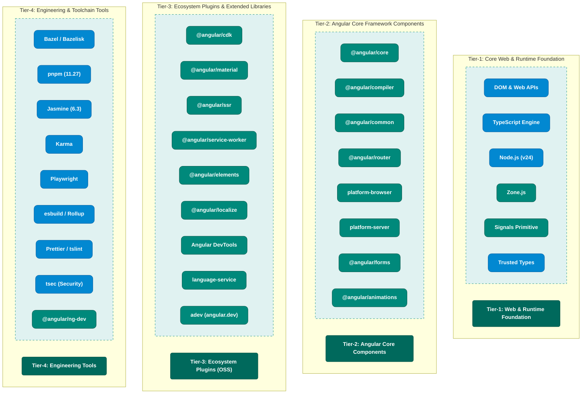

# Angular Architecture – Component Tiers (Reference Diagram Data)

> **Context**: This document provides the architectural data, tier classifications, component breakdowns, and codebase evidence needed to create the **"Angular Architecture – Component Tiers"** diagram, matching the reference structure of the **K3s Architecture – Component Tiers** model.

---

## 1. Visual Diagram (Mermaid Representation)

---

## 2. Diagram Color Palette & Legend

| Element | Box / Fill Color | Text Color | Border Style | Meaning |
| :--- | :--- | :--- | :--- | :--- |
| **Tier Header Block (Left)** | Dark Teal (`#00695C`) | White (`#FFFFFF`) | Solid Rounded Rectangle | Section Identifier (Tier 1 to Tier 4) |
| **Angular First-Party Component** | Teal / Medium Green (`#00897B`) | White (`#FFFFFF`) | Rounded Pill (`rx: 10`) | Component authored and maintained by the Angular Team |
| **Dependent 3P / Foundation Component** | Bright Blue (`#0288D1`) | White (`#FFFFFF`) | Rounded Pill (`rx: 10`) | External open-source dependency, runtime, or standard |
| **Component Container (Right)** | Pale Teal Tint (`#E0F2F1`) | Dark Green (`#004D40`) | Dashed Teal Rectangle (`stroke-dasharray: 5 5`) | Container grouping components within a tier |

---

## 3. Tier-by-Tier Component Data & Codebase Evidence

### Tier-1: Core Web & Runtime Foundation (Underlying Platform Primitives)
*In the K3s reference model, this tier contains containerd, runc, kube-proxy, and Linux OS primitives. In Angular, this tier represents the underlying web platform, JavaScript runtime, execution context, and language engine.*

| Component Name (Pill Label) | Classification | Role & Purpose | Codebase Evidence |
| :--- | :--- | :--- | :--- |
| **DOM & Web APIs** | Dependent 3P / Standards | HTML5 DOM primitives (`Document`, `Element`, `EventTarget`, Web Animations API, Custom Elements) | Standard browser runtime environment; `packages/platform-browser` |
| **TypeScript Engine** | Dependent 3P Component | Static type analysis, AST generation, and compiler API powering Angular's Ivy compiler | `package.json` (`"typescript": "~5.x"`), `MODULE.bazel` (`aspect_rules_ts: 3.10.1`) |
| **Node.js (v24)** | Dependent 3P Component | Pinned hermetic JavaScript runtime for Server-Side Rendering (SSR), build actions, and dev tooling | `.nvmrc` (`v24.21.0`), `MODULE.bazel` (`@rules_nodejs` pinned toolchain v24.21.0) |
| **Zone.js** | Angular First-Party | Execution context polyfill that monkey-patches async browser APIs to schedule change detection | `packages/zone.js/BUILD.bazel`, `packages/zone.js/` |
| **Signals Primitive** | Angular First-Party | Low-level push/pull reactive dependency graph algorithm powering Angular Signals | `packages/core/primitives/signals/BUILD.bazel`, `packages/core/primitives/signals/` |
| **Trusted Types** | Dependent 3P / Standards | W3C specification API for preventing DOM-based Cross-Site Scripting (XSS) | `tools/bazel/tsec.bzl`, `packages/core/src/sanitization/trusted_types.ts` |
| **reflect-metadata** | Dependent 3P Component | ES7 decorator metadata polyfill for dependency injection type introspection | `package.json` (`reflect-metadata`), `tools/testing/BUILD.bazel` |

---

### Tier-2: Angular Core Framework Components (First-Party Framework Core)
*In the K3s reference model, this tier contains the core k3s engine, helm-controller, and klipper-lb. In Angular, this tier represents the central framework packages that define components, templates, routing, and compilation.*

| Component Name (Pill Label) | Classification | Role & Purpose | Codebase Evidence |
| :--- | :--- | :--- | :--- |
| **@angular/core** | Angular First-Party | Inversion of Control / DI container, Component model, Signals API (`signal`, `computed`, `effect`), `@defer` blocks, lifecycle hooks | `packages/core/package.json`, `packages/core/BUILD.bazel` |
| **@angular/compiler** | Angular First-Party | Ivy compilation engine (`ngtsc`), template parser, AOT code generator, and HTML/expression AST parser | `packages/compiler/package.json`, `packages/compiler/BUILD.bazel` |
| **@angular/compiler-cli** | Angular First-Party | Command-line compiler bridge wrapping TypeScript's `tsc` with Angular Ivy transforms | `packages/compiler-cli/package.json`, `packages/compiler-cli/BUILD.bazel` |
| **@angular/common** | Angular First-Party | Built-in control flow (`@if`, `@for`, `@switch`), framework pipes (`AsyncPipe`, `DatePipe`), and `HttpClient` | `packages/common/package.json`, `packages/common/BUILD.bazel` |
| **@angular/router** | Angular First-Party | Client-side SPA navigation, route matching, lazy-loading via `import()`, route guards, and functional resolvers | `packages/router/package.json`, `packages/router/BUILD.bazel` |
| **platform-browser** | Angular First-Party | DOM rendering adapter, HTML sanitization engine, event delegation, and browser bootstrapping | `packages/platform-browser/package.json`, `packages/platform-browser/BUILD.bazel` |
| **platform-server** | Angular First-Party | Server-side rendering bootstrap engine, server DOM adapter (Domino), and transfer state serialization | `packages/platform-server/package.json`, `packages/platform-server/BUILD.bazel` |
| **@angular/forms** | Angular First-Party | Reactive Forms (`FormGroup`, `FormControl`), Template-Driven forms (`ngModel`), Signal Forms, and validation engine | `packages/forms/package.json`, `packages/forms/BUILD.bazel` |
| **@angular/animations** | Angular First-Party | DSL animation engine (`trigger`, `transition`, `style`, `animate`) driving Web Animations API | `packages/animations/package.json`, `packages/animations/BUILD.bazel` |

---

### Tier-3: Ecosystem Plugins & Extended Libraries (First-Party & Community Add-Ons)
*In the K3s reference model, this tier contains Flannel (CNI), Metrics-server, and Traefik (Ingress). In Angular, this tier represents extended ecosystem libraries, UI suites, developer tools, and official documentation.*

| Component Name (Pill Label) | Classification | Role & Purpose | Codebase Evidence |
| :--- | :--- | :--- | :--- |
| **@angular/cdk** | Angular First-Party | Component Development Kit providing headless UI behaviors (Overlay, DragDrop, Virtual Scroll, A11y, Portals) | `package.json` (`@angular/cdk: 22.2.0`), `packages/` integration targets |
| **@angular/material** | Angular First-Party | Official Google Material Design 3 UI component library (Button, Dialog, Table, FormField, Sidenav) | `package.json` (`@angular/material: 22.2.0`) |
| **@angular/ssr** | Angular First-Party | Modern Server-Side Rendering engine, full-page hydration, event replay, and streaming SSR | `packages/ssr/package.json`, `packages/ssr/BUILD.bazel` |
| **@angular/service-worker** | Angular First-Party | Progressive Web App (PWA) runtime engine, offline caching manifests, and background push notifications | `packages/service-worker/package.json`, `packages/service-worker/BUILD.bazel` |
| **@angular/elements** | Angular First-Party | Custom Elements bridge converting Angular components into framework-agnostic Web Components | `packages/elements/package.json`, `packages/elements/BUILD.bazel` |
| **@angular/localize** | Angular First-Party | Internationalization (i18n) engine, CLDR locale data integration, and compile-time translation inlining | `packages/localize/package.json`, `packages/localize/BUILD.bazel` |
| **Angular DevTools** | Angular First-Party | Chrome and Firefox browser extension for inspecting component trees, profiling change detection, and DI injection | `devtools/package.json`, `devtools/projects/ng-devtools/`, `devtools/BUILD.bazel` |
| **language-service** | Angular First-Party | TypeScript Language Service plugin delivering template autocompletion, type checking, and diagnostics in IDEs | `packages/language-service/package.json`, `vscode-ng-language-service/` |
| **adev (angular.dev)** | Angular First-Party | Official documentation platform, interactive WebContainer tutorials, and live coding playground | `adev/package.json`, `adev/BUILD.bazel` |
| **Babel / Terser** | Dependent 3P Component | Build-time AST transformation and minification plugins for optimizing distribution bundles | `package.json` (`@babel/core: 8.0.6`, `@babel/generator`) |

---

### Tier-4: Engineering & Toolchain Tools (Build, Test, Quality & Release Infrastructure)
*In the K3s reference model, this tier contains Dapper, Sonobuoy, Ginkgo/Gomega, and Go test. In Angular, this tier represents build orchestration, test frameworks, linters, and developer infrastructure.*

| Component Name (Pill Label) | Classification | Role & Purpose | Codebase Evidence |
| :--- | :--- | :--- | :--- |
| **Bazel / Bazelisk** | Dependent 3P Component | Multi-language hermetic build system, fine-grained action caching, and target dependency graph engine | `.bazelversion` (8.8.1), `.bazelrc`, `MODULE.bazel`, `BUILD.bazel`, `@bazel/bazelisk` |
| **pnpm (11.27)** | Dependent 3P Component | Strict, disk-efficient package manager with workspace isolation across the monorepo | `pnpm-lock.yaml`, `package.json` (`"packageManager": "pnpm@11.27.1"`), `AGENTS.md` |
| **Jasmine (6.3)** | Dependent 3P Component | Behavior-Driven Development (BDD) unit testing framework and assertion library | `package.json` (`"jasmine": "6.3.0"`), `tools/defaults.bzl` (`_jasmine_test`), `*.spec.ts` |
| **Karma** | Dependent 3P Component | Browser-based test execution runner managing real DOM test execution across Chromium and Firefox | `package.json` (`"karma": "~6.4.0"`), `tools/bazel/web_test.bzl` (`ng_web_test_suite`) |
| **Playwright** | Dependent 3P Component | Headless cross-browser automation framework for End-to-End (E2E) integration testing | `MODULE.bazel` (`@rules_browsers`), `packages/private/testing/src/utils.ts`, `adev/` E2E suite |
| **esbuild / Rollup** | Dependent 3P Component | Ultra-fast JavaScript bundlers for action scripts and production Flat ESM (FESM) package bundling | `package.json` (`"esbuild": "0.28.2"`, `"rollup": "4.63.4"`), `MODULE.bazel` |
| **Prettier / tslint** | Dependent 3P Component | Monorepo code style formatters and TypeScript static analysis linters | `.prettierrc`, `package.json` (`"prettier": "^3.8.0"`, `"tslint": "6.1.3"`), `.github/workflows/pr.yml` |
| **tsec (Security)** | Dependent 3P / Google Sec | Static analysis security tool enforcing Trusted Types compliance and preventing DOM-based XSS | `tools/bazel/tsec.bzl` (`tsec_test`), `packages:tsec_exemption` |
| **@angular/ng-dev** | Angular First-Party | Angular developer infrastructure CLI managing release publishing, branch cherry-picks, and PR validation | `package.json` (`@angular/ng-dev`), `MODULE.bazel` (`@devinfra`), `.ng-dev/` config files |

---

## 4. Summary Mapping: K3s vs. Angular Tiers

| Architecture Tier | K3s Equivalent (from Uploaded Graphic) | Angular Monorepo Counterpart |
| :--- | :--- | :--- |
| **Tier-1** | **K8s Core components** (`runc`, `kube-proxy`, `containerd`) | **Core Web & Runtime Foundation** (`DOM APIs`, `TypeScript Engine`, `Node.js`, `Zone.js`, `Signals`) |
| **Tier-2** | **K3s Components** (`k3s`, `Helm-Controller`, `Klipper-lb`) | **Angular Core Framework** (`@angular/core`, `compiler`, `common`, `router`, `platform-browser`, `forms`) |
| **Tier-3** | **Eco system Plugins** (`Flannel`, `Metrics-server`, `Traefik`) | **Ecosystem Plugins & Extensions** (`@angular/cdk`, `material`, `ssr`, `service-worker`, `DevTools`, `adev`) |
| **Tier-4** | **Engineering Tools** (`Dapper`, `Sonobuoy`, `Gomega`, `Go test`) | **Engineering & Toolchain Tools** (`Bazel`, `pnpm`, `Jasmine`, `Karma`, `Playwright`, `esbuild`, `tsec`, `ng-dev`) |
