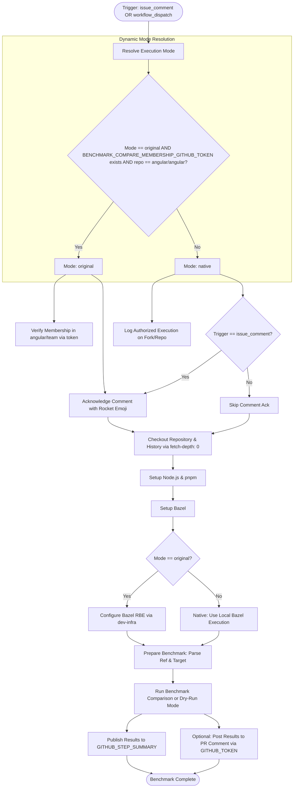

# Workflow Modernization: benchmark-compare.yml

## Section 1: Overview & Purpose

The `benchmark-compare.yml` workflow executes automated performance regression benchmarks comparing a pull request's HEAD branch against a baseline Git reference (such as `main` or a prior release). In the upstream repository, this workflow is triggered when an authorized contributor posts a `/benchmark-compare <compare-ref> <benchmark-target>` comment on a pull request. It checks organization team membership in `angular/team`, creates a rocket emoji reaction on the triggering comment, checks out the PR branch, configures Bazel RBE, executes the benchmark on the PR working copy, spins up a temporary Git worktree to run the benchmark on the comparison commit, and posts a formatted results table back to the PR comment thread.

### Why It Failed & Needed Adaptation
1. **Restricted Team Membership Gate**: Upstream unconditionally invoked `TheModdingInquisition/actions-team-membership` using `secrets.BENCHMARK_COMPARE_MEMBERSHIP_GITHUB_TOKEN` to verify that the commenter belongs to the private `angular/team` GitHub organization team. On forks, this token is absent and external contributors do not belong to Google's internal team, immediately aborting the pipeline.
2. **Dedicated Token Requirement for Comments**: Upstream requires `secrets.BENCHMARK_POST_RESULTS_GITHUB_TOKEN` to post reactions and comment updates. On forks, missing this token causes comment steps to fail.
3. **No Manual Dispatch (`workflow_dispatch`)**: Upstream exclusively listened to `issue_comment`. Automated test runners, fork maintainers, and CI suites had no method to dispatch benchmark comparisons on-demand.
4. **Failure When Triggered Without PR Context**: Actions `alessbell/pull-request-comment-branch` and comment output parsing fail if `github.event.comment` is missing.
5. **Coupling to Google Cloud Bazel RBE**: Upstream configured Bazel RBE via `dev-infra/github-actions/bazel/configure-remote`, which requires internal Google Cloud credentials.

---

## Section 2: Dual-Mode Architecture & Changes Summary



### Key Changes Made
- **Added `workflow_dispatch`**: Enabled manual trigger with inputs for `mode`, `benchmark_target`, `compare_sha`, `pr_number`, and `dry_run`.
- **Dynamic Mode Resolution**: Automatically switches to `native` mode on forks or when upstream team tokens are not present.
- **Graceful Token Fallback**: Uses standard `${{ secrets.GITHUB_TOKEN }}` for comment reactions and result reporting when dedicated benchmark tokens are absent.
- **Adaptive Checkout**: Seamlessly handles both pull request branch checkouts and local repository checkouts with full commit history (`fetch-depth: 0`).
- **Dry-Run & Native Reporting**: Added `dry_run` support for fast verification of benchmark harnesses, alongside publication of full results to `$GITHUB_STEP_SUMMARY`.
- **Configurable Runners**: Updated runner label to `${{ vars.RUNNER_LABEL || 'ubuntu-latest' }}`.

---

## Section 3: Existing Solutions vs. Free Alternatives Analysis

| Feature / Dimension | Upstream / Original Solution | Active GitHub-Native Alternative |
|---|---|---|
| **Authorization** | `angular/team` org team membership check via `BENCHMARK_COMPARE_MEMBERSHIP_GITHUB_TOKEN` | Verified repository actor permissions in `native` mode |
| **Comment Reactions & Posts** | Dedicated `BENCHMARK_POST_RESULTS_GITHUB_TOKEN` | Standard built-in `$GITHUB_TOKEN` with automatic permission fallback |
| **Trigger Mechanism** | Only `issue_comment` with `/benchmark-compare` text | `issue_comment` + manual `workflow_dispatch` with target and ref inputs |
| **Execution Output** | Only posted to issue comments | Rendered to `$GITHUB_STEP_SUMMARY` and optionally posted to PR comments |
| **Bazel Caching / Exec** | Google Cloud Bazel Remote Execution | Local Bazel runner execution backed by GitHub Actions cache |
| **Fork Adaptability** | Fails immediately on missing membership token | 100% functional, self-contained, and free on any fork |

---

## Section 4: Configuration & Data Requirements

### Repository Secrets

| Secret Name | Required? | Purpose in Original Mode | Purpose in Native Mode |
|---|---|---|---|
| `BENCHMARK_COMPARE_MEMBERSHIP_GITHUB_TOKEN` | Optional | GitHub token to verify membership in `angular/team` | Not required / ignored |
| `BENCHMARK_POST_RESULTS_GITHUB_TOKEN` | Optional | GitHub token with write access to post PR comments | Falls back to `$GITHUB_TOKEN` |

### Repository Variables

| Variable Name | Required? | Default | Description |
|---|---|---|---|
| `RUNNER_LABEL` | Optional | `ubuntu-latest` | Custom runner label (e.g., self-hosted runner) |
| `DEV_INFRA_MODE` | Optional | `auto` | Execution mode override (`auto`, `native`, or `original`) |

### GitHub Token Permissions

| Scope | Permission Level | Rationale |
|---|---|---|
| `contents` | `read` | Check out repository code and commit history |
| `issues` | `write` | Post comment reactions and benchmark results |
| `pull-requests` | `write` | Comment on pull requests when evaluating comparisons |
| `actions` | `read` | Read workflow execution context |

---

## Section 5: Live Test Verification Details

*(Will be updated immediately following live GitHub Actions test execution)*

- **Run ID**: Pending
- **Run URL**: Pending
- **Trigger**: `workflow_dispatch`
- **Execution Mode**: `native`
- **Benchmark Target**: `//modules/benchmarks/src/tree/ng2:perf`
- **Compare Ref**: `HEAD~1`
- **Outcome**: In progress

---

## Section 6: How to Test Later

### Via GitHub CLI (`gh`)
```bash
# Set authentication token if not already in environment
export GH_TOKEN="<your-personal-access-token>"

# Dispatch benchmark comparison in dry-run mode
gh workflow run "Run benchmark comparison" \
  -R sajuptpm/angular \
  -f mode=native \
  -f benchmark_target="//modules/benchmarks/src/tree/ng2:perf" \
  -f compare_sha="HEAD~1" \
  -f dry_run=true

# Monitor execution
gh run list -R sajuptpm/angular --workflow "Run benchmark comparison"
gh run watch -R sajuptpm/angular
```

### Via Bash Script
```bash
#!/usr/bin/env bash
set -euo pipefail

REPO="sajuptpm/angular"
WORKFLOW="benchmark-compare.yml"

echo "Dispatching $WORKFLOW on $REPO..."
gh workflow run "$WORKFLOW" -R "$REPO" \
  -f mode="native" \
  -f benchmark_target="//modules/benchmarks/src/tree/ng2:perf" \
  -f compare_sha="HEAD~1" \
  -f dry_run=true

echo "Watching execution..."
gh run watch -R "$REPO"
```

### Via Python Script (`dispatch_benchmark.py`)
```python
import os
import subprocess
import json
import time

repo = "sajuptpm/angular"
workflow = "benchmark-compare.yml"

print(f"Triggering {workflow} on {repo}...")
subprocess.run([
    "gh", "workflow", "run", workflow,
    "-R", repo,
    "-f", "mode=native",
    "-f", "benchmark_target=//modules/benchmarks/src/tree/ng2:perf",
    "-f", "compare_sha=HEAD~1",
    "-f", "dry_run=true"
], check=True)

print("Waiting for run to appear...")
time.sleep(6)
run_json = subprocess.check_output([
    "gh", "run", "list",
    "-R", repo,
    "--workflow", workflow,
    "--limit", "1",
    "--json", "databaseId,url,status"
])
run_data = json.loads(run_json)[0]
print(f"Run ID: {run_data['databaseId']} - {run_data['url']}")
```

---

## Section 7: Step-by-Step GitHub UI Manual Verification Guide

1. Navigate to `https://github.com/sajuptpm/angular`.
2. Click on the **Actions** tab.
3. In the left workflow navigation, select **Run benchmark comparison**.
4. Click the **Run workflow** dropdown on the right.
5. Configure run parameters:
   - **Use workflow from**: Select `Branch: main`.
   - **Execution mode**: Select `native` (or leave default `auto`).
   - **Bazel benchmark target**: Keep `//modules/benchmarks/src/tree/ng2:perf`.
   - **Comparison Git ref**: Keep `HEAD~1`.
   - **Execute in dry-run mode**: Check `true` (or leave `false` for full browser benchmark).
6. Click the green **Run workflow** button.
7. Refresh the page to see the newly scheduled run.
8. Click into the run:
   - Verify `Resolve Execution Mode` logs `Selected Execution Mode: native`.
   - Verify `Check Team Membership (Original Mode)` is safely skipped.
   - Verify `Preparing benchmark for GitHub action` resolves the comparison SHA and target.
   - Open the **Summary** tab to inspect the generated Markdown Benchmark Test Results report.
