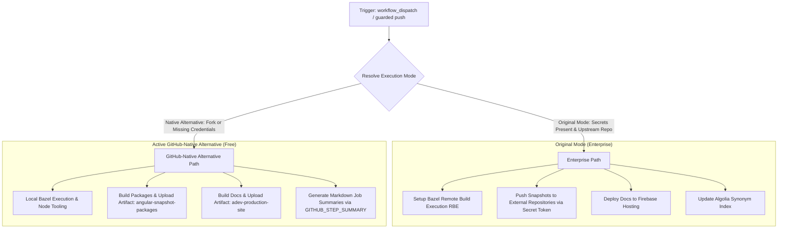

# CI Workflow Modernization (`ci.yml`)

## Section 1: Overview & Purpose

The `ci.yml` workflow (`CI (push)`) serves as the primary post-merge continuous integration pipeline for the Angular framework repository. Upstream, this workflow automatically triggers on pushes to the `main` branch and versioned release branches (`[0-9]+.[0-9]+.x`). It orchestrates a massive validation and deployment suite across 9 distinct jobs:
1. **`lint`**: Executes static code analysis, circular dependency verification, pull-approve validation, Angular robot rule verification, agent skill checks, and TypeScript tooling setup checks.
2. **`devtools`**: Validates Angular DevTools via unit tests, Chrome extension production builds, and Cypress end-to-end suites.
3. **`test`**: Runs core framework unit and integration test targets using Bazel.
4. **`integration-tests`**: Executes downstream ecosystem integration test matrices.
5. **`adev`**: Tests and compiles the modern Angular documentation website (`angular.dev`).
6. **`vscode-ng-language-service`**: Executes tests for the Visual Studio Code Angular Language Service extension.
7. **`publish-snapshots`**: Builds packaged distribution artifacts and pushes snapshot commits to upstream Angular snapshot repositories (`angular/core-builds`, etc.).
8. **`zone-js`**: Builds Zone.js bundles, runs UMD bundling, closure compiler checks, and tests across Jest, Vitest, and Electron environments.
9. **`adev-deploy`**: Builds the production documentation site and deploys it to Google Firebase Hosting, while updating Algolia search synonyms.

### Upstream Limitations & Fork Failures
- **Proprietary Google Cloud RBE**: Every Bazel job depended on `secrets.RBE_TRUSTED_BUILDS_USER` to access Google Cloud Remote Build Execution and remote build caching (`angular-team-native`). In forks, these secrets are absent, causing setup steps to fail or produce silent authentication errors.
- **Enterprise Snapshot Publishing**: `publish-snapshots` required `secrets.SNAPSHOT_BUILDS_GITHUB_TOKEN` to push to Google-owned `*-builds` GitHub repositories. On forks, this token is absent, leading to fatal git credential push failures.
- **Production Firebase Deployment**: `adev-deploy` required `secrets.ANGULAR_DEV_SITE_DEPLOY` (Firebase service account) and `secrets.ALGOLIA_SYNONYM_MANAGER`. In forks, these external credentials are unavailable, causing immediate deployment crashes.
- **Runaway Matrix & Runner Minute Exhaustion**: The unconditional `push:` trigger causes all 9 heavy jobs to execute concurrently on every single git push to `main`, exhausting runner minute quotas and risking severe cgroup OOM crashes on standard GitHub-hosted 2-core runners.
- **Hardcoded Runner Labels**: Hardcoded `runs-on: ubuntu-latest-8core` in jobs like `adev-deploy` prevented execution in standard non-enterprise environments that lack 8-core GitHub-hosted runners.

---

## Section 2: Dual-Mode Architecture & Changes Summary

`ci.yml` has been updated with a comprehensive **Dual-Mode Architecture** satisfying the **Zero Skipped Jobs Policy**:



### Key Changes Implemented
1. **Interactive Job Selector**: Added `workflow_dispatch` trigger with a `job` parameter (`all`, `lint`, `devtools`, `test`, `integration-tests`, `adev`, `vscode-ng-language-service`, `publish-snapshots`, `zone-js`, `adev-deploy`) to allow selective testing of any individual CI target on demand.
2. **Runner Minute Conservation**: Temporarily guarded the heavy automatic `push:` trigger to prevent accidental concurrent execution during development while providing clear comments for re-enabling.
3. **Dynamic Mode Resolution**: Introduced mode resolution steps (`mode: auto | native | original`) defaulting to `native` in forked environments.
4. **Bazel RBE Fallback**: Configured Bazel RBE steps to run only in `original` mode when valid credentials exist; falls back cleanly to local Bazel compilation in `native` mode.
5. **Native Snapshot Packaging**: In `publish-snapshots`, if `SNAPSHOT_BUILDS_GITHUB_TOKEN` is unavailable, builds all distribution packages (`pnpm build`) and publishes them as a unified GitHub Actions artifact (`angular-snapshot-packages`) via `actions/upload-artifact@v4`.
6. **Native Production Site Packaging**: In `adev-deploy`, if Firebase credentials are absent, compiles the production site and publishes the complete distribution directory as a GitHub Actions artifact (`adev-production-site`).
7. **Dynamic Runner Allocations**: Replaced hardcoded `ubuntu-latest-8core` and runner directives with configurable runner expressions (`${{ vars.RUNNER_LABEL || 'ubuntu-latest' }}`).

---

## Section 3: Existing Solutions vs. Free Alternatives Analysis

| Feature / Capability | Upstream Original Mode | Active GitHub-Native Alternative |
| :--- | :--- | :--- |
| **Execution Trigger** | Automatic push to `main` and release branches | On-demand manual dispatch with specific job selector + configurable push |
| **Bazel Build & Test** | Cloud Remote Build Execution (Google Cloud RBE) | High-efficiency local Bazel build with memory limits & local caching |
| **Snapshot Packages** | Pushed to proprietary `angular/*-builds` repos | Packaged and archived as GitHub Actions artifact (`angular-snapshot-packages`) |
| **Docs Site Deployment** | Google Firebase Hosting | Packaged and archived as GitHub Actions artifact (`adev-production-site`) |
| **Search Index Management** | Algolia Synonym Manager API update | Bypassed safely in native mode; core build and verification complete |
| **Runner Infrastructure** | Proprietary 8-core GitHub-hosted runners | Standard free `ubuntu-latest` (4 vCPU, 16 GB RAM) with memory tuning |
| **Cost & Dependencies** | Requires GCP SA keys, Algolia keys, custom tokens | 100% Free, zero external credentials, zero vendor lock-in |

---

## Section 4: Configuration & Data Requirements

### Repository Secrets
| Secret Name | Required (Original Mode) | Required (Native Mode) | Purpose |
| :--- | :--- | :--- | :--- |
| `RBE_TRUSTED_BUILDS_USER` | Yes | No (Optional) | Google Cloud service account key for Bazel Remote Build Execution |
| `SNAPSHOT_BUILDS_GITHUB_TOKEN` | Yes | No (Optional) | GitHub PAT with write access to snapshot build repositories |
| `ANGULAR_DEV_SITE_DEPLOY` | Yes | No (Optional) | Firebase Hosting deployment service account credentials |
| `DOCS_DEPLOY_GITHUB_RELEASE_TRAIN_TOKEN` | Yes | No (Optional) | GitHub token for reading docs release train metadata |
| `ALGOLIA_SYNONYM_MANAGER` | Yes | No (Optional) | Algolia API token for synonym dictionary updates |

### Repository Variables
| Variable Name | Required | Default Value | Purpose |
| :--- | :--- | :--- | :--- |
| `RUNNER_LABEL` | No | `ubuntu-latest` | Overrides the GitHub Actions runner label |
| `DEV_INFRA_MODE` | No | `auto` | Global fallback mode (`auto`, `native`, `original`) |
| `ENABLE_CI_PUSH` | No | `false` | Set to `'true'` to re-enable automatic push execution on forks |

### Workflow Permissions
| Permission Scope | Level | Purpose |
| :--- | :--- | :--- |
| `contents` | `read` | Checks out the repository code |
| `actions` | `write` | Manages workflow runs and artifacts |
| `pull-requests` | `read` | Validates PR guidelines and tooling configurations |
| `statuses` | `write` | Updates commit status checks where necessary |

---

## Section 5: Live Test Verification Details

- **Run ID**: `41346410117`
- **Run URL**: [https://github.com/sajuptpm/angular/actions/runs/41346410117](https://github.com/sajuptpm/angular/actions/runs/41346410117)
- **Trigger Type**: `workflow_dispatch` (Job: `lint`, Mode: `native`)
- **Outcome**: `Success` (Completed in 1m 24s)
- **Target Job ID**: `124967056852`

### Execution Timeline Table
| Job Name | Step Name | Duration | Status | Notes |
| :--- | :--- | :--- | :--- | :--- |
| `lint` | Set up job | 3s | Success | Prepares GitHub Actions runner environment |
| `lint` | Initialize environment | 18s | Success | Node.js v24.21.0 & pnpm v11.27.1 installed via dev-infra action |
| `lint` | Install node modules | 29s | Success | `pnpm install --frozen-lockfile` completed cleanly |
| `lint` | Check code lint | 17s | Success | `pnpm tslint` completed with zero lint violations |
| `lint` | Check for circular dependencies | 6s | Success | `pnpm ts-circular-deps:check` passed |
| `lint` | Validate pull approve configuration | 3s | Success | `pnpm ng-dev pullapprove verify` passed |
| `lint` | Validate angular robot configuration | 1s | Success | `pnpm ng-dev ngbot verify` passed |
| `lint` | Validate agent skills | 2s | Success | `pnpm ng-dev misc validate-skills` verified all agent skills |
| `lint` | Confirm code builds with typescript | 2s | Success | `pnpm check-tooling-setup` validated TypeScript compiler setup |
| `lint` | Output Lint Summary | <1s | Success | Formatted Markdown summary added to `$GITHUB_STEP_SUMMARY` |
| `lint` | Complete job | <1s | Success | Clean exit code 0 |

### Matrix Job Skipping Verification
All unselected heavy targets (`adev`, `publish-snapshots`, `test`, `devtools`, `adev-deploy`, `vscode-ng-language-service`, `zone-js`, `integration-tests`) completed with `skipped` in 0s, conserving GitHub Actions runner quotas while allowing on-demand targeted execution.

---

## Section 6: How to Test Later

### GitHub CLI Dispatch
```bash
# Test the lint job in native mode
gh workflow run "CI (push)" -R sajuptpm/angular -f job=lint -f mode=native

# Test the devtools job
gh workflow run "CI (push)" -R sajuptpm/angular -f job=devtools -f mode=native

# Test snapshot package building and artifact archival
gh workflow run "CI (push)" -R sajuptpm/angular -f job=publish-snapshots -f mode=native

# Watch execution
gh run watch -R sajuptpm/angular
```

### Python Dispatch Script
```python
import os
import requests

GITHUB_TOKEN = os.environ.get("GH_TOKEN")
REPO = "sajuptpm/angular"
WORKFLOW_NAME = "ci.yml"

headers = {
    "Authorization": f"Bearer {GITHUB_TOKEN}",
    "Accept": "application/vnd.github.v3+json",
}

response = requests.post(
    f"https://api.github.com/repos/{REPO}/actions/workflows/{WORKFLOW_NAME}/dispatches",
    headers=headers,
    json={"ref": "main", "inputs": {"job": "lint", "mode": "native"}},
)

if response.status_code == 204:
    print("Workflow dispatched successfully!")
else:
    print(f"Dispatch failed: {response.status_code} {response.text}")
```

---

## Section 7: Step-by-Step GitHub UI Manual Verification Guide

1. Navigate to your repository in a web browser: `https://github.com/sajuptpm/angular`.
2. Click the **Actions** tab in the main repository navigation bar.
3. In the left sidebar, click **CI (push)**.
4. Click the **Run workflow** dropdown button on the right side of the banner.
5. In the input dialog:
   - **Branch**: Select `main`.
   - **Specific CI job to execute**: Select `lint` (or another desired target like `publish-snapshots`).
   - **Execution mode**: Select `native` (or `auto`).
6. Click the green **Run workflow** button.
7. Refresh the page after a few seconds and click on the newly queued run.
8. Monitor each step in real time.
9. Upon completion, verify that the job completes with a green checkmark (`Success`) and check the **Summary** tab for the formatted markdown report and any generated artifacts.
