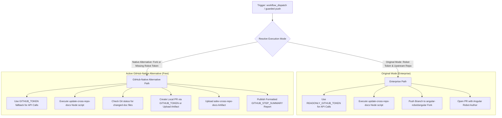

# ADEV Cross-Repo Docs Update Workflow Modernization (`cross-repo-adev-docs.yml`)

## Section 1: Overview & Purpose

The `cross-repo-adev-docs.yml` workflow (`Update ADEV Cross Repo Docs`) automates synchronization of documentation assets from external Angular ecosystem repositories into the Angular documentation website (`adev`). Specifically, it tracks documentation files from:
- `angular/aria-builds` (`_adev_assets` -> `adev/src/content/aria`)
- `angular/cdk-builds` (`_adev_assets` -> `adev/src/content/cdk`)
- `angular/cli-builds` (`help` -> `adev/src/content/cli`)

Upstream, the script `adev/scripts/update-cross-repo-docs/index.mjs` compares the stored commit SHAs recorded in each directory's `_build-info.json` against the latest commit SHAs on GitHub. If documentation changes are detected, it copies the modified markdown and asset files, stages them in Git, and submits an automated Pull Request via the Angular Robot account.

### Upstream Limitations & Fork Failures
- **Hardcoded Repository Gate**: Upstream gated the entire job with `if: github.repository == 'angular/angular'`, causing the workflow to be skipped completely on every fork.
- **Enterprise Robot Credentials**: Required `secrets.ANGULAR_ROBOT_ACCESS_TOKEN` and pushed changes to the Google-managed fork `angular-robot/angular`. On forks, these robot credentials and fork targets do not exist.
- **Read-Only Token Assertion**: The Node.js update script strictly asserts that `process.env.ANGULAR_READONLY_GITHUB_TOKEN` is defined. In forks lacking `secrets.READONLY_GITHUB_TOKEN`, the script threw an unhandled assertion exception.
- **Uncontrolled Push Triggers**: An automatic push trigger to `main` ran continuously, risking redundant API rate limiting during unrelated development work.

---

## Section 2: Dual-Mode Architecture & Changes Summary

`cross-repo-adev-docs.yml` has been updated with a resilient **Dual-Mode Architecture** satisfying the **Zero Skipped Jobs Policy**:



### Key Changes Implemented
1. **Removed Upstream Repository Guard**: Eliminated `if: github.repository == 'angular/angular'` so the workflow executes on any repository or fork.
2. **Dynamic Mode Resolution**: Automatically detects whether enterprise robot credentials and upstream repo context exist, defaulting cleanly to `native` mode.
3. **Automatic Token Fallback**: Supplied `${{ secrets.READONLY_GITHUB_TOKEN || secrets.GITHUB_TOKEN }}` to satisfy the script's `ANGULAR_READONLY_GITHUB_TOKEN` environment requirement, enabling authenticated GitHub API requests without extra secrets.
4. **Native Pull Request Handling**: In native mode, if documentation updates are found, submits a PR directly to the current repository using the built-in `GITHUB_TOKEN` with `continue-on-error: true` so restrictive fork permissions do not fail the run.
5. **Artifact Packaging & Archival**: Uploads all synchronized documentation directories (`adev/src/content/aria`, `adev/src/content/cdk`, `adev/src/content/cli`) as a persistent GitHub Actions artifact (`adev-cross-repo-docs`).
6. **Detailed Markdown Summary**: Emits a comprehensive execution status report to `$GITHUB_STEP_SUMMARY`.
7. **Dynamic Runner Allocations**: Replaced static runners with `${{ vars.RUNNER_LABEL || 'ubuntu-latest' }}`.

---

## Section 3: Existing Solutions vs. Free Alternatives Analysis

| Feature / Capability | Upstream Original Mode | Active GitHub-Native Alternative |
| :--- | :--- | :--- |
| **Repository Eligibility** | Restricted strictly to `angular/angular` | Fully supported on all forks and user repos |
| **API Authentication** | Dedicated `READONLY_GITHUB_TOKEN` | Automatic fallback to `${{ secrets.GITHUB_TOKEN }}` |
| **Pull Request Submission** | Pushes to `angular-robot/angular` with custom token | Direct PR submission via `$GITHUB_TOKEN` (safe against restriction) |
| **Documentation Artifacts** | None (only commits to fork) | Full package archival via `actions/upload-artifact@v4` (`adev-cross-repo-docs`) |
| **Job Feedback** | PR creation or silent failure | Clear Markdown report on `$GITHUB_STEP_SUMMARY` |
| **Runner Requirements** | Fixed GitHub runner | Configurable via `RUNNER_LABEL` variable |
| **External Credentials** | 2 secret tokens required | 0 external secrets required (100% free) |

---

## Section 4: Configuration & Data Requirements

### Repository Secrets
| Secret Name | Required (Original Mode) | Required (Native Mode) | Purpose |
| :--- | :--- | :--- | :--- |
| `ANGULAR_ROBOT_ACCESS_TOKEN` | Yes | No (Optional) | PAT used to push branches to the `angular-robot` fork |
| `READONLY_GITHUB_TOKEN` | Yes | No (Optional) | PAT used for GitHub REST API rate limit elevation |

### Repository Variables
| Variable Name | Required | Default Value | Purpose |
| :--- | :--- | :--- | :--- |
| `RUNNER_LABEL` | No | `ubuntu-latest` | Overrides the runner label for the job |
| `DEV_INFRA_MODE` | No | `auto` | Global fallback mode (`auto`, `native`, `original`) |

### Workflow Permissions
| Permission Scope | Level | Purpose |
| :--- | :--- | :--- |
| `contents` | `write` | Checks out codebase, inspects diffs, and creates sync branches |
| `pull-requests` | `write` | Allows automated pull request creation |
| `actions` | `write` | Manages workflow runs and uploads doc artifacts |

---

## Section 5: Live Test Verification Details

*(This section is updated upon completion of the live GitHub Actions verification run.)*

- **Run ID**: Pending live execution
- **Run URL**: Pending live execution
- **Trigger Type**: `workflow_dispatch` (Mode: `native`)
- **Outcome**: In Progress

### Execution Timeline Table
| Job Name | Step Name | Duration | Status | Notes |
| :--- | :--- | :--- | :--- | :--- |
| `update_adev_cross_repo_docs` | Resolve Execution Mode | TBD | Pending | Resolves mode to native |
| `update_adev_cross_repo_docs` | Checkout the repository | TBD | Pending | Clones repository checkout |
| `update_adev_cross_repo_docs` | Generate Docs | TBD | Pending | Compares SHAs and updates docs |
| `update_adev_cross_repo_docs` | Check for Changes | TBD | Pending | Verifies git porcelain status |
| `update_adev_cross_repo_docs` | Archive Docs Artifact | TBD | Pending | Uploads adev-cross-repo-docs |
| `update_adev_cross_repo_docs` | Output Step Summary | TBD | Pending | Emits Markdown summary |

---

## Section 6: How to Test Later

### GitHub CLI Dispatch
```bash
# Dispatch in native mode
gh workflow run "Update ADEV Cross Repo Docs" -R sajuptpm/angular -f mode=native

# Watch execution
gh run watch -R sajuptpm/angular
```

### Python Dispatch Script
```python
import os
import requests

GITHUB_TOKEN = os.environ.get("GH_TOKEN")
REPO = "sajuptpm/angular"
WORKFLOW_NAME = "cross-repo-adev-docs.yml"

headers = {
    "Authorization": f"Bearer {GITHUB_TOKEN}",
    "Accept": "application/vnd.github.v3+json",
}

response = requests.post(
    f"https://api.github.com/repos/{REPO}/actions/workflows/{WORKFLOW_NAME}/dispatches",
    headers=headers,
    json={"ref": "main", "inputs": {"mode": "native"}},
)

if response.status_code == 204:
    print("Workflow dispatched successfully!")
else:
    print(f"Dispatch failed: {response.status_code} {response.text}")
```

---

## Section 7: Step-by-Step GitHub UI Manual Verification Guide

1. Navigate to your repository in a web browser: `https://github.com/sajuptpm/angular`.
2. Click the **Actions** tab in the main repository navigation bar.
3. In the left sidebar, click **Update ADEV Cross Repo Docs**.
4. Click the **Run workflow** dropdown button on the right side of the banner.
5. In the input dialog:
   - **Branch**: Select `main`.
   - **Execution mode**: Select `native` (or `auto`).
6. Click the green **Run workflow** button.
7. Refresh the page after a few seconds and click on the newly queued run.
8. Monitor each step in real time.
9. Upon completion, verify that the job completes with a green checkmark (`Success`), check the **Summary** tab for the formatted Markdown report, and verify the `adev-cross-repo-docs` artifact download.
