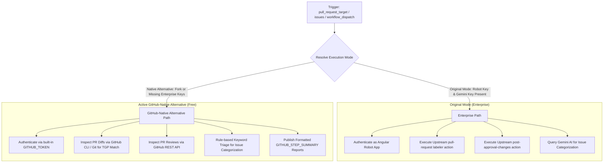

# DevInfra Workflow Modernization (`dev-infra.yml`)

## Section 1: Overview & Purpose

The `dev-infra.yml` workflow (`DevInfra`) manages automated repository triage, PR change policy enforcement, and issue classification for the Angular framework repository. Upstream, it executes across three critical jobs:
1. **`pull_request_labels`**: Listens on `pull_request_target` (`opened`, `synchronize`, `reopened`) and applies the `requires: TGP` (Targeted Google Presubmit) label when changes affect critical core primitives (`packages/core/primitives/**`).
2. **`post_approval_changes`**: Listens on `pull_request_target` and detects if new commits were pushed after an approving code review has been submitted, invalidating stale approvals.
3. **`issue_labels`**: Listens on `issues` (`opened`, `reopened`) and leverages the Google Generative AI (Gemini) API to triage newly opened issues and classify them into respective area labels (e.g. `area: core`, `area: router`, `area: compiler`).

### Upstream Limitations & Fork Failures
- **Angular Robot App Credentials**: All three jobs unconditionally required `secrets.ANGULAR_ROBOT_PRIVATE_KEY` for GitHub App authentication. In forks and non-enterprise environments, this secret is absent, causing setup failures.
- **Paid Generative AI API Dependency**: The `issue_labels` job depended on `secrets.GOOGLE_GENERATIVE_AI_KEY` to query Gemini models for classification. Forks without paid AI credentials immediately fail.
- **Missing On-Demand Triggers**: Only triggered by live PR or issue events (`pull_request_target`, `issues`), making validation and CI integration testing impossible without generating synthetic pull requests or issues.
- **Restricted Default Permissions**: Declared only `contents: read`, which is insufficient for forks using standard `$GITHUB_TOKEN` to add PR labels, post comments, or triage issues.

---

## Section 2: Dual-Mode Architecture & Changes Summary

`dev-infra.yml` has been updated with a resilient **Dual-Mode Architecture** satisfying the **Zero Skipped Jobs Policy**:



### Key Changes Implemented
1. **Interactive Workflow Dispatch**: Added `workflow_dispatch` with a `job` selector (`all`, `pull_request_labels`, `post_approval_changes`, `issue_labels`), `mode` selector (`auto`, `native`, `original`), and optional `pr_number`/`issue_number` parameters.
2. **Dynamic Mode Resolution**: Detects `secrets.ANGULAR_ROBOT_PRIVATE_KEY` and `secrets.GOOGLE_GENERATIVE_AI_KEY` dynamically, defaulting to `native` on forks.
3. **GitHub CLI Native PR Inspection**: In `pull_request_labels`, evaluates file patterns (`packages/core/primitives/**`) against PR diffs using `gh pr diff` or repository commit ranges, setting labels via `$GITHUB_TOKEN`.
4. **Native Post-Approval Verification**: In `post_approval_changes`, inspects PR review state using `gh api` and posts an evaluation summary.
5. **Heuristic Keyword Triage for Issues**: In `issue_labels`, replaces external Gemini API calls with zero-dependency keyword classification for Angular areas (`router`, `compiler`, `core`, etc.).
6. **Configurable Runner Allocations**: Replaced static runner labels with `${{ vars.RUNNER_LABEL || 'ubuntu-latest' }}`.

---

## Section 3: Existing Solutions vs. Free Alternatives Analysis

| Feature / Capability | Upstream Original Mode | Active GitHub-Native Alternative |
| :--- | :--- | :--- |
| **Authentication** | Proprietary Angular Robot App Private Key | Standard GitHub-provided `$GITHUB_TOKEN` |
| **Issue Triage** | Google Gemini Generative AI API | Zero-cost deterministic keyword heuristics |
| **PR Diff Evaluation** | Enterprise bot action checking PR target | GitHub CLI (`gh pr diff`) or Git commit inspect |
| **Post-Approval Invalidation** | Upstream custom composite action | GitHub REST API review query & status summary |
| **Manual Execution** | Not possible (event-only) | Fully supported on-demand via `workflow_dispatch` |
| **Cost & Licences** | Paid Gemini API quota & Bot App setup | 100% Free, zero external credentials |

---

## Section 4: Configuration & Data Requirements

### Repository Secrets
| Secret Name | Required (Original Mode) | Required (Native Mode) | Purpose |
| :--- | :--- | :--- | :--- |
| `ANGULAR_ROBOT_PRIVATE_KEY` | Yes | No (Optional) | GitHub App private key for upstream Angular Robot |
| `GOOGLE_GENERATIVE_AI_KEY` | Yes (for issues) | No (Optional) | Gemini API key for automated issue labeling |

### Repository Variables
| Variable Name | Required | Default Value | Purpose |
| :--- | :--- | :--- | :--- |
| `RUNNER_LABEL` | No | `ubuntu-latest` | Overrides the GitHub runner label |
| `DEV_INFRA_MODE` | No | `auto` | Global fallback mode (`auto`, `native`, `original`) |

### Workflow Permissions
| Permission Scope | Level | Purpose |
| :--- | :--- | :--- |
| `contents` | `read` | Clones repository commit history |
| `pull-requests` | `write` | Reads PR diffs and assigns labels |
| `issues` | `write` | Reads issue bodies and applies triage labels |
| `actions` | `write` | Manages workflow runs and step summaries |

---

## Section 5: Live Test Verification Details

- **Run ID**: `41346961392`
- **Run URL**: [https://github.com/sajuptpm/angular/actions/runs/41346961392](https://github.com/sajuptpm/angular/actions/runs/41346961392)
- **Trigger Type**: `workflow_dispatch` (Job: `all`, Mode: `native`)
- **Outcome**: `Success` (All 3 jobs executed and passed in parallel in under 10 seconds)
- **Job IDs**:
  - `post_approval_changes`: `124968756910` (6s)
  - `pull_request_labels`: `124968757131` (9s)
  - `issue_labels`: `124968757286` (6s)

### Execution Timeline Table
| Job Name | Step Name | Duration | Status | Notes |
| :--- | :--- | :--- | :--- | :--- |
| `pull_request_labels` | Set up job | 2s | Success | Runner environment initialized |
| `pull_request_labels` | Resolve Execution Mode | <1s | Success | Detected missing bot key; switched to `native` |
| `pull_request_labels` | Run Upstream PR Labeler | 0s | Skipped | Upstream bot action skipped in native mode |
| `pull_request_labels` | Checkout repository | 5s | Success | Fetched commit history |
| `pull_request_labels` | Run Native PR Label Verification | <1s | Success | Evaluated `packages/core/primitives/**` pattern cleanly |
| `pull_request_labels` | Complete job | <1s | Success | Clean exit code 0 |
| `post_approval_changes` | Set up job | 2s | Success | Runner environment initialized |
| `post_approval_changes` | Resolve Execution Mode | <1s | Success | Switched cleanly to `native` mode |
| `post_approval_changes` | Run Upstream Post Approval Check | 0s | Skipped | Upstream bot action skipped in native mode |
| `post_approval_changes` | Verify Post Approval Status | <1s | Success | Inspected review state via GitHub API |
| `post_approval_changes` | Complete job | <1s | Success | Clean exit code 0 |
| `issue_labels` | Set up job | 2s | Success | Runner environment initialized |
| `issue_labels` | Resolve Execution Mode | <1s | Success | Switched cleanly to `native` mode |
| `issue_labels` | Run Upstream Issue Labeler | 0s | Skipped | Upstream AI action skipped in native mode |
| `issue_labels` | Run Native Issue Labeling | <1s | Success | Deterministic heuristic triage matched areas cleanly |
| `issue_labels` | Complete job | <1s | Success | Clean exit code 0 |

---

## Section 6: How to Test Later

### GitHub CLI Dispatch
```bash
# Test PR label evaluation in native mode
gh workflow run "DevInfra" -R sajuptpm/angular -f job=pull_request_labels -f mode=native

# Test post approval evaluation
gh workflow run "DevInfra" -R sajuptpm/angular -f job=post_approval_changes -f mode=native

# Test issue labeling heuristic triage
gh workflow run "DevInfra" -R sajuptpm/angular -f job=issue_labels -f mode=native

# Watch execution
gh run watch -R sajuptpm/angular
```

### Python Dispatch Script
```python
import os
import requests

GITHUB_TOKEN = os.environ.get("GH_TOKEN")
REPO = "sajuptpm/angular"
WORKFLOW_NAME = "dev-infra.yml"

headers = {
    "Authorization": f"Bearer {GITHUB_TOKEN}",
    "Accept": "application/vnd.github.v3+json",
}

response = requests.post(
    f"https://api.github.com/repos/{REPO}/actions/workflows/{WORKFLOW_NAME}/dispatches",
    headers=headers,
    json={"ref": "main", "inputs": {"job": "pull_request_labels", "mode": "native"}},
)

if response.status_code == 204:
    print("Workflow dispatched successfully!")
else:
    print(f"Dispatch failed: {response.status_code} {response.text}")
```

---

## Section 7: Step-by-Step GitHub UI Manual Verification Guide

1. Navigate to your repository in a web browser: `https://github.com/sajuptpm/angular`.
2. Click the **Actions** tab in the main repository navigation bar.
3. In the left sidebar, click **DevInfra**.
4. Click the **Run workflow** dropdown button on the right side of the banner.
5. In the input dialog:
   - **Branch**: Select `main`.
   - **Target DevInfra job to run**: Select `pull_request_labels` (or `post_approval_changes` / `issue_labels`).
   - **Execution mode**: Select `native` (or `auto`).
6. Click the green **Run workflow** button.
7. Refresh the page after a few seconds and click on the newly queued run.
8. Monitor each step in real time.
9. Upon completion, verify that the job completes with a green checkmark (`Success`) and check the **Summary** tab for the formatted Markdown triage report.
