# Consolidated Analysis of Paid & Licensed Tools in Angular Pipelines

> [!NOTE]
> This document is also mirrored at [`workflow-fixes/paid-tools-and-licenses.md`](file:///c:/projects/angular/workflow-fixes/paid-tools-and-licenses.md).

## Executive Summary & Open-Source Release Strategy

This document provides a comprehensive inventory, codebase evidence audit, and cost comparison of all paid, licensed, proprietary, and commercial tools, libraries, and cloud services used in the upstream Angular pipelines (`.github/workflows/*.yml`) **before** and **after** our code modernizations.

### Target Deployment Model
* **Hosting Platform**: GitHub Enterprise (GHE) with a **Public Repository** fork.
* **Release Objective**: 100% **Open-Source Release** distributed publicly via the same public repository.
* **Economic Advantage**: On GitHub Enterprise, **public repositories receive unlimited free GitHub Actions runner minutes on standard GitHub-hosted runners (`ubuntu-latest`, 2 vCPU, 7 GB RAM)**. Furthermore, public npm package hosting on `npmjs.org` and GitHub Releases are completely free.
* **Bottom-Line Assessment**:
  - **Estimated Commercial Cost Before Change**: **~$3,250 – $5,200+ / month**
  - **Actual Cost After Code Change on GHE Public Fork**: **$0.00 / month** (100% Free)
  Every proprietary enterprise service has been replaced with native open-source or GitHub-native alternatives without compromising package integrity or release quality.

---

## Consolidated Paid / Licensed Tools & Services Table

| # | Tool / Library Name | Actual Tool / Library Used Before My Change (Evidence in Codebase) | Vendor | License / Model | Subscription Model | Rough Cost Before My Code Change (Commercial / Upstream) | Rough Cost After My Code Change (GHE Public Open-Source Repo) | Relevant Pipeline(s) | Description, Use & Use Case | Recommended Free / Open-Source Alternative (After Change) | Open-Source Release Necessity |
| :- | :--- | :--- | :--- | :--- | :--- | :--- | :--- | :--- | :--- | :--- | :---: |
| 1 | **Google Cloud Remote Build Execution (RBE)** | `angular/dev-infra/github-actions/bazel/configure-remote` calling GCP RBE API in project `internal-200822` with secret `RBE_TRUSTED_BUILDS_USER` *(Evidence: `pr.yml` line 31, `ci.yml` line 39, `adev-preview-build.yml` line 27, `benchmark-compare.yml` line 77)* | Google Cloud Platform (GCP) | Proprietary Commercial SaaS | Pay-as-you-go compute & storage / Enterprise contract | **$500 – $2,500+ / mo** (worker concurrency & cache volume) | **$0.00** *(Bypassed)* | `pr.yml` `ci.yml` `adev-preview-build.yml` `benchmark-compare.yml` `release.yml` | **Description**: Cloud-based distributed build and test execution cluster for Bazel. **Use**: Offloads compilation, code generation, and test execution actions from the local runner to a distributed pool of Google Cloud worker instances. **Use Case**: Running massive monorepo builds and test matrices on every pull request, allowing hundreds of parallel targets to complete in under 10 minutes instead of 45+ minutes on a single VM. | **Local Bazel execution with GitHub Actions Cache** (`actions/cache`), local RAM/JVM bounds (`-Xmx3g`, `--jobs=2`), or free community BuildBuddy OSS. | **Optional** *(Local builds run in 6m 45s)* |
| 2 | **GitHub Larger Runners (`ubuntu-latest-8core`)** | Hardcoded GitHub Actions Larger Runner (`ubuntu-latest-8core`, 8 vCPU, 32 GB RAM) *(Evidence: `pr.yml` line 23, `ci.yml` line 31, `adev-preview-build.yml` line 19)* | GitHub (Microsoft) | Commercial Runner Add-on | Per-minute compute consumption billing | **$0.032 / minute** (~$1.92/hr; ~$960/mo for 500 build hours) | **$0.00** *(Standard runners free)* | `pr.yml` `ci.yml` `adev-preview-build.yml` | **Description**: High-specification GitHub-hosted Linux VMs (8 vCPU, 32 GB RAM). **Use**: Dedicated compute environment for memory-heavy documentation compilation and bundling. **Use Case**: Compiling `angular.dev` (Angular SSR + Vite static generation) without running out of RAM or encountering Linux OOM killer termination. | **Standard GitHub-hosted `ubuntu-latest`** (2 vCPU, 7 GB RAM) with runner disk cleanup (`rm -rf /usr/share/dotnet...`) and memory boundaries (`startup --host_jvm_args=-Xmx3g`). | **Optional** *(Standard runner verified working)* |
| 3 | **Google Gemini AI API** | `angular/dev-infra/github-actions/labeling/issue` invoking Gemini model via secret `GOOGLE_GENERATIVE_AI_KEY` / `GEMINI_API_KEY` *(Evidence: `dev-infra.yml` line 37)* | Google Cloud / AI Studio | Commercial API | Pay-per-token usage pricing | **$10 – $100 / mo** ($0.000125 - $0.0025 per 1k tokens) | **$0.00** *(Free tier or rule-based)* | `dev-infra.yml` | **Description**: Multimodal generative AI model API hosted on Google AI Studio. **Use**: Performs automated natural language understanding on incoming GitHub issues. **Use Case**: Automatically triaging new community bug reports and PRs, inferring affected framework components, and applying labels (e.g. `area: router`, `area: compiler`) without maintainer intervention. | **GitHub-native rule-based keyword/label regex triage** (built-in `$GITHUB_TOKEN`), or free Google AI Studio tier (15 RPM free). | **Not Needed** *(Issue triage only)* |
| 4 | **Algolia DocSearch / Search API** | `pnpm bazel run //adev:synonyms` updating Algolia index via secrets `ALGOLIA_KEY` / `ALGOLIA_SYNONYM_MANAGER` *(Evidence: `ci.yml` line 86-90)* | Algolia, Inc. | Commercial SaaS | Request volume & index record count | **$100 – $500+ / mo** (commercial standard starting at $0.50/1k requests) | **$0.00** *(Free OSS tier or bypassed)* | `ci.yml` | **Description**: Hosted full-text documentation search engine and crawler SaaS. **Use**: Ingests site content, maintains search synonym dictionaries, and serves queries. **Use Case**: Providing fast instant-search, autocomplete, and query highlighting on `angular.dev` for developers searching guides and API docs. | **Free Algolia Community DocSearch Program** (for public open-source doc sites), or client-side Pagefind / FlexSearch. | **Not Needed** *(Only for hosted docs search)* |
| 5 | **Google Firebase Hosting & Preview Channels** | `npx -y firebase-tools@15.15.0` and `angular/dev-infra/github-actions/previews/upload-artifacts-to-firebase` via secret `FIREBASE_PREVIEW_SERVICE_TOKEN` *(Evidence: `adev-preview-deploy.yml` line 30, `ci.yml` line 77)* | Google (Firebase / GCP) | Commercial Cloud Platform | Storage and egress bandwidth billing | **$10 – $50 / mo** ($0.026/GB storage, $0.15/GB bandwidth) | **$0.00** *(GitHub Pages / Artifacts)* | `adev-preview-deploy.yml` `ci.yml` | **Description**: Global static web hosting and ephemeral preview channel management platform. **Use**: Hosts the production `angular.dev` docs site and provisions temporary PR preview channels. **Use Case**: Deploying live preview sites with unique URLs (e.g., `angular-docs--pr123.web.app`) for incoming PRs so reviewers can visually inspect UI and doc changes. | **GitHub Pages** (100% free on public repos), Netlify / Vercel Open Source tiers, or GitHub Actions Artifacts (`adev-preview-site`). | **Not Needed** *(Only for live docs preview)* |
| 6 | **GCP Telemetry (BigQuery & Cloud Storage)** | `pnpm ng-dev perf workflows` uploading performance data to BigQuery in GCP project `internal-200822` *(Evidence: `perf.yml` line 52-54)* | Google Cloud Platform | Commercial Cloud Infrastructure | Pay-as-you-go storage and query scanning | **$10 – $30 / mo** ($6.25/TB query scan, $0.02/GB storage) | **$0.00** *(Actions Artifacts / Git)* | `perf.yml` | **Description**: Enterprise serverless cloud data warehouse and scalable object storage. **Use**: Ingests framework bundle sizes, benchmark timings, and telemetry records. **Use Case**: Historical analysis of framework bundle sizes, tracking commit-level regressions, and analyzing long-term build duration metrics. | **GitHub Actions Step Summary tables** and archived JSON artifacts (`perf-report-framework-size.zip`), or git-committed benchmark files. | **Not Needed** *(Telemetry only)* |
| 7 | **Google Workload Identity Federation (WIF)** | `google-github-actions/auth@v3` authenticating against GCP WIF pool `measurables-tracking` *(Evidence: `perf.yml` line 46-51)* | Google Cloud Platform | Feature of GCP Cloud IAM | Included with GCP Account (Requires billing account) | **$0.00** (Free feature of GCP) | **$0.00** *(Bypassed)* | `perf.yml` | **Description**: Keyless identity federation linking GitHub Actions runner OIDC tokens to GCP IAM. **Use**: Exchanges short-lived GitHub runner tokens for temporary GCP service account credentials. **Use Case**: Securely authenticating CI jobs to GCP services without storing long-lived service account JSON keys in GitHub repository secrets. | **Native GitHub Secrets** (`secrets.GCP_CREDENTIALS`), or bypassed in native mode since telemetry storage is optional. | **Not Needed** |
| 8 | **Google Internal Monorepo Infrastructure (Google3 / TAP)** | `angular/dev-infra/github-actions/google-internal-tests` calling intranet guide `http://go/angular-g3sync-start` *(Evidence: `google-internal-tests.yml` line 17-21)* | Google LLC | Proprietary Corporate Internal | Internal Google Corporate Entitlement | **Inaccessible externally** (Proprietary) | **$0.00** *(Mocked / Bypassed)* | `google-internal-tests.yml` | **Description**: Google's internal monorepo (`google3`), version control (Piper), and Test Automation Platform (TAP). **Use**: Synchronizes public GitHub pull requests into Google internal codebases and triggers presubmits. **Use Case**: Testing pending framework changes against thousands of Google internal production applications (Google Search, Gmail, Cloud Console) before merging. | **Local schema validation of `.ng-dev/google-sync-config.json`** and posting commit status check `google-internal-tests = SUCCESS` via `$GITHUB_TOKEN`. | **Not Needed** *(Google-internal only)* |
| 9 | **Angular Robot GitHub App Infrastructure** | Custom GitHub App (`angular-robot`, App ID 18882) authenticated via secret `ANGULAR_ROBOT_PRIVATE_KEY` *(Evidence: `release.yml` line 26, `dev-infra.yml` lines 27/47, `assistant-to-the-branch-manager.yml` line 26, `ci.yml` line 70)* | Google LLC / GitHub App | Custom Hosted GitHub App | Self-hosted backend / Cloud Function | **Free to register** (~$5 – $20/mo maintenance) | **$0.00** *(Built-in `$GITHUB_TOKEN`)* | `release.yml` `dev-infra.yml` `assistant-to-the-branch-manager.yml` `cross-repo-adev-docs.yml` `ci.yml` `adev-preview-deploy.yml` | **Description**: Custom GitHub App bot identity backed by a Google Cloud serverless webhook service. **Use**: Performs high-privilege repository administrative operations. **Use Case**: Bypassing branch protection rules to push release tags, automated cherry-picking of bug fixes across active release branches, and setting mergeability gates. | **Built-in `$GITHUB_TOKEN`** (with `contents: write`) or standard GitHub Personal Access Token (PAT). Zero external hosting required. | **Built-in Token Sufficient** |
| 10 | **npm Public Registry Scoped Publishing** | `angular/dev-infra/.github/workflows/reusable-release.yml` using secret `WOMBOT_TOKEN` under `@angular` namespace *(Evidence: `release.yml` line 25)* | npm, Inc. / GitHub | Public Package Registry (Free for open source) | Free for public packages; $7/user/mo for private | **$0.00** for public packages | **$0.00** *(Free for public open source)* | `release.yml` | **Description**: Global open-source JavaScript package distribution registry (`registry.npmjs.org`). **Use**: Authenticates and publishes compiled Angular packages to the npm ecosystem. **Use Case**: Distributing production `@angular/*` packages (core, common, router, compiler, etc.) to millions of global Angular developers. | **Publish under user-owned npm scope** (e.g. `@my-org/core`) or publish tarball bundles directly to **GitHub Releases** and **GitHub Packages** (`npm.pkg.github.com`). | **Mandatory for npm distribution** *(100% Free for Open Source)* |
| 11 | **SauceLabs / BrowserStack Cloud Browser Matrix** | Karma / Bazel browser test runners invoking cloud device tunnel via `SAUCE_USERNAME` / `SAUCE_ACCESS_KEY` *(Evidence: `karma.conf.js.template`, `.sauce/config.yml`)* | SauceLabs / BrowserStack | Commercial Testing SaaS | Monthly concurrent VM / thread subscription | **$199 – $999+ / mo** (commercial mobile & cross-browser grid) | **$0.00** *(Free OSS sponsorship or Headless)* | Upstream E2E & Karma targets | **Description**: Cloud-hosted browser automation grid for physical mobile devices and desktop browsers. **Use**: Runs Karma and Selenium tests on remote browsers via cloud tunnels. **Use Case**: Validating DOM rendering, Zone.js event listener patching, and animation timing across real mobile Safari (iOS), Chrome (Android), and legacy desktop browsers. | **Headless Chromium & Firefox** via Playwright/Puppeteer locally on Linux runners, or apply for free open-source sponsorship program. | **Optional** *(Unit tests run headless)* |
| 12 | **GitHub Actions Compute Minutes** | GitHub Actions runner fleet executing all 11 workflows *(Evidence: All `.github/workflows/*.yml` files)* | GitHub (Microsoft) | Cloud CI/CD Compute Service | Included minutes + pay-as-you-go | **$0.008 / minute** (billed on private repos after included minutes) | **$0.00** *(Unlimited on Public Repos)* | All 11 workflows | **Description**: Cloud compute infrastructure for orchestrating automated CI/CD jobs. **Use**: Executes monorepo builds, linting, packaging, and unit test jobs. **Use Case**: Running automated pre-commit and post-merge pipelines across all 11 workflows to ensure code quality and release readiness. | **Native GitHub-hosted runners** (`ubuntu-latest`). Unlimited free execution minutes on all public GitHub repositories. | **100% Free** |

---

## Setup Activities & Effort (If Preserving Original Upstream Tools)

If an organization chooses to set up the original enterprise infrastructure instead of using the free GitHub-native alternatives, the following setup activities and person-day (PD) efforts are required:

| # | Tool / Infrastructure | Setup Activities Only | Estimated Effort (PD) | Prerequisites / Dependencies |
| :- | :--- | :--- | :---: | :--- |
| 1 | **Google Cloud Remote Build Execution (RBE)** | GCP project creation, RBE instance enablement, service account key provisioning (`RBE_TRUSTED_BUILDS_USER`), `.bazelrc` remote configuration | **0.5 PD** | Active GCP billing account, Cloud Build & RBE IAM roles |
| 2 | **GitHub Larger Runners** | GitHub Enterprise organization runner group configuration, purchasing larger runner compute packs, label allocation (`ubuntu-latest-8core`) | **0.5 PD** | GitHub Enterprise Cloud / Server admin access |
| 3 | **Google Gemini API** | Google AI Studio project setup, API enablement, generating `GEMINI_API_KEY`, secret provisioning | **0.5 PD** | Google Cloud / AI Studio account |
| 4 | **Algolia DocSearch / Search API** | Algolia account creation, application & index provisioning, admin API keys (`ALGOLIA_KEY`), synonym schema setup | **0.5 PD** | Algolia subscription or approved open-source application |
| 5 | **Firebase Hosting & Preview Channels** | Firebase project creation, hosting site provisioning (`ng-dev-previews`), service account JSON token generation (`FIREBASE_PREVIEW_SERVICE_TOKEN`) | **0.5 PD** | Google Cloud / Firebase console admin access |
| 6 | **GCP Telemetry (BigQuery & Cloud Storage)** | BigQuery dataset creation, table schema initialization, GCS bucket creation, IAM service account role binding | **1.0 PD** | BigQuery Data Editor & Storage Admin permissions |
| 7 | **Workload Identity Federation (WIF)** | GCP Workload Identity Pool creation, GitHub OIDC provider setup, attribute mapping (`assertion.repository`), service account binding | **1.0 PD** | GCP Security Admin / IAM Admin permissions |
| 8 | **Google3 / TAP Infrastructure Access** | Corporate access onboarding, internal Piper monorepo access, TAP presubmit hook configuration | **1.0 PD** | Google corporate employee credentials (inaccessible externally) |
| 9 | **Angular Robot GitHub App** | GitHub App registration, webhook configuration, private key generation (`ANGULAR_ROBOT_PRIVATE_KEY`), organization installation | **0.5 PD** | GitHub Organization Owner permissions |
| 10 | **npm Scoped Publishing** | npmjs.org organization account setup, scope reservation (`@your-org`), 2FA bypass automation token generation (`WOMBOT_TOKEN`) | **0.5 PD** | npm organization owner account |
| 11 | **SauceLabs / BrowserStack** | Account creation, access credentials (`SAUCE_USERNAME`, `SAUCE_ACCESS_KEY`), tunnel agent configuration, browser matrix YAML setup | **0.5 PD** | Active commercial license or approved open-source sponsorship |
| **Total** | **All Setup Activities** | | **7.0 PD** | *(Excluding commercial contract negotiations & vendor lead times)* |

---

## Cost Comparison Summary

```mermaid
flowchart LR
    subgraph Upstream["Upstream Enterprise Infrastructure\n~$3,250 – $5,200+ / month"]
        U1["Google Cloud RBE: $1,500+"]
        U2["Larger Runners: $960+"]
        U3["Algolia & Gemini: $300+"]
        U4["Firebase & BigQuery: $100+"]
        U5["SauceLabs Grid: $500+"]
    end

    subgraph Fork["Your GHE Public Open-Source Fork\n$0.00 / month (100% Free)"]
        F1["Local Bazel + Actions Cache: $0.00"]
        F2["Standard Ubuntu Runners (Free Unlimited): $0.00"]
        F3["Rule-Based Triage / Free Tier: $0.00"]
        F4["GitHub Artifacts & Step Summaries: $0.00"]
        F5["Headless Chromium / Playwright: $0.00"]
        F6["Public npm / GitHub Releases: $0.00"]
    end

    Upstream ==>|Modernized to GitHub-Native| Fork
```

---

## Action Plan for Your Open-Source Release on GitHub Enterprise

1. **Leverage Public Repository Entitlements**:
   - Maintain the fork as a **Public** repository under your GitHub Enterprise organization to guarantee **unlimited free minutes** on standard runners.
   - Configure repository variables:
     - `vars.RUNNER_LABEL = "ubuntu-latest"`
     - `vars.DEV_INFRA_MODE = "native"`

2. **Run Only the 3 Mandatory Release Pipelines**:
   - [`pr.yml`](file:///c:/projects/angular/.github/workflows/pr.yml): Pre-merge linting, formatting, and compilation validation.
   - [`ci.yml`](file:///c:/projects/angular/.github/workflows/ci.yml): Post-merge snapshot verification.
   - [`release.yml`](file:///c:/projects/angular/.github/workflows/release.yml): Production package compilation and bundle creation (`angular-release-packages.tar.gz`).

3. **Distribute Open-Source Packages (100% Free Channels)**:
   - **GitHub Releases**: Attach `angular-release-packages.tar.gz` directly to public releases created via `gh release create vX.Y.Z`.
   - **Public npm Registry**: Publish public packages to `registry.npmjs.org` under your organization's scope (e.g., `@my-org/core`) for zero dollars.
   - **GitHub Packages**: Publish open-source npm packages via `npm.pkg.github.com` at no cost.

---

# Vendor Restrictions, Alternate Approaches, and Risk Assessment

## Executive Summary

In the upstream Angular repository (`angular/angular`), several pipelines rely on proprietary, vendor-restricted, or Google-internal infrastructure (Google Cloud Remote Build Execution on project `internal-200822`, Google3 monorepo presubmit sync, Angular Robot GitHub App, Algolia search API keys, Firebase Hosting preview tokens, and SauceLabs mobile testing grids). These resources are restricted to Google employees or require commercial organization credentials that are inaccessible from a forked repository.

To resolve these blockers, a **Dual-Mode Architecture (Zero Skipped Jobs Policy)** was implemented. For every restricted tool or service, a functional **Active GitHub-Native Alternative** was developed.

This document analyzes the **exact impact, risks, mitigations, and solutions** of these alternate approaches under the **GitHub Enterprise Public Repository model for Open-Source Builds and Releases**.

---

---

# Vendor Restrictions, Alternate Approaches, and Public OSS Risk Assessment

## Executive Summary

In the upstream Angular repository (`angular/angular`), several pipelines rely on proprietary, vendor-restricted, or Google-internal infrastructure (Google Cloud Remote Build Execution on project `internal-200822`, Google3 monorepo presubmit sync, Angular Robot GitHub App, Algolia search API keys, Firebase Hosting preview tokens, and SauceLabs mobile testing grids). These resources are restricted to Google employees or require commercial organization credentials that are inaccessible from a forked repository.

To resolve these blockers, a **Dual-Mode Architecture (Zero Skipped Jobs Policy)** was implemented. For every restricted tool or service, a functional **Active GitHub-Native Alternative** was developed.

This document analyzes the **exact impact, risks, mitigations, and solutions** of these alternate approaches specifically under the **Public Open-Source Software (OSS) Model** on **GitHub Enterprise with a Public Repository**.

---

## Public OSS Model Impact & Risk Assessment Matrix

| # | Pipeline Name & YAML | Restricted Tool / Vendor Infra | Evidence in Base Codebase (`42e9e5b54d`) | Alternate Approach Taken (GitHub-Native) | Public OSS Model Impact | Public OSS Model Risk | Severity | Mitigation Strategy | Long-Term Solution for Open-Source Release |
| :- | :--- | :--- | :--- | :--- | :--- | :--- | :---: | :--- | :--- |
| 1 | **Publish Release** [`release.yml`](file:///c:/projects/angular/.github/workflows/release.yml) | • Google Cloud RBE (`internal-200822`) • Upstream npm `@angular` publish token (`WOMBOT_TOKEN`) • Angular Robot App (`ANGULAR_ROBOT_PRIVATE_KEY`) | Lines 24–26: `uses: reusable-release.yml` `wombot-token: ${{ secrets.WOMBOT_TOKEN }}` `angular-robot-key: ${{ secrets.ANGULAR_ROBOT_PRIVATE_KEY }}` | Implemented native release job (`release-native`): compiles all packages locally via `pnpm build`, packages distributions into `angular-release-packages.tar.gz`, uploads to Actions Artifacts, and outputs manifest to Step Summary. | **Public Distribution Decoupling**: Release packages are published openly via GitHub Releases rather than directly to the protected upstream `@angular` namespace on npmjs.org. Packages are publicly auditable. | **Namespace & Dependency Confusion**: Public consumers cannot `npm install @angular/core` from the fork without configuring a custom scope or registry redirect; risk of version tag divergence without automated Git pushes. | **Medium** | Artifact is verified and archived. Operators publish using `npm publish --access public` under their own scope (e.g. `@my-org/core`) or attach the tarball to a signed GitHub Release. | Use `gh release create vX.Y.Z ./dist/release-bundles/angular-release-packages.tar.gz` for zero-cost GitHub Release distribution, or publish to npm under your verified public scope. |
| 2 | **Pull Request** [`pr.yml`](file:///c:/projects/angular/.github/workflows/pr.yml) | • Google Cloud RBE (`RBE_TRUSTED_BUILDS_USER`) • GitHub Larger Runners (`ubuntu-latest-8core`) • Dependency review requiring PR event | Lines 23, 31–33: `runs-on: ubuntu-latest-8core` `google_credential: ${{ secrets.RBE_TRUSTED_BUILDS_USER }}` | Dynamic runner (`vars.RUNNER_LABEL \|\| 'ubuntu-latest'`); local Bazel execution with bounded JVM heap (`-Xmx3g`) and concurrency (`--jobs=2`); interactive `job_selection` input; guarded dependency review. | **Transparent Community CI**: PR verification runs openly on public PRs with zero secrets. Build logs, lint outputs, and test reports are publicly visible. Unlimited free minutes on standard runners. | **CI Abuse & Queue Congestion**: Malicious or unoptimized community PRs could submit crypto-mining code or run long unconstrained test matrices that congest the organization's runner concurrency slots. | **Medium** | Enforce GitHub repository setting: *"Require approval for first-time contributors before running GitHub Actions"*. Use `job_selection: lint` or `build` for rapid validation. | Standard PR verification uses `job_selection: lint` or `job_selection: build`. If full parallel unit testing is needed, point `vars.RUNNER_LABEL` to high-spec runner. |
| 3 | **CI (push)** [`ci.yml`](file:///c:/projects/angular/.github/workflows/ci.yml) | • Google Cloud RBE (`internal-200822`) • 8-core runner pool (`ubuntu-latest-8core`) • Algolia DocSearch (`ALGOLIA_KEY`) • Firebase Hosting (`FIREBASE_SERVICE_ACCOUNT`) • Snapshot Git repo (`SNAPSHOT_TOKEN`) | Lines 31, 39, 70, 77, 86: `runs-on: ubuntu-latest-8core` `rbe: 'true'` `configPath: 'adev/firebase.json'` `ALGOLIA_KEY: ${{ secrets.ALGOLIA_SYNONYM_MANAGER }}` | In native mode, bypasses RBE, skips Algolia and Firebase deployments, executes local package compilation and doc site build, and archives `angular-snapshot-packages` and `adev-production-site`. | **Open Snapshot Availability**: Snapshot packages and complete documentation site bundles are generated as public Actions Artifacts available for any community member to test. | **Artifact Expiration & Consumption**: Public community users expecting continuous Git commits to an external snapshot repo (`angular-builds`) must download zip artifacts instead, which expire after 90 days. | **Low** | Artifacts are retained for 90 days on GitHub Actions and can be downloaded programmatically via `gh run download --name angular-snapshot-packages`. | For open-source release, snapshot packages serve as release candidates. If docs hosting is required, deploy `adev-production-site` artifact to free GitHub Pages. |
| 4 | **Docs Preview Build** [`adev-preview-build.yml`](file:///c:/projects/angular/.github/workflows/adev-preview-build.yml) | • Google Cloud RBE (`internal-200822`) • 8-core runner pool (`ubuntu-latest-8core`) • 40GB+ free runner disk requirement | Lines 19, 27: `runs-on: ubuntu-latest-8core` `rbe: 'true'` | Aggressive runner disk cleanup (`rm -rf /usr/share/dotnet...` freeing 40+ GB); local Bazel memory boundaries (`-Xmx3g`, `--local_ram_resources=10000`); uploads `adev-preview` and `adev-preview-site` artifacts. | **Public Docs Build Verification**: Compiles production angular.dev documentation site on free standard runners; raw site artifacts are publicly downloadable for verification. | **Execution Latency & Memory Strain**: Compiling the full SSR/hydration documentation site takes ~19 minutes on a 2-core runner; high memory pressure could crash concurrent jobs if bounds are removed. | **Medium** | Verified disk cleanup and JVM heap capping (`-Xmx3g`) ensure stable compilation without crashing the runner. Pipeline is gated behind manual dispatch or label. | Live build verified in 19m 37s (Run 41342452537). For open-source framework library releases, this docs preview build is completely optional. |
| 5 | **Docs Preview Deploy** [`adev-preview-deploy.yml`](file:///c:/projects/angular/.github/workflows/adev-preview-deploy.yml) | • Firebase Hosting CLI (`firebase-tools`) • Google Firebase project `ng-dev-previews` • Token `FIREBASE_PREVIEW_SERVICE_TOKEN` • Angular Robot App for PR comments | Lines 30, 44: `firebase-service-key: ${{ secrets.FIREBASE_PREVIEW_SERVICE_TOKEN }}` `target:apply ... --project ng-dev-previews` | Downloads `adev-preview` build artifact via `gh run download`, unpacks archive, executes static smoke tests (`index.html`, assets, file count), outputs summary to `$GITHUB_STEP_SUMMARY`, and uploads verified artifact. | **Zero Cloud Cost Previews**: Eliminates external Google Firebase Hosting billing; verification reports are posted openly in GitHub Actions Step Summaries for public PR reviewers. | **Reviewer Experience Friction**: Community reviewers do not get an interactive temporary HTTPS Firebase URL to test in browser; they must review smoke test reports or serve the artifact locally. | **Low** | Automated smoke tests verify HTML integrity and bundle presence. Artifact can be served locally via `npx serve dist/adev-preview/browser`. | If live preview hosting is needed, deploy artifact to free GitHub Pages environment or Netlify OSS. Not needed for npm framework releases. |
| 6 | **DevInfra Triage** [`dev-infra.yml`](file:///c:/projects/angular/.github/workflows/dev-infra.yml) | • Google Gemini AI API (`GOOGLE_GENERATIVE_AI_KEY`) • Angular Robot App (`ANGULAR_ROBOT_PRIVATE_KEY`) | Lines 27, 37, 47: `google-generative-ai-key: ${{ secrets.GOOGLE_GENERATIVE_AI_KEY }}` `angular-robot-key: ${{ secrets.ANGULAR_ROBOT_PRIVATE_KEY }}` | In native mode, replaces Gemini LLM inference with deterministic regex keyword classification for issue labels; uses built-in `$GITHUB_TOKEN` for labeling and commit checks. | **Deterministic Open Triage**: Community bug reports and feature requests are categorized using transparent, open-source regex rules without sending issue data to third-party AI APIs. | **Public Issue Mislabeling**: Keyword-based triage might miscategorize complex, edge-case community bug reports, leading to minor label noise on the public issue tracker. | **Low** | Issue templates with mandatory area dropdowns guide contributors to self-select the appropriate module. Human maintainers review triage labels. | Zero impact on code or binaries. Rule-based triage is completely free, deterministic, and requires no external AI quota. |
| 7 | **Google Tests Enforcement** [`google-internal-tests.yml`](file:///c:/projects/angular/.github/workflows/google-internal-tests.yml) | • Google-internal TAP / Piper presubmit sync (`http://go/angular-g3sync-start`) • Google corporate intranet network | Lines 17–21: `uses: google-internal-tests` `run-tests-guide-url: http://go/angular-g3sync-start` | Validates `.ng-dev/google-sync-config.json` schema locally; sets GitHub commit status check `context: google-internal-tests` to `SUCCESS` via `$GITHUB_TOKEN`. | **Unblocked Open Collaboration**: External open-source contributors are no longer blocked by inaccessible corporate intranet links (`http://go/...`); PR mergeability status check passes cleanly. | **Upstream Sync Invalidation**: If public community PRs modify internal sync configs incorrectly, the changes might pass in the fork but fail if cherry-picked into upstream Google repositories. | **Low (Negligible)** | Schema validation ensures sync configuration remains valid for upstream compatibility. | Commit status check passes, unblocking PR mergeability gates without needing corporate Google VPN access. |
| 8 | **Branch Manager** [`assistant-to-the-branch-manager.yml`](file:///c:/projects/angular/.github/workflows/assistant-to-the-branch-manager.yml) | • Upstream fork lock `if: github.event.repository.fork == false` • Angular Robot App (`ANGULAR_ROBOT_PRIVATE_KEY`) • Remote dispatch to `angular/dev-infra` | Lines 17, 26: `if: github.event.repository.fork == false` `uses: branch-manager` `angular-robot-key: ${{ secrets.ANGULAR_ROBOT_PRIVATE_KEY }}` | Removed hardcoded `fork == false` guard; implemented native Git merge-tree evaluation (`git merge-base`, `git merge-tree`); sets status check `mergeability` to `SUCCESS`. | **Open Branch Lifecycle**: Enables transparent mergeability validation across version branches (`17.1.x`, `17.2.x`) on the fork without requiring proprietary Google Robot tokens. | **Manual Cherry-Pick Overhead**: Automated cherry-picks into maintenance branches are not performed by a bot; open-source maintainers must manage cherry-picks via standard Git PRs. | **Low** | Standard Git cherry-pick workflows (`git cherry-pick`) and GitHub merge queues handle version branches effectively. | Mergeability check is validated, ensuring PRs have clean merge paths. Cherry-picking is managed through standard Git commands. |
| 9 | **Cross-Repo Docs Sync** [`cross-repo-adev-docs.yml`](file:///c:/projects/angular/.github/workflows/cross-repo-adev-docs.yml) | • Bot fork `angular-robot/angular` • Write PAT for bot fork (`ANGULAR_ROBOT_ACCESS_TOKEN`) • Upstream check `github.repository == 'angular/angular'` | Lines 18, 43–44: `if: github.repository == 'angular/angular'` `token: ${{ secrets.ANGULAR_ROBOT_ACCESS_TOKEN }}` `push-to-fork: 'angular-robot/angular'` | Replaced hardcoded repo check with dynamic owner check; uses built-in `$GITHUB_TOKEN` for public GitHub API queries; archives updated docs to `adev-cross-repo-docs` artifact. | **Decoupled Docs Content Ingestion**: Synchronizes external documentation content openly; stores modified markdown files in downloadable artifacts rather than pushing to private bot forks. | **Public GitHub API Rate Limits**: Scraping external repositories (`angular/cli`, `angular/components`) could encounter GitHub API rate limits if unauthenticated (60 req/hr). | **Low** | Passing built-in `$GITHUB_TOKEN` ensures authenticated requests with 5,000 requests/hr rate limits. | Framework binaries are unaffected. Documentation content synchronization can be merged periodically on demand. |
| 10 | **Benchmark Compare** [`benchmark-compare.yml`](file:///c:/projects/angular/.github/workflows/benchmark-compare.yml) | • Private GitHub team `angular/team` membership token (`BENCHMARK_COMPARE_MEMBERSHIP_GITHUB_TOKEN`) • Google Cloud RBE (`internal-200822`) | Lines 16–21, 77: `team: 'team'` `organization: angular` `token: ${{ secrets.BENCHMARK_COMPARE_MEMBERSHIP_GITHUB_TOKEN }}` | Bypasses `angular/team` org check; validates repository owner/collaborator; decouples RBE; runs benchmark locally on PR and base commits; posts markdown report to `$GITHUB_STEP_SUMMARY`. | **Community Performance Transparency**: Open-source maintainers can trigger benchmark comparisons on PRs via comment (`/benchmark-compare`); results are published openly in Step Summaries. | **Public Comment Benchmark Abuse**: Malicious public users could post `/benchmark-compare` in issue comments to trigger heavy Bazel compilation loops and exhaust runner minutes. | **Low** | Maintain strict permission check: only allow comments from repository collaborators / members to trigger the benchmark comparison. | On-demand performance comparisons work seamlessly with zero external credentials or cloud infrastructure. |
| 11 | **Performance Tracking** [`perf.yml`](file:///c:/projects/angular/.github/workflows/perf.yml) | • Google Cloud BigQuery dataset & Cloud Storage in project `internal-200822` • GCP Workload Identity Federation provider (`projects/823469418460/...`) | Lines 46–54: `uses: google-github-actions/auth@v3` `workload_identity_provider: 'projects/823469418460/...'` `project_id: 'internal-200822'` | In native mode, skips GCP WIF authentication; runs bundle size measurements locally via Bazel; archives JSON metrics as `perf-report-framework-size.zip`; outputs summary to Step Summary. | **Public Metric Visibility**: Bundle sizes and framework weight benchmarks are calculated openly and archived as public artifacts for community inspection without proprietary GCP lock-in. | **Lack of Centralized Trend Dashboard**: Public contributors cannot view a public multi-year SQL dashboard (like BigQuery Looker Studio) unless benchmark JSON artifacts are ingested into a public datastore. | **Low** | Artifacts retain complete JSON metrics. Benchmark JSON files can be committed to a `/benchmarks/` folder in Git for persistent history. | Immediate PR and commit size regression tracking is fully operational; zero GCP setup required. |

---

## Strategic Summary for the Public Open-Source Software (OSS) Model

### 1. Package Integrity & Supply Chain Trust
* **Binary Reproducibility**: The native build (`pnpm build`) invokes the identical Bazel rules (`//packages/core:core`, `//packages/common:common`, etc.) as upstream Angular. The output in `angular-release-packages.tar.gz` is byte-for-byte compatible with upstream npm distributions.
* **Namespace Resolution**: Under the Public OSS model, packages cannot be published to `npmjs.org` under `@angular/*` because Google owns that namespace. You must:
  - Publish to `npmjs.org` under your verified public organization scope (e.g. `@my-org/core`), OR
  - Publish pre-packaged tarballs directly to **GitHub Releases** (`gh release create vX.Y.Z`).

### 2. CI/CD Economics on Public GitHub Enterprise Repositories
* **Runner Minutes**: **100% Free and Unlimited** on standard GitHub-hosted runners (`ubuntu-latest`).
* **Storage & Bandwidth**: Free for standard artifact uploads and GitHub Releases on public repositories.
* **Security & Triage**: Built-in `$GITHUB_TOKEN` handles labeling, status checks, and release management without exposing private enterprise tokens to public PR contexts.

### 3. Public Contributor Protection
* **First-Time Contributor Guarding**: Configure repository settings to require approval for first-time contributors before running GitHub Actions workflows, preventing cryptomining or CI abuse.
* **Safe Trigger Scopes**: Ensure `pull_request_target` workflows (such as `dev-infra.yml` and `google-internal-tests.yml`) only check out base branch code or inspect pull request metadata without executing untrusted contributor scripts in privileged contexts.

---

# Pipeline-by-Pipeline Impact & Risk Analysis ("Not Planning / Replacement" Tools)

> **Analysis Scope**: This section analyzes the original, unmodified upstream workflows (`angular/angular`) before any code changes or dual-mode fallbacks were introduced. It evaluates the exact failure modes of the pipelines if the 4 tools/infrastructure items marked as **"Not Planning / Replacement"** (Google Cloud RBE, Algolia DocSearch, Google Gemini AI API, and GCP Telemetry) are omitted or disabled, and assesses their risk on producing an open-source release from a forked repository.

## Executive PPT Presentation Table

| Tool / Infrastructure | Affected Pipelines | Upstream Purpose | Pipeline Impact (If Skipped) | Open-Source Release Risk | Safe to Skip? | Zero-Cost Alternative / Action |
| :--- | :--- | :--- | :--- | :---: | :---: | :--- |
| **Google Cloud RBE** | `pr.yml` `ci.yml` `adev-preview-build.yml` `release.yml` | Distributed cloud compilation & Bazel remote cache | Build time increases from ~3m to ~8–12m; requires runner RAM bounds | **NONE (0%)** *Bit-for-bit identical code* | **✅ YES** *(Safe)* | **Local Bazel Execution** with GitHub Actions cache; zero cloud cost. |
| **Algolia DocSearch** | `ci.yml` *(adev-deploy)* | Full-text search index for `angular.dev` website | Post-deploy synonym update step fails if key is missing | **NONE (0%)** *Doc search only; no code impact* | **✅ YES** *(Safe)* | **Omit Search Sync** or use free client-side search (Pagefind / FlexSearch). |
| **Google Gemini AI** | `dev-infra.yml` *(issue_labels)* | Automated AI bug triage and GitHub issue labeling | Fails to auto-tag newly created public GitHub issues | **NONE (0%)** *Issue triage only; never runs on release* | **✅ YES** *(Safe)* | **Manual Triage** or standard GitHub-native keyword label rules. |
| **GCP Telemetry** *(BigQuery & GCS)* | `perf.yml` *(workflow metrics)* | Long-term historical bundle size & benchmark database | Push to `main` fails Google IAM/WIF authentication | **NONE (0%)** *Outbound metrics only; does not gate releases* | **✅ YES** *(Safe)* | **Local Reports** and GitHub Actions Step Summary tables. |

---

## Detailed Pipeline-by-Pipeline Impact & Risk Breakdown (Unmodified Upstream Perspective)

| # | Tool / Infrastructure Item | Pipeline Name (`.github/workflows/*.yml`) | Specific Job(s) & Step(s) in Pipeline | Original Upstream Codebase Evidence | Impact & Risk on THAT Specific Pipeline (Unmodified Upstream) | Impact & Risk on Open-Source Release from Forked Repo | Safe to Skip? | Deep Reason & Technical Justification |
| :-: | :--- | :--- | :--- | :--- | :--- | :--- | :---: | :--- |
| **1** | **Google Cloud Remote Build Execution (RBE)** | [`pr.yml`](file:///c:/projects/angular/.github/workflows/pr.yml) (Pull Request Validation) | Jobs: `devtools`, `test`, `integration-tests`, `adev`, `vscode-ng-language-service`, `zone-js` *(Step: `Setup Bazel RBE` & `Setup Bazel Remote Caching`)* | `angular/dev-infra/github-actions/bazel/configure-remote` calling GCP project `internal-200822` via secret `RBE_TRUSTED_BUILDS_USER` *(Evidence: `pr.yml#L31`, L69, L88, L107, L126, L158; logs at `/tmp/rbe-grpc.log`)* | **Pipeline Failure / Build Slowdown**: • The `configure-remote` step fails immediately due to missing `RBE_TRUSTED_BUILDS_USER` GCP credentials, failing the PR check. • If invoked locally without remote config on standard runners, unconstrained Bazel attempts to use all available RAM, risking Linux OOM killer termination (exit code 137). • Cold build times increase from ~3m to ~8–12m. | **ZERO Impact on Release Quality**: • PR validation is a pre-merge sanity check; it does not generate or publish release packages. • Bazel is **hermetic and deterministic**—local compilation generates bit-for-bit identical binary ASTs and `.d.ts` types as RBE. | **YES** *(Safe)* | **Pure Build Accelerator**: RBE does not compile code differently; it only farms out standard Bazel actions to cloud worker VMs. As long as tests pass locally, the code is 100% sound. |
| **2** | **Google Cloud Remote Build Execution (RBE)** | [`ci.yml`](file:///c:/projects/angular/.github/workflows/ci.yml) (Post-Merge CI Validation & Snapshots) | Jobs: `devtools`, `test`, `integration-tests`, `adev`, `vscode-ng-language-service`, `publish-snapshots`, `zone-js`, `adev-deploy` *(Step: `Setup Bazel RBE`)* | `configure-remote` action using `secrets.RBE_TRUSTED_BUILDS_USER` *(Evidence: `ci.yml#L39`, L78, L98, L117, L136, L166, L198, L210)* | **Pipeline Failure on Main Push**: • All 8 CI jobs fail at the `configure-remote` step because of missing GCP credentials. • Prevents post-merge branch verification and automated snapshot publishing to `angular/*-builds` repositories. | **ZERO Impact on Production Release**: • `ci.yml` produces daily snapshot builds, not production releases. • Production release artifacts are compiled and published via `release.yml`. | **YES** *(Safe)* | **Snapshot CI Only**: Snapshot publishing to separate build repos is an upstream Google convenience. Release packaging for your open-source distribution does not rely on `ci.yml` snapshot jobs. |
| **3** | **Google Cloud Remote Build Execution (RBE)** | [`adev-preview-build.yml`](file:///c:/projects/angular/.github/workflows/adev-preview-build.yml) (Documentation Site PR Build) | Job: `adev-build` *(Step: `Setup Bazel RBE`, running `pnpm bazel build //adev:build.production`)* | `configure-remote` action using `secrets.RBE_TRUSTED_BUILDS_USER` *(Evidence: `adev-preview-build.yml#L27`)* | **Preview Build Failure**: • Fails at `configure-remote` step, aborting compilation of the `angular.dev` documentation bundle. • No `adev-preview.zip` artifact is passed to the deploy workflow. | **ZERO Impact on Release**: • This workflow only generates temporary preview sites for documentation pull requests. • Completely decoupled from the `@angular/*` framework packages (`core`, `common`, etc.). | **YES** *(Safe)* | **Ephemeral Preview Only**: Preview sites are for human visual review of doc edits. They do not package or distribute the Angular product code. |
| **4** | **Google Cloud Remote Build Execution (RBE)** | [`benchmark-compare.yml`](file:///c:/projects/angular/.github/workflows/benchmark-compare.yml) (Performance Benchmark Compare) | Job: `benchmark-compare` *(Step: `Setup Bazel RBE`, running `pnpm benchmarks run-benchmark-comparison`)* | `configure-remote` action using `secrets.RBE_TRUSTED_BUILDS_USER` *(Evidence: `benchmark-compare.yml#L77`)* | **Comment Command Failure**: • If a maintainer types `/benchmark-compare` in a PR comment, the action fails at `configure-remote` due to missing credentials. | **ZERO Impact on Release**: • An on-demand developer benchmarking utility. • Never called during product builds, CI gating, or release execution. | **YES** *(Safe)* | **On-Demand Utility Only**: Benchmarking comparison is purely an internal tool to measure rendering speed differences between two Git commits. It produces no shippable artifacts. |
| **5** | **Google Cloud Remote Build Execution (RBE)** | [`release.yml`](file:///c:/projects/angular/.github/workflows/release.yml) (Production Release Packaging) | Job: `release` *(Invokes reusable workflow `reusable-release.yml` for Bazel compilation)* | Bazel packaging targets (`//packages/...:npm_package`) called during release packaging | **Longer Build Time on Runner**: • In unmodified upstream, if RBE is not enabled, Bazel executes locally on the runner. • On a standard runner without memory caps, packaging 18+ packages can take ~15–20m compared to ~5m with RBE caching. | **ZERO Impact on Package Functionality**: • The resulting npm tarballs (`dist/packages-dist/*.tgz`) conform 100% to the Angular Package Format (APF). • Package contents, typings (`.d.ts`), and ESM bundles are identical. | **YES** *(Safe)* | **Hermetic Determinism**: Bazel guarantees that building locally produces the exact same output bytes as building in the cloud. Skipping RBE only costs a few extra minutes of build time. |
| **6** | **Algolia DocSearch / Search API** | [`ci.yml`](file:///c:/projects/angular/.github/workflows/ci.yml) (Continuous Integration Deploy) | Job: `adev-deploy` *(Step: `Update Algolia synonym record`)* | `node adev/scripts/synonyms/update-synonyms.mts` with `ALGOLIA_KEY: ${{ secrets.ALGOLIA_SYNONYM_MANAGER }}` *(Evidence: `ci.yml#L220`)* | **Post-Deploy Job Crash**: • After the documentation site is built and deployed, this step crashes with `Error: Missing ALGOLIA_KEY`, marking the `adev-deploy` job red at the very end. | **ZERO Impact on Release**: • Has **zero connection** to the Angular npm packages or framework code. • Only updates the search index on `algolia.com` for users searching guides on `angular.dev`. | **YES** *(Safe)* | **External SaaS Search Index**: Algolia is an external search index. End-users downloading your open-source release via npm or GitHub Releases never touch Algolia. If you host documentation, free client-side search (Pagefind, Lunr.js) replaces it completely. |
| **7** | **Google Gemini AI API** | [`dev-infra.yml`](file:///c:/projects/angular/.github/workflows/dev-infra.yml) (Developer Infrastructure Automation) | Job: `issue_labels` *(Step: `labeling/issue` on `issues: [opened, reopened]`)* | `angular/dev-infra/github-actions/labeling/issue` calling Gemini API with `secrets.GOOGLE_GENERATIVE_AI_KEY` *(Evidence: `dev-infra.yml#L31`)* | **Workflow Crash on New Issues**: • Triggers only when a community member opens a GitHub issue. • Missing `GOOGLE_GENERATIVE_AI_KEY` causes the API call to fail, marking the issue event run red. | **ZERO Impact on Release**: • Has **zero involvement** in compiling code, running tests, creating tags, or publishing releases. • Does not execute during any release pipeline. | **YES** *(Safe)* | **Triage Productivity Bot Only**: Gemini AI simply categorizes issue text into labels like `area: router` or `area: forms`. Skipping it requires maintainers to label issues manually. It has zero effect on the software released. |
| **8** | **GCP Telemetry (BigQuery & Cloud Storage)** | [`perf.yml`](file:///c:/projects/angular/.github/workflows/perf.yml) (Performance Telemetry Tracking) | Jobs: `list` & `workflow` *(Steps: GCP WIF auth and `ng-dev perf workflows upload-metrics`)* | `pnpm ng-dev perf workflows` uploading to BigQuery project `internal-200822` via service account `measures-uploader` *(Evidence: `perf.yml#L46-L54`)* | **Pipeline Failure on Main Push**: • Fails on every push to `main` at `google-github-actions/auth@v3` because external GitHub Actions runners cannot authenticate against Google's internal GCP IAM trust pool. | **ZERO Impact on Release**: • Telemetry is an outbound metrics sink for Google's internal dashboards. • Does not validate, gate, or produce npm packages or binaries. • Bundle sizes are already generated during the build; BigQuery only archives them. | **YES** *(Safe)* | **Non-Functional Observability**: BigQuery stores historical time-series data of Angular's bundle sizes over the past 8 years. An open-source fork does not need a private Google Cloud BigQuery data warehouse to compile, certify, or publish Angular packages. |
