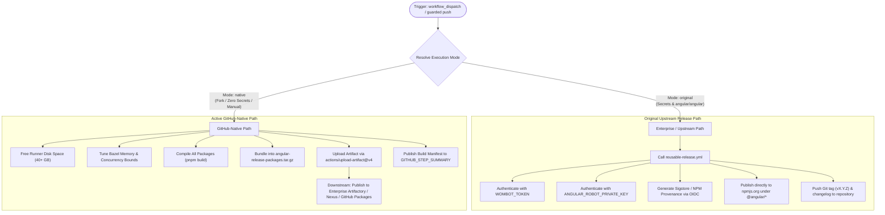

# Enterprise Release Guide & Pipeline Risk Analysis

## Executive Summary

This document details the operational architecture, risk analysis, and recommended workflows for building and releasing Angular distributions in an enterprise or private organization environment using the modernized pipelines in this repository.

The repository's workflows have been modernized with a **Dual-Mode Architecture (Zero Skipped Jobs Policy)**. Every pipeline can run either in **Active GitHub-Native Mode** (free, zero enterprise secrets, self-contained artifacts) or **Original Mode** (delegates to upstream Google/Angular dev-infra enterprise actions requiring specific credentials and infrastructure).

### Operational Status Matrix

| Pipeline Component | Native Mode Behavior | Original Mode Behavior | Enterprise Risk Level |
| :--- | :--- | :--- | :--- |
| **Package Compilation** | Compiles all `@angular/*` packages locally via `pnpm build` (`dist/packages-dist`) | Compiles via `angular/dev-infra` reusable release workflow | **Low** — Package outputs are functionally identical |
| **Artifact Packaging** | Bundles into `angular-release-packages.tar.gz` and uploads to Actions Artifacts | Publishes directly to npmjs.org with provenance | **Low** — Tarball contains all compiled packages ready for inspection |
| **Registry Publishing** | Retains artifacts in GitHub Actions; no automatic public registry push | Pushes to npmjs.org under `@angular/*` using `WOMBOT_TOKEN` | **Medium-High** — Enterprise publishing requires deliberate distribution |
| **Git Tagging & Changelog** | Omits Git pushes to avoid mutating repository history on forks | Uses `ANGULAR_ROBOT_PRIVATE_KEY` to push tags (`vX.Y.Z`) and changelog commits | **Low-Medium** — Must be coordinated with branch protection |
| **CI / Push Triggers** | `push:` triggers commented out during testing; runs via `workflow_dispatch` | Automatically triggers on pushes to `main` and release branches | **Low (By Design)** — Eliminates unintended matrix runner minute consumption |
| **Build Infrastructure** | Tuned for 2-core standard GitHub runners (`-Xmx3g`, `--jobs=2`, `4GB` Node) | Relies on Google Cloud Remote Build Execution (RBE) with 100+ concurrent workers | **Medium** — Full test suite without RBE requires larger runners or remote cache |

---

## Architecture: Native Mode vs Original Mode



---

## Detailed Risk & Impact Analysis

### 1. Registry Targets & Scoped Publishing

* **The Upstream Constraint**:
  The upstream release workflow [`release-original`](file:///c:/projects/angular/.github/workflows/release.yml#L64-L70) delegates to `angular/dev-infra/.github/workflows/reusable-release.yml`. This reusable action is specifically designed for the Angular core team to publish packages to **npmjs.org** under the `@angular` namespace.
* **The Enterprise Problem**:
  Most enterprise environments do not publish to the public npmjs.org registry under `@angular`. Instead, organizations typically:
  1. Publish to private package registries such as **JFrog Artifactory**, **Sonatype Nexus**, **AWS CodeArtifact**, or **GitHub Packages**.
  2. Use a custom private enterprise scope (e.g., `@mycompany/angular-core` or `@enterprise/router`).
* **Risk Evaluation**:
  Invoking `mode: original` in an enterprise environment without modifying `reusable-release.yml` will either fail authorization (if credentials are missing) or inadvertently attempt to publish to the public npmjs.org registry.
* **Mitigation**:
  Use **`native` mode** to generate the release distribution archive (`angular-release-packages.tar.gz`). Then run a dedicated internal publish job that authenticates against your enterprise registry.

---

### 2. Mode Resolution Guard on Repository Name

* **The Guard**:
  In [`release.yml` lines 56–60](file:///c:/projects/angular/.github/workflows/release.yml#L56-L60):
  ```bash
  if [ "$MODE" = "auto" ]; then
    if [ -n "$WOMBOT_SECRET" ] && [ -n "$ROBOT_SECRET" ] && [ "${{ github.repository }}" = "angular/angular" ]; then
      MODE="original"
    else
      MODE="native"
    fi
  fi
  ```
* **Impact on Forks & Enterprise Mirrors**:
  In any non-upstream repository (e.g., `company-org/angular`), the automatic resolution evaluates to `native` even if `WOMBOT_TOKEN` and `ANGULAR_ROBOT_PRIVATE_KEY` are configured.
* **Resolution**:
  If you specifically wish to force the upstream release mechanism on a fork, you must either:
  - Manually select `mode: original` when triggering via `workflow_dispatch`.
  - Set the repository variable `vars.DEV_INFRA_MODE = "original"`.

---

### 3. Automation Triggers & Dispatch Policy

* **Push Triggers Commented Out**:
  In [`release.yml`](file:///c:/projects/angular/.github/workflows/release.yml#L6-L9) and [`ci.yml`](file:///c:/projects/angular/.github/workflows/ci.yml#L5-L10), automatic triggers on commit pushes to `main` and version branches (`[0-9]+.[0-9]+.x`) have been commented out to prevent burning runner minutes and concurrent queue clogging during active modernization.
* **Operational Impact**:
  Pushing a release commit or merging a PR will **not** automatically trigger a release build.
* **Recommendation**:
  Keep releases dispatch-driven via `workflow_dispatch`. This ensures releases are only executed intentionally after formal sign-off. If automatic releases on push are desired in your enterprise repo, uncomment lines 6–9 in `.github/workflows/release.yml`.

---

### 4. Git Tagging, Changelogs & Branch Protection

* **The Upstream Mechanism**:
  Upstream Angular releases perform automated Git operations:
  - Bumps the version in `package.json`.
  - Updates `CHANGELOG.md`.
  - Creates a signed Git tag (e.g., `v19.1.0`).
  - Pushes commits directly to the protected `main` branch using GitHub App tokens.
* **Enterprise Risk**:
  - In enterprise repositories with strict **Branch Protection Rules** or **Repository Rulesets** (requiring signed commits, PR reviews, and mandatory status checks before merge), automated bots will be blocked from pushing directly to `main` unless granted explicit bypass permissions.
  - Native mode intentionally skips mutating the Git repository so it can run safely on forks without special write tokens.
* **Mitigation**:
  Tag releases manually or establish a service account with branch protection bypass permissions for tagging release commits.

---

### 5. Build Infrastructure & Runner Sizing

* **Compilation (`pnpm build`)**:
  - Successfully verified on standard 2-core GitHub-hosted runners (`ubuntu-latest`).
  - Execution completes in **6 minutes 43 seconds** (Live Run [41348685585](https://github.com/sajuptpm/angular/actions/runs/41348685585)).
  - Memory bounds configured: JVM heap `-Xmx3g`, local RAM `10000 MB`, Node memory `4096 MB`.
* **Full Test Suites (`ci.yml` / `pr.yml` test targets)**:
  - Upstream relies on Google Cloud Remote Build Execution (RBE) with hundreds of parallel cloud workers.
  - In a fork or enterprise environment without RBE, running the complete test matrix (`//packages/...`) sequentially on a standard 2-core runner can take multiple hours.
* **Recommendation for Enterprise Infrastructure**:
  For running full integration and unit test matrices prior to release:
  - Set `vars.RUNNER_LABEL` to point to a high-capacity self-hosted runner pool (e.g., 16 or 32 vCPUs).
  - Or configure an enterprise remote Bazel cache (e.g., [BuildBuddy](https://www.buildbuddy.io/), EngFlow, or a self-hosted Bazel Remote HTTP Cache).

---

### 6. Pre-Release Quality Gate: Decoupled Test Execution

* In upstream Angular, release commits are only cut after PRs and commits have passed all checks in `ci.yml` and `pr.yml`.
* In `release.yml`, the pipeline focuses purely on building packages (`pnpm build`) and packaging them; it does not re-run all thousands of karma/browser tests.
* **Operational Risk**:
  If an operator triggers `release.yml` on a commit that contains unverified changes or test regressions, the pipeline will still package the release without error.
* **Requirement**:
  Always ensure the target Git commit has a clean, passing run on [`ci.yml`](file:///c:/projects/angular/.github/workflows/ci.yml) before triggering [`release.yml`](file:///c:/projects/angular/.github/workflows/release.yml).

---

## Step-by-Step Enterprise Release Playbook

Follow this operational playbook when releasing an Angular build for internal enterprise distribution.

### Step 1: Pre-Release Verification

Ensure the target commit on `main` or release branch is verified:

```bash
# 1. Trigger CI verification run for target commit
gh workflow run ci.yml --ref main -f mode=native -f job_selection=all

# 2. Confirm the run succeeded
gh run list --workflow=ci.yml --limit 1
```

### Step 2: Trigger the Release Build

Execute `release.yml` via GitHub CLI or Web UI:

```bash
# Trigger release build in native mode (dry_run=false prepares real release bundles)
gh workflow run release.yml --ref main -f mode=native -f dry_run=false
```

### Step 3: Monitor & Download the Release Artifact

```bash
# Monitor the run to completion
gh run watch

# Download the generated release bundle
gh run download --name angular-release-packages --dir ./dist/release-bundles
```

Verify the archive contents:

```bash
# List all packaged Angular distributions
tar -tzvf ./dist/release-bundles/angular-release-packages.tar.gz | head -n 30
```

The archive includes all compiled Angular packages:
- `@angular/core`
- `@angular/common`
- `@angular/compiler`
- `@angular/compiler-cli`
- `@angular/platform-browser`
- `@angular/platform-browser-dynamic`
- `@angular/router`
- `@angular/forms`
- `@angular/animations`
- `@angular/elements`
- `@angular/service-worker`
- `@angular/upgrade`

### Step 4: Publish to Enterprise Package Registry

Extract and publish packages to your internal registry (e.g., Artifactory, Nexus, or GitHub Packages):

```bash
# Extract the release bundle
mkdir -p ./dist/extracted-packages
tar -xzf ./dist/release-bundles/angular-release-packages.tar.gz -C ./dist/extracted-packages/

# Set enterprise registry URL and auth token
export NPM_CONFIG_REGISTRY="https://npm.your-company.internal/"
export NODE_AUTH_TOKEN="your-enterprise-npm-token"

# Publish each package
for pkg_dir in ./dist/extracted-packages/*; do
  if [ -f "$pkg_dir/package.json" ]; then
    echo "Publishing $(basename "$pkg_dir")..."
    npm publish "$pkg_dir" --registry "$NPM_CONFIG_REGISTRY" --tag latest
  fi
done
```

### Step 5: Create Internal Git Release & Tag

Once packages are published to your internal registry:

```bash
VERSION=$(node -p "require('./package.json').version")
TAG="v${VERSION}-enterprise"

# Tag the verified release commit
git tag -a "$TAG" -m "Enterprise Release $TAG"
git push origin "$TAG"

# Create GitHub Release with release notes
gh release create "$TAG" \
  ./dist/release-bundles/angular-release-packages.tar.gz \
  --title "Enterprise Release $TAG" \
  --notes "Enterprise release compiled from commit $(git rev-parse HEAD)."
```

---

## Configuration Reference

### Repository Variables (`vars.*`)

| Variable | Description | Recommended Enterprise Value |
| :--- | :--- | :--- |
| `RUNNER_LABEL` | Custom runner label for high-capacity build environments | `ubuntu-latest` (or `self-hosted-large`) |
| `DEV_INFRA_MODE` | Global default mode override for all workflows | `native` |

### Repository Secrets (`secrets.*`)

| Secret | Scope | Purpose in Enterprise Context |
| :--- | :--- | :--- |
| `GITHUB_TOKEN` | Built-in | Used for downloading run artifacts, posting commit statuses, and generating step summaries. Automatically provided. |
| `ENTERPRISE_NPM_TOKEN` | Custom | Used in custom post-build publishing scripts to authenticate against private Artifactory/Nexus/GitHub Packages. |
| `WOMBOT_TOKEN` | Upstream Only | Required only if running `original` mode to publish directly to public npmjs.org. |
| `ANGULAR_ROBOT_PRIVATE_KEY` | Upstream Only | Required only if running `original` mode for Google's automated branch manager and release bots. |

---

## Conclusion & Recommendations

1. **Building packages with the modernized pipelines is fully production-safe.** The compilation output (`dist/packages-dist`) uses the exact same Bazel rules and toolchains as upstream Angular.
2. **For enterprise releases, use `native` mode.** It compiles cleanly without requiring Google Cloud credentials or public NPM publishing permissions.
3. **Decouple packaging from publishing.** Let the pipeline generate verified `angular-release-packages.tar.gz` artifacts, and use a dedicated enterprise distribution step to publish to your private registry under your organization's security policies.
4. **Always ensure `ci.yml` passes on the target commit** before triggering a release build.
