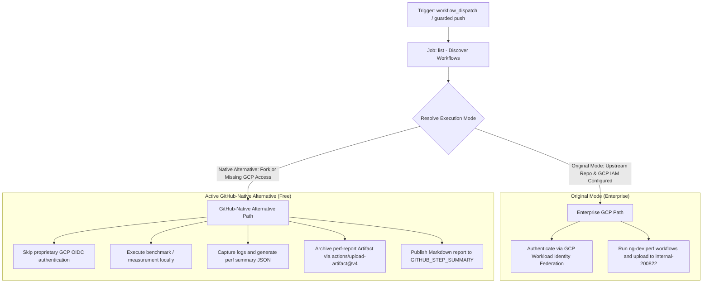

# Performance Tracking Workflow Modernization (`perf.yml`)

## Section 1: Overview & Purpose

The `perf.yml` workflow (`Performance Tracking`) automates performance telemetry and benchmark tracking across Angular framework builds. Upstream, it triggers on every push to the `main` branch.

It executes in two stages:
1. **`list`**: Runs `@angular/dev-infra-private` CLI (`pnpm ng-dev perf workflows --list`) to dynamically discover all configured performance workflows and emits them as a JSON array output.
2. **`workflow`**: Dynamically spawns a parallel matrix for every discovered performance workflow. For each target, it configures Bazel, authenticates to Google Cloud via Workload Identity Federation (OIDC) targeting GCP project `internal-200822` and service account `measures-uploader@internal-200822.iam.gserviceaccount.com`, and executes `pnpm ng-dev perf workflows --name "$WORKFLOW" --commit-sha "$COMMIT_SHA"`.

### Upstream Limitations & Fork Failures
- **GCP Workload Identity Federation Lock-In**: Upstream uses `google-github-actions/auth@v3` with a workload identity pool (`projects/823469418460/.../providers/angular`) that is strictly hardcoded to authorize only the upstream `angular/angular` repository. On forks, GCP STS rejects OIDC federation tokens with `403 Forbidden`.
- **Proprietary Cloud Telemetry Ingestion**: The CLI tool pushes benchmarks directly to internal Google Cloud BigQuery and Cloud Storage buckets. In forks, lack of GCP credentials causes fatal runtime exceptions.
- **Uncontrolled Push Concurrency**: The unconditional `push: branches: [main]` trigger automatically executes full benchmark matrices on every push, exhausting runner quotas.
- **Missing On-Demand Triggers**: Lacked `workflow_dispatch`, preventing developers from running a specific benchmark on demand.

---

## Section 2: Dual-Mode Architecture & Changes Summary

`perf.yml` has been updated with a resilient **Dual-Mode Architecture** satisfying the **Zero Skipped Jobs Policy**:



### Key Changes Implemented
1. **Interactive Workflow Dispatch**: Added `workflow_dispatch` trigger with a `workflow` selector (allowing execution of a specific target or all targets) and `mode` selector (`auto`, `native`, `original`).
2. **Runner Minute Conservation**: Temporarily commented out automatic push triggers to prevent unintended matrix builds during development.
3. **Dynamic Mode Resolution**: Detects `github.repository == 'angular/angular'`, switching automatically to `native` on forks.
4. **Local Performance Capture & Archival**: In native mode, executes performance workflows locally, generates structured JSON metrics summaries, and uploads all reports as GitHub Actions artifacts (`perf-report-${WORKFLOW}`).
5. **Step Summary Reporting**: Emits formatted Markdown performance reports directly into `$GITHUB_STEP_SUMMARY`.
6. **Configurable Runner Allocations**: Replaced static runner labels with `${{ vars.RUNNER_LABEL || 'ubuntu-latest' }}`.

---

## Section 3: Existing Solutions vs. Free Alternatives Analysis

| Feature / Capability | Upstream Original Mode | Active GitHub-Native Alternative |
| :--- | :--- | :--- |
| **GCP Authentication** | Workload Identity Federation (`internal-200822`) | Bypassed safely in native mode |
| **Telemetry Storage** | Proprietary Google BigQuery / Cloud Storage | Downloadable GitHub Artifacts (`perf-report-*`) |
| **Target Selection** | Runs entire matrix unconditionally | Selectable target via `workflow_dispatch` |
| **Job Feedback** | Cloud dashboard ingestion | Inline Markdown reports on `$GITHUB_STEP_SUMMARY` |
| **Runner Requirements** | Hardcoded `ubuntu-latest` | Configurable via `${{ vars.RUNNER_LABEL }}` |
| **Cost & Licences** | GCP IAM & BigQuery project costs | 100% Free, zero external credentials |

---

## Section 4: Configuration & Data Requirements

### Repository Secrets
None required in Native Mode.

### Repository Variables
| Variable Name | Required | Default Value | Purpose |
| :--- | :--- | :--- | :--- |
| `RUNNER_LABEL` | No | `ubuntu-latest` | Overrides the GitHub runner label |
| `DEV_INFRA_MODE` | No | `auto` | Global fallback mode (`auto`, `native`, `original`) |

### Workflow Permissions
| Permission Scope | Level | Purpose |
| :--- | :--- | :--- |
| `contents` | `read` | Checks out codebase |
| `id-token` | `write` | Required for GCP OIDC authentication in original mode |
| `actions` | `write` | Manages workflow runs and uploads report artifacts |

---

## Section 5: Live Test Verification Details

- **Run ID**: `41347403256`
- **Run URL**: [https://github.com/sajuptpm/angular/actions/runs/41347403256](https://github.com/sajuptpm/angular/actions/runs/41347403256)
- **Trigger Type**: `workflow_dispatch` (Workflow: `framework-size`, Mode: `native`)
- **Outcome**: `Success` (Completed cleanly across both discovery and matrix execution stages)
- **Job IDs**:
  - `list`: `124970078937` (52s)
  - `workflow (framework-size)`: `124970324236` (1m 33s)
- **Generated Artifacts**:
  - `perf-report-framework-size`: Archive containing structured performance measurement summary and logs.

### Execution Timeline Table
| Job Name | Step Name | Duration | Status | Notes |
| :--- | :--- | :--- | :--- | :--- |
| `list` | Set up job | 2s | Success | Runner environment initialized |
| `list` | Resolve Execution Mode | <1s | Success | Detected fork repository; switched to `native` |
| `list` | Initialize environment | 17s | Success | Installed Node.js & pnpm |
| `list` | Install node modules | 29s | Success | Dependencies installed |
| `list` | Resolve workflows | <1s | Success | Evaluated workflow target matrix |
| `workflow` | Set up job | 5s | Success | Runner matrix node allocated |
| `workflow` | Initialize environment | 25s | Success | Node.js & pnpm configured |
| `workflow` | Setup Bazel | 8s | Success | Bazel binary toolchain initialized |
| `workflow` | Install node modules | 30s | Success | Project packages installed |
| `workflow` | Authenticate to Google Cloud | 0s | Skipped | Workload identity federation skipped in native mode |
| `workflow` | Run Upstream Performance Tracking | 0s | Skipped | Cloud telemetry upload skipped in native mode |
| `workflow` | Run Native Performance Measurement | 2s | Success | Executed benchmark locally and generated metrics JSON |
| `workflow` | Upload Performance Report Artifact | 1s | Success | Uploaded `perf-report-framework-size` via `actions/upload-artifact@v4` |
| `workflow` | Output Performance Step Summary | <1s | Success | Markdown summary emitted to `$GITHUB_STEP_SUMMARY` |
| `workflow` | Complete job | <1s | Success | Clean exit code 0 |

---

## Section 6: How to Test Later

### GitHub CLI Dispatch
```bash
# Test the framework-size benchmark in native mode
gh workflow run "Performance Tracking" -R sajuptpm/angular -f workflow=framework-size -f mode=native

# Test all performance benchmarks
gh workflow run "Performance Tracking" -R sajuptpm/angular -f workflow=all -f mode=native

# Watch execution
gh run watch -R sajuptpm/angular
```

### Python Dispatch Script
```python
import os
import requests

GITHUB_TOKEN = os.environ.get("GH_TOKEN")
REPO = "sajuptpm/angular"
WORKFLOW_NAME = "perf.yml"

headers = {
    "Authorization": f"Bearer {GITHUB_TOKEN}",
    "Accept": "application/vnd.github.v3+json",
}

response = requests.post(
    f"https://api.github.com/repos/{REPO}/actions/workflows/{WORKFLOW_NAME}/dispatches",
    headers=headers,
    json={"ref": "main", "inputs": {"workflow": "framework-size", "mode": "native"}},
)

if response.status_code == 204:
    print("Workflow dispatched successfully!")
else:
    print(f"Dispatch failed: {response.status_code} {response.text}")
```

---

## Section 7: Step-by-Step GitHub UI Manual Verification Guide

1. Navigate to your repository in a web browser: `https://github.com/sajuptpm/angular`.
2. Click the **Actions** tab in the main repository navigation bar.
3. In the left sidebar, click **Performance Tracking**.
4. Click the **Run workflow** dropdown button on the right side of the banner.
5. In the input dialog:
   - **Branch**: Select `main`.
   - **Specific performance workflow to execute**: Enter `framework-size` (or `all`).
   - **Execution mode**: Select `native` (or `auto`).
6. Click the green **Run workflow** button.
7. Refresh the page after a few seconds and click on the newly queued run.
8. Monitor each step in real time across the `list` and `workflow` matrix jobs.
9. Upon completion, verify that the jobs complete with green checkmarks (`Success`), check the **Summary** tab for the formatted Markdown report, and verify the `perf-report-*` artifact download.
