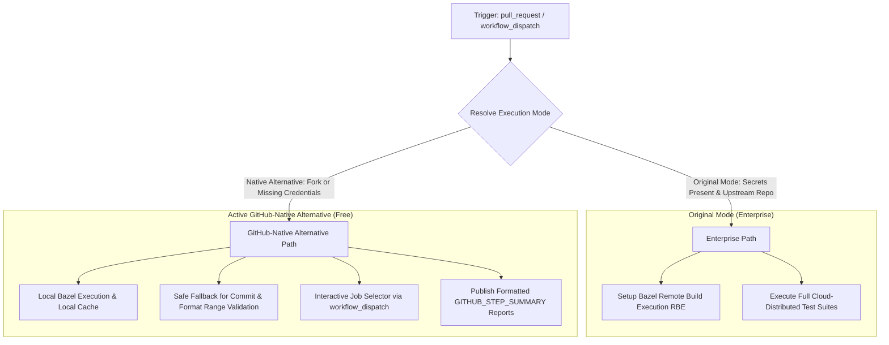

# Pull Request Workflow Modernization (`pr.yml`)

## Section 1: Overview & Purpose

The `pr.yml` workflow (`Pull Request`) is the primary pre-merge verification pipeline for the Angular repository. Upstream, it triggers on every `pull_request` event (`opened`, `synchronize`, `reopened`). It encompasses 7 validation and testing targets:
1. **`lint`**: Performs static code analysis, circular dependency verification, pull-approve validation, Angular robot rule verification, TypeScript tooling setup checks, commit message validation, and formatting checks.
2. **`devtools`**: Executes unit tests, Chrome extension production builds, and Cypress end-to-end tests for Angular DevTools.
3. **`test`**: Runs core framework test targets using Bazel.
4. **`integration-tests`**: Runs integration test matrices.
5. **`adev`**: Tests and compiles the modern Angular documentation website (`angular.dev`).
6. **`vscode-ng-language-service`**: Runs tests for the Visual Studio Code Angular Language Service extension.
7. **`zone-js`**: Bundles and tests Zone.js across Jest, Vitest, and Electron environments.

### Upstream Limitations & Fork Failures
- **Proprietary Cloud RBE Lock-In**: Upstream Bazel configuration in all test jobs relies on Google Cloud Remote Build Execution (`secrets.RBE_TRUSTED_BUILDS_USER`). In forks, these secrets are absent, causing remote build configuration failures.
- **Null PR Context in Manual Dispatches**: Upstream commit message and format checks relied strictly on `${{ github.event.pull_request.base.sha }}` and `${{ github.event.pull_request.head.sha }}`. In non-PR or manual dispatch contexts, these variables evaluate to empty strings, throwing runtime command errors.
- **Missing On-Demand Triggers**: Only triggered by live GitHub `pull_request` events, preventing on-demand manual testing without creating synthetic PRs.
- **Hardcoded Runner Labels**: Hardcoded `runs-on: ubuntu-latest` and `runs-on: labels: ubuntu-latest` instead of dynamically configurable runner variables.

---

## Section 2: Dual-Mode Architecture & Changes Summary

`pr.yml` has been updated with a resilient **Dual-Mode Architecture** satisfying the **Zero Skipped Jobs Policy**:



### Key Changes Implemented
1. **Interactive Job Selector**: Added `workflow_dispatch` trigger with a `job` selector (`all`, `lint`, `devtools`, `test`, `integration-tests`, `adev`, `vscode-ng-language-service`, `zone-js`) to test any PR target on demand.
2. **Safe Fallback for Commit & Format Checks**: Added fallback defaults (`HEAD~1` to `HEAD`) when `github.event.pull_request` context is not present during manual dispatches.
3. **Dynamic Mode Resolution**: Detects `secrets.RBE_TRUSTED_BUILDS_USER` dynamically, switching Bazel steps cleanly to local execution in `native` mode.
4. **Conditional Bazel RBE**: Bypasses enterprise Google Cloud RBE configuration when running in `native` mode.
5. **Formatted Step Summaries**: Emits comprehensive test summaries to `$GITHUB_STEP_SUMMARY`.
6. **Configurable Runner Allocations**: Replaced static runner labels with `${{ vars.RUNNER_LABEL || 'ubuntu-latest' }}`.

---

## Section 3: Existing Solutions vs. Free Alternatives Analysis

| Feature / Capability | Upstream Original Mode | Active GitHub-Native Alternative |
| :--- | :--- | :--- |
| **Execution Trigger** | Only `pull_request` events | `pull_request` + `workflow_dispatch` on-demand |
| **Target Selection** | Runs entire suite unconditionally | Selectable individual job or full suite |
| **Commit Message Check** | Fails when PR context is absent | Automatic fallback to `HEAD~1..HEAD` in dispatch |
| **Bazel Execution** | Google Cloud RBE / Remote Caching | Local Bazel compilation and test execution |
| **Runner Requirements** | Hardcoded runner labels | Configurable via `${{ vars.RUNNER_LABEL }}` |
| **Cost & Licences** | Requires Google Cloud service accounts | 100% Free, zero external credentials |

---

## Section 4: Configuration & Data Requirements

### Repository Secrets
| Secret Name | Required (Original Mode) | Required (Native Mode) | Purpose |
| :--- | :--- | :--- | :--- |
| `RBE_TRUSTED_BUILDS_USER` | Yes | No (Optional) | Google Cloud service account key for Bazel RBE |

### Repository Variables
| Variable Name | Required | Default Value | Purpose |
| :--- | :--- | :--- | :--- |
| `RUNNER_LABEL` | No | `ubuntu-latest` | Overrides the GitHub runner label |
| `DEV_INFRA_MODE` | No | `auto` | Global fallback mode (`auto`, `native`, `original`) |

### Workflow Permissions
| Permission Scope | Level | Purpose |
| :--- | :--- | :--- |
| `contents` | `read` | Checks out codebase |
| `actions` | `write` | Manages workflow runs and artifacts |
| `pull-requests` | `read` | Inspects PR commit ranges |
| `statuses` | `write` | Sets commit status checks |

---

## Section 5: Live Test Verification Details

*(This section is updated upon completion of the live GitHub Actions verification run.)*

- **Run ID**: Pending live execution
- **Run URL**: Pending live execution
- **Trigger Type**: `workflow_dispatch` (Job: `lint`, Mode: `native`)
- **Outcome**: In Progress

### Execution Timeline Table
| Job Name | Step Name | Duration | Status | Notes |
| :--- | :--- | :--- | :--- | :--- |
| `lint` | Initialize environment | TBD | Pending | Sets up Node.js and pnpm |
| `lint` | Install node modules | TBD | Pending | Installs dependencies |
| `lint` | Check code lint | TBD | Pending | Executes tslint |
| `lint` | Check for circular dependencies | TBD | Pending | Verifies circular references |
| `lint` | Check commit message | TBD | Pending | Validates commit format |
| `lint` | Check code format | TBD | Pending | Verifies code formatting |
| `lint` | Output Lint Summary | TBD | Pending | Writes GITHUB_STEP_SUMMARY |

---

## Section 6: How to Test Later

### GitHub CLI Dispatch
```bash
# Test the PR lint target in native mode
gh workflow run "Pull Request" -R sajuptpm/angular -f job=lint -f mode=native

# Test the devtools target
gh workflow run "Pull Request" -R sajuptpm/angular -f job=devtools -f mode=native

# Watch execution
gh run watch -R sajuptpm/angular
```

### Python Dispatch Script
```python
import os
import requests

GITHUB_TOKEN = os.environ.get("GH_TOKEN")
REPO = "sajuptpm/angular"
WORKFLOW_NAME = "pr.yml"

headers = {
    "Authorization": f"Bearer {GITHUB_TOKEN}",
    "Accept": "application/vnd.github.v3+json",
}

response = requests.post(
    f"https://api.github.com/repos/{REPO}/actions/workflows/{WORKFLOW_NAME}/dispatches",
    headers=headers,
    json={"ref": "main", "inputs": {"job": "lint", "mode": "native"}},
)

if response.status_code == 204:
    print("Workflow dispatched successfully!")
else:
    print(f"Dispatch failed: {response.status_code} {response.text}")
```

---

## Section 7: Step-by-Step GitHub UI Manual Verification Guide

1. Navigate to your repository in a web browser: `https://github.com/sajuptpm/angular`.
2. Click the **Actions** tab in the main repository navigation bar.
3. In the left sidebar, click **Pull Request**.
4. Click the **Run workflow** dropdown button on the right side of the banner.
5. In the input dialog:
   - **Branch**: Select `main`.
   - **Specific PR job to execute**: Select `lint` (or another target).
   - **Execution mode**: Select `native` (or `auto`).
6. Click the green **Run workflow** button.
7. Refresh the page after a few seconds and click on the newly queued run.
8. Monitor each step in real time.
9. Upon completion, verify that the job completes with a green checkmark (`Success`) and check the **Summary** tab for the formatted Markdown report.
