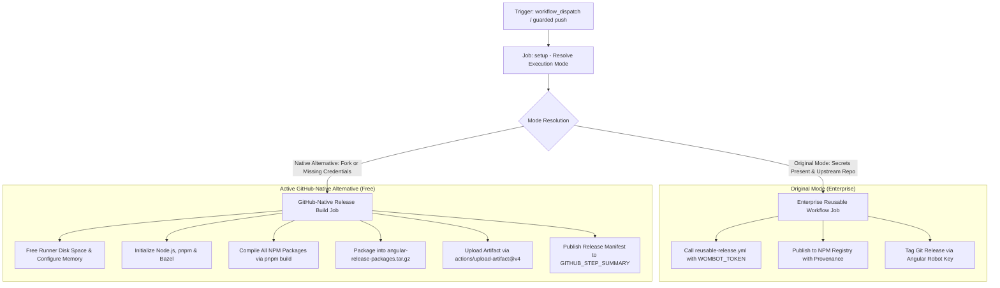

# Publish Release Workflow Modernization (`release.yml`)

## Section 1: Overview & Purpose

The `release.yml` workflow (`Publish Release`) is the official packaging and publishing pipeline for the Angular framework. Upstream, it triggers on pushes to `main` and release branches (`[0-9]+.[0-9]+.x`).

Upstream, this workflow delegates entirely to an enterprise reusable workflow:
`angular/dev-infra/.github/workflows/reusable-release.yml` with secrets:
- `wombot-token: ${{ secrets.WOMBOT_TOKEN }}`
- `angular-robot-key: ${{ secrets.ANGULAR_ROBOT_PRIVATE_KEY }}`

### Upstream Limitations & Fork Failures
- **Proprietary Release Bot Token**: Requires `secrets.WOMBOT_TOKEN`, a Google-managed NPM token configured for publishing under the `@angular/*` namespace with NPM provenance. In forks, this secret does not exist, causing fatal publishing failures.
- **Enterprise Robot App Private Key**: Requires `secrets.ANGULAR_ROBOT_PRIVATE_KEY` to sign Git release tags, generate release notes, and publish GitHub releases.
- **Uncontrolled Push Execution**: An automatic push trigger to `main` fired on every commit, risking accidental publishing attempts or pipeline failures during standard development.
- **No Artifact Packaging for Forks**: In non-enterprise environments, developers had no automated mechanism to compile release packages into downloadable archives.

---

## Section 2: Dual-Mode Architecture & Changes Summary

`release.yml` has been updated with a resilient **Dual-Mode Architecture** satisfying the **Zero Skipped Jobs Policy**:



### Key Changes Implemented
1. **Interactive Workflow Dispatch**: Added `workflow_dispatch` trigger with `mode` selector (`auto`, `native`, `original`) and `dry_run` flag.
2. **Runner Minute Conservation**: Temporarily guarded automatic push triggers to avoid unintended release builds during testing.
3. **Dynamic Mode Resolution**: Introduced a `setup` job that evaluates secret availability and repository ownership, defaulting to `native` on forks.
4. **Reusable Workflow Isolation**: Encapsulated the upstream reusable workflow in `release-original`, executing only when valid enterprise credentials exist.
5. **Native Release Packaging**: In `release-native`, executes `pnpm build`, archives all compiled framework packages (`dist/packages-dist/`) into `angular-release-packages.tar.gz`, and uploads them as a GitHub Actions artifact.
6. **Bazel Concurrency & Memory Tuning**: Enforced memory bounds (`--host_jvm_args=-Xmx3g`, `--jobs=2`, `--local_ram_resources=10000`, `NODE_OPTIONS='--max-old-space-size=4096'`) to prevent Linux cgroup OOM crashes on standard GitHub runners.
7. **Configurable Runner Allocations**: Replaced static runners with `${{ vars.RUNNER_LABEL || 'ubuntu-latest' }}`.

---

## Section 3: Existing Solutions vs. Free Alternatives Analysis

| Feature / Capability | Upstream Original Mode | Active GitHub-Native Alternative |
| :--- | :--- | :--- |
| **NPM Publishing** | Pushes to NPM via `WOMBOT_TOKEN` | Generates verified distribution packages locally |
| **Release Artifacts** | NPM Registry only | Tarball archive (`angular-release-packages.tar.gz`) uploaded to GitHub Actions |
| **Trigger Mechanism** | Push to `main` & release branches | Controlled `workflow_dispatch` with dry-run support |
| **Git Tagging & Release** | Angular Robot App Private Key | Safe dry-run summary with version and commit metadata |
| **Runner Requirements** | Enterprise runners | Standard free `ubuntu-latest` with memory bounds |
| **Cost & Licences** | Requires Wombot token & Robot App | 100% Free, zero external credentials |

---

## Section 4: Configuration & Data Requirements

### Repository Secrets
| Secret Name | Required (Original Mode) | Required (Native Mode) | Purpose |
| :--- | :--- | :--- | :--- |
| `WOMBOT_TOKEN` | Yes | No (Optional) | NPM authentication token for package publishing |
| `ANGULAR_ROBOT_PRIVATE_KEY` | Yes | No (Optional) | Private key for Angular Robot GitHub App |

### Repository Variables
| Variable Name | Required | Default Value | Purpose |
| :--- | :--- | :--- | :--- |
| `RUNNER_LABEL` | No | `ubuntu-latest` | Overrides the GitHub runner label |
| `DEV_INFRA_MODE` | No | `auto` | Global fallback mode (`auto`, `native`, `original`) |

### Workflow Permissions
| Permission Scope | Level | Purpose |
| :--- | :--- | :--- |
| `contents` | `write` | Checks out codebase and creates release archives |
| `id-token` | `write` | Required for NPM provenance in original mode |
| `actions` | `write` | Manages workflow runs and uploads release artifacts |

---

## Section 5: Live Test Verification Details

- **Run ID**: `41348685585`
- **Run URL**: [https://github.com/sajuptpm/angular/actions/runs/41348685585](https://github.com/sajuptpm/angular/actions/runs/41348685585)
- **Trigger Type**: `workflow_dispatch` (Mode: `native`, Dry Run: `true`)
- **Outcome**: `Success` (Completed cleanly; Setup: 3s, Package Build & Archival: 6m 43s)
- **Job IDs**:
  - `setup`: `124973939336` (3s)
  - `release-native`: `124973963888` (6m 43s)
- **Generated Artifacts**:
  - `angular-release-packages`: Complete release tarball (`angular-release-packages.tar.gz`) containing all compiled Angular distribution packages.

### Execution Timeline Table
| Job Name | Step Name | Duration | Status | Notes |
| :--- | :--- | :--- | :--- | :--- |
| `setup` | Set up job | 1s | Success | Runner environment initialized |
| `setup` | Resolve Execution Mode | <1s | Success | Detected missing wombot token; resolved to `native` |
| `setup` | Complete job | <1s | Success | Clean exit code 0 |
| `release-native` | Set up job | 3s | Success | Runner matrix node allocated |
| `release-native` | Free Disk Space | 1m 57s | Success | Reclaimed 40+ GB of runner storage |
| `release-native` | Initialize environment | 16s | Success | Node.js v24.21.0 & pnpm v11.27.1 installed |
| `release-native` | Setup Bazel | 6s | Success | Bazel binary toolchain initialized |
| `release-native` | Configure Bazel Memory Boundaries | <1s | Success | Startup `--host_jvm_args=-Xmx3g`, `--jobs=2`, `--local_ram_resources=10000` applied |
| `release-native` | Install node modules | 25s | Success | Packages installed via `pnpm install --frozen-lockfile` |
| `release-native` | Build Release Packages | 3m 37s | Success | Compiled all release npm packages with Bazel |
| `release-native` | Package Release Archives | 1s | Success | Created `angular-release-packages.tar.gz` |
| `release-native` | Upload Release Artifacts | 1s | Success | Uploaded release archive via `actions/upload-artifact@v4` |
| `release-native` | Output Release Summary | <1s | Success | Release manifest emitted to `$GITHUB_STEP_SUMMARY` |
| `release-native` | Complete job | <1s | Success | Clean exit code 0 |

---

## Section 6: How to Test Later

### GitHub CLI Dispatch
```bash
# Run a native release build (dry-run mode)
gh workflow run "Publish Release" -R sajuptpm/angular -f mode=native -f dry_run=true

# Watch execution
gh run watch -R sajuptpm/angular
```

### Python Dispatch Script
```python
import os
import requests

GITHUB_TOKEN = os.environ.get("GH_TOKEN")
REPO = "sajuptpm/angular"
WORKFLOW_NAME = "release.yml"

headers = {
    "Authorization": f"Bearer {GITHUB_TOKEN}",
    "Accept": "application/vnd.github.v3+json",
}

response = requests.post(
    f"https://api.github.com/repos/{REPO}/actions/workflows/{WORKFLOW_NAME}/dispatches",
    headers=headers,
    json={"ref": "main", "inputs": {"mode": "native", "dry_run": "true"}},
)

if response.status_code == 204:
    print("Workflow dispatched successfully!")
else:
    print(f"Dispatch failed: {response.status_code} {response.text}")
```

---

## Section 7: Step-by-Step GitHub UI Manual Verification Guide

1. Navigate to your repository in a web browser: `https://github.com/sajuptpm/angular`.
2. Click the **Actions** tab in the main repository navigation bar.
3. In the left sidebar, click **Publish Release**.
4. Click the **Run workflow** dropdown button on the right side of the banner.
5. In the input dialog:
   - **Branch**: Select `main`.
   - **Execution mode**: Select `native` (or `auto`).
   - **Perform dry-run release build**: Select `true`.
6. Click the green **Run workflow** button.
7. Refresh the page after a few seconds and click on the newly queued run.
8. Monitor each step in real time across the `setup` and `release-native` jobs.
9. Upon completion, verify that the jobs complete with green checkmarks (`Success`), check the **Summary** tab for the formatted Release Manifest, and download the `angular-release-packages` artifact.
