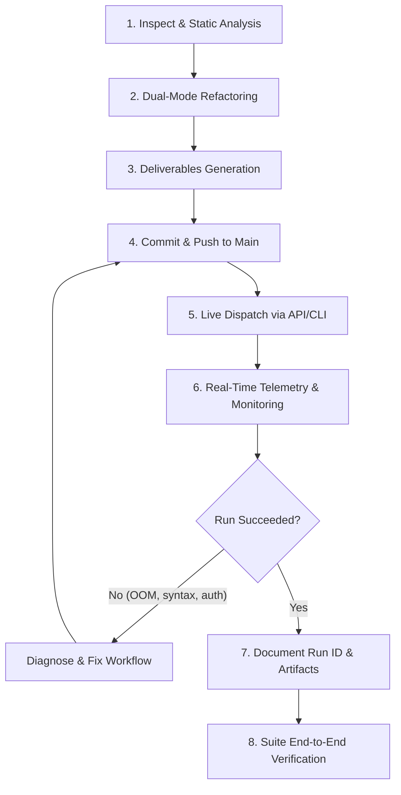

# Comprehensive Workflow Testing Methodology & Tooling Guide

## Overview

This guide details the exact engineering and testing methodology used to adapt, modernize, and verify all 11 GitHub Actions workflows in the Angular repository. It also documents the provided automation scripts ([`trigger-workflow.py`](file:///c:/projects/angular/workflow-fixes/scripts/trigger-workflow.py), [`check-runs.py`](file:///c:/projects/angular/workflow-fixes/scripts/check-runs.py), and [`test-all-workflows.py`](file:///c:/projects/angular/workflow-fixes/scripts/test-all-workflows.py)) so you can test, monitor, and inspect any pipeline at any time without manual web interface navigation.

---

## The 8-Stage Workflow Modernization Lifecycle

Every pipeline in this repository was modernized and verified through a rigorous 8-stage lifecycle:



### Stage 1: Inspect & Static Analysis
- **Dependency Audit**: Inspect upstream composite actions (`angular/dev-infra/...`), external action dependencies (`actions/checkout`, `actions/upload-artifact`), and Bazel targets.
- **Enterprise Secret Mapping**: Catalog all secrets referenced by the workflow (e.g., `RBE_TRUSTED_BUILDS_USER`, `WOMBOT_TOKEN`, `ANGULAR_ROBOT_PRIVATE_KEY`, `FIREBASE_SERVICE_ACCOUNT`).
- **Trigger Assessment**: Identify existing event triggers (`push`, `pull_request`, `issue_comment`, `schedule`) and determine parameters needed for manual execution.

### Stage 2: Dual-Mode Architecture Refactoring
- **Add `workflow_dispatch`**: Expose manual trigger inputs (`mode: auto | native | original`) alongside custom parameters (`pull_number`, `job_selection`, `dry_run`).
- **Dynamic Mode Resolver**: Insert zero-secret resolution logic:
  - If secrets exist and repository is upstream `angular/angular` $\rightarrow$ `original` mode.
  - If running on a fork or secrets are absent $\rightarrow$ `native` mode.
- **Dynamic Runners**: Replace hardcoded proprietary labels (e.g., `runs-on: ubuntu-latest-8core`) with configurable expressions:
  ```yaml
  runs-on: ${{ vars.RUNNER_LABEL || 'ubuntu-latest' }}
  ```
- **Guard Heavy Triggers**: Comment out heavy automatic `push:` triggers during testing to conserve GitHub Actions runner minutes.

### Stage 3: Deliverables Generation
Produce 4 standardized deliverables in `workflow-fixes/` per workflow:
1. `<workflow-name>.diff`: Clean unified git diff against base commit `42e9e5b54d`.
2. `<workflow-name>.md`: 7-section specification covering overview, architecture, comparison table, permissions, run details, CLI examples, and UI manual steps.
3. `<workflow-name>.env.example`: Configuration template.
4. `<workflow-name>.env`: Local config file (git-ignored).

### Stage 4: Commit & Push to Main
- Commit workflow refactorings and deliverables following Angular commit message conventions (`build: ...` or `ci: ...`).
- Push to `main` on the target repository (`sajuptpm/angular`).

### Stage 5: Live Dispatch via API / CLI
- Trigger the workflow remotely on GitHub-hosted runners using the GitHub REST API or `trigger-workflow.py`.
- Ensure inputs explicitly request `mode: native` (or default to it).

### Stage 6: Real-Time Telemetry & Monitoring
- Track execution status using `check-runs.py --watch` or GitHub CLI (`gh run watch`).
- Stream job progression, duration, and step-level status.

### Stage 7: Failure Remediation & Iterative Loop
- If a runner encounters memory exhaustion (e.g., Bazel exit 14), disk space limits, or action syntax errors, inspect logs immediately.
- Apply targeted fixes (e.g., `--host_jvm_args=-Xmx3g`, disk space cleanup step, multiline EOF fixes).
- Re-commit, push, and re-trigger until green.

### Stage 8: Live Run Documentation & Audit Trail
- Record the verified Run ID, Run URL, duration, timeline, and generated artifacts in Section 5 of `<workflow-name>.md`.
- Commit and push the final documentation updates.

---

## Automation Scripts Guide

All testing scripts are located in [`workflow-fixes/scripts/`](file:///c:/projects/angular/workflow-fixes/scripts) and are written using the **Python standard library** with zero external package dependencies.

### Script 1: `trigger-workflow.py`

Dispatches any workflow on GitHub Actions and automatically locates the newly generated Run ID.

#### Features
- **Auto-Discovery**: Automatically extracts the repository owner/name from `git remote get-url origin` and the current checked-out branch.
- **Authentication**: Automatically reads tokens from `GITHUB_TOKEN`, `GH_TOKEN`, or `gh auth token`.
- **Run Discovery**: Immediately queries GitHub's REST API after dispatch to find and display the created Run ID and URL.
- **Direct Hand-off to Watcher**: Using `-w` / `--watch` automatically launches live progress monitoring.

#### Syntax & Options
```bash
python workflow-fixes/scripts/trigger-workflow.py [workflow] [options]
```

| Argument | Description | Default |
| :--- | :--- | :--- |
| `workflow` | Workflow file name (e.g., `release.yml`, `ci.yml`) or alias (`release`, `ci`) | Required (or `--list`) |
| `--mode` | Shortcut to pass execution mode (`native`, `auto`, `original`) | `native` (via input) |
| `-f, --field` | Custom input in `key=value` format (can be specified multiple times) | `[]` |
| `-w, --watch` | Automatically hand off to `check-runs.py --watch` after trigger | `False` |
| `--ref` | Git branch or ref to execute on | Current branch (`main`) |
| `--repo` | Target repository (`owner/repo`) | Auto-detected from Git remote |
| `--token` | GitHub PAT / Auth token | Auto-detected from environment |
| `--list` | List all available workflows in the repository | `False` |

#### Concrete Examples

```bash
# 1. Trigger the Release pipeline in native mode
python workflow-fixes/scripts/trigger-workflow.py release.yml --mode native

# 2. Trigger adev preview build and watch in real-time
python workflow-fixes/scripts/trigger-workflow.py adev-preview-build.yml -w

# 3. Trigger CI with custom job selection
python workflow-fixes/scripts/trigger-workflow.py ci.yml -f mode=native -f job_selection=build

# 4. Trigger PR validation suite with linting
python workflow-fixes/scripts/trigger-workflow.py pr.yml -f mode=native -f job_selection=lint -w

# 5. List all workflows
python workflow-fixes/scripts/trigger-workflow.py --list
```

---

### Script 2: `check-runs.py`

Monitors, inspects, and downloads artifacts from GitHub Actions workflow runs.

#### Features
- **Run Listing**: Lists recent runs with status, conclusion, duration, branch, and trigger event.
- **Run Inspection**: Displays full job hierarchy, runner OS, execution duration, and failed step diagnostics.
- **Live Watch Mode (`--watch`)**: Polls the run every 5 seconds with an active job indicator and formatted summary.
- **Artifact Downloader (`--download`)**: Automatically downloads all artifacts generated by a run into `downloads/<run_id>/`.

#### Syntax & Options
```bash
python workflow-fixes/scripts/check-runs.py [run_id] [options]
```

| Argument | Description | Default |
| :--- | :--- | :--- |
| `run_id` | GitHub Actions Run ID to inspect or monitor | Optional (lists runs if omitted) |
| `--list` | List recent runs across all workflows | `False` |
| `--workflow` | Filter recent runs by workflow filename (e.g., `release.yml`) | None |
| `-w, --watch` | Watch run progress continuously until completion | `False` |
| `-d, --download` | Download all artifacts produced by the run | `False` |
| `--poll-interval` | Polling frequency in seconds | `5` |
| `--repo` | Target repository (`owner/repo`) | Auto-detected |
| `--token` | GitHub Auth Token | Auto-detected |

#### Concrete Examples

```bash
# 1. List the 10 most recent workflow runs across the repository
python workflow-fixes/scripts/check-runs.py --list

# 2. List recent runs specifically for release.yml
python workflow-fixes/scripts/check-runs.py --workflow release.yml

# 3. Inspect details of a specific run (e.g. verified release run 41348685585)
python workflow-fixes/scripts/check-runs.py 41348685585

# 4. Watch an in-progress run in real-time and download its artifacts when finished
python workflow-fixes/scripts/check-runs.py 41348685585 --watch --download
```

#### Sample Output of `check-runs.py`
```text
================================================================================
RUN #41348685585 : Publish Release
================================================================================
Status:     COMPLETED | Conclusion: SUCCESS | Duration: 6m 53s
Branch:     main (commit: 0122ccf66a) | Trigger: workflow_dispatch
URL:        https://github.com/sajuptpm/angular/actions/runs/41348685585

JOBS:
Job Name                            Status       Conclusion   Duration   Runner
--------------------------------------------------------------------------------
setup                               completed    success      3s         ubuntu-latest
release-native                      completed    success      6m 43s     ubuntu-latest
release-original                    completed    skipped      0s         default

ARTIFACTS:
Artifact Name                       Size         Expired    ID
--------------------------------------------------------------------------------
angular-release-packages            10.6 MB      No         13100318524
================================================================================
```

---

### Script 3: `check-run-jobs.py`

Deep inspection and cross-pipeline analysis of jobs, statuses, timings, and failures.

#### Features
- **Job Status Breakdown**: Categorizes jobs into Passed, Failed, Running, and Skipped.
- **Timing & Latency**: Measures pipeline execution duration and runner queue latency.
- **Step-Level Failure Diagnostics**: Pinpoints the exact failing step, number, and duration within failed jobs.
- **Cross-Pipeline Dashboard (`--overview`)**: Analyzes the latest run of all 11 workflows across the repository in a single unified table.
- **Markdown Export (`--markdown`)**: Generates GitHub-flavored markdown summaries for PRs or issue comments.

#### Concrete Examples

```bash
# 1. Deep job breakdown for a specific run (e.g. release run):
python workflow-fixes/scripts/check-run-jobs.py 41348685585

# 2. View cross-pipeline health dashboard across ALL 11 workflows:
python workflow-fixes/scripts/check-run-jobs.py --overview

# 3. Filter recent runs by conclusion (e.g. find failed runs):
python workflow-fixes/scripts/check-run-jobs.py --status failure

# 4. View latest run and jobs for a specific workflow:
python workflow-fixes/scripts/check-run-jobs.py --workflow ci.yml

# 5. Export job analysis as Markdown table:
python workflow-fixes/scripts/check-run-jobs.py 41348685585 --markdown
```

---

### Script 4: `cancel-queued-runs.py`

Emergency queue clearance and runner minute conservation utility.

#### Features
- **Queue Inspection**: Lists all currently queued and active runs across the repository.
- **Selective Cancellation**: Cancel a specific stuck run or cancel all queued runs before they begin execution.
- **Bulk Cleanup**: Cancel all active runs to immediately clear self-hosted or GitHub-hosted runners.

#### Concrete Examples

```bash
# 1. List active and queued runs:
python workflow-fixes/scripts/cancel-queued-runs.py --list

# 2. Cancel a specific run by ID:
python workflow-fixes/scripts/cancel-queued-runs.py 41348685585

# 3. Cancel all queued runs:
python workflow-fixes/scripts/cancel-queued-runs.py --queued

# 4. Cancel all active (queued + in-progress) runs:
python workflow-fixes/scripts/cancel-queued-runs.py --all
```

---

### Script 5: `validate-workflows.py`

Static linter and dual-mode compliance validator for `.github/workflows/*.yml`.

#### Features
- **YAML Syntax Validation**: Parses every workflow with PyYAML to catch indentation and syntax errors.
- **Trigger Compliance**: Verifies `workflow_dispatch` is present for manual testing.
- **Runner Audit**: Ensures jobs use dynamic `${{ vars.RUNNER_LABEL || 'ubuntu-latest' }}` rather than hardcoded proprietary runner pools.
- **Security Audit**: Validates that no `secrets.*` references are evaluated inside step `if:` expressions.
- **Action Pinning**: Confirms modern actions (`actions/upload-artifact@v4`) and pinned commit SHAs are utilized.
- **Runner Minute Protection**: Confirms heavy automatic `push:` triggers are commented or guarded.

#### Concrete Examples

```bash
# 1. Audit all 11 workflows in the repository:
python workflow-fixes/scripts/validate-workflows.py

# 2. Audit a specific workflow file:
python workflow-fixes/scripts/validate-workflows.py release.yml
```

---

### Script 6: `test-all-workflows.py`

Executes sequential end-to-end suite testing across all modernized workflows.

#### Features
- **Sequential Execution**: Dispatches workflows one by one, avoiding runner concurrency queue saturation.
- **Mode Filtering**: Supports `--quick` to run only lightweight pipelines (under 1 minute) or specific targeted workflows.
- **Consolidated Reporting**: Compiles execution outcomes into a clean summary table upon completion.

#### Concrete Examples

```bash
# 1. Run quick smoke test on lightweight workflows (branch manager, dev-infra, docs sync, google tests)
python workflow-fixes/scripts/test-all-workflows.py --quick

# 2. Run targeted test on specific pipelines
python workflow-fixes/scripts/test-all-workflows.py --workflows dev-infra.yml,google-internal-tests.yml,pr.yml

# 3. Run full sequential verification of all 11 workflows
python workflow-fixes/scripts/test-all-workflows.py
```

---

## Workflow-by-Workflow Testing Matrix & Parameter Reference

Use this reference table to test any specific workflow with its validated inputs:

| # | Workflow File | Description | Recommended Test Command | Verified Duration | Primary Artifact / Output |
| :- | :--- | :--- | :--- | :--- | :--- |
| 1 | [`adev-preview-build.yml`](file:///c:/projects/angular/.github/workflows/adev-preview-build.yml) | Compiles angular.dev preview | `python workflow-fixes/scripts/trigger-workflow.py adev-preview-build.yml -f mode=native -w` | ~19m | `adev-preview` (~65 MB), `adev-preview-site` |
| 2 | [`adev-preview-deploy.yml`](file:///c:/projects/angular/.github/workflows/adev-preview-deploy.yml) | Deploys docs preview / smoke tests | `python workflow-fixes/scripts/trigger-workflow.py adev-preview-deploy.yml -f mode=native -w` | ~30s | `adev-preview-deployed`, Step Summary |
| 3 | [`assistant-to-the-branch-manager.yml`](file:///c:/projects/angular/.github/workflows/assistant-to-the-branch-manager.yml) | Branch mergeability check | `python workflow-fixes/scripts/trigger-workflow.py assistant-to-the-branch-manager.yml -f mode=native -w` | ~12s | Commit status `mergeability` |
| 4 | [`benchmark-compare.yml`](file:///c:/projects/angular/.github/workflows/benchmark-compare.yml) | Performance benchmark comparison | `python workflow-fixes/scripts/trigger-workflow.py benchmark-compare.yml -f mode=native -w` | ~2m | Performance diff Step Summary |
| 5 | [`ci.yml`](file:///c:/projects/angular/.github/workflows/ci.yml) | Core snapshot build & packages | `python workflow-fixes/scripts/trigger-workflow.py ci.yml -f mode=native -f job_selection=build -w` | ~1m 30s | `angular-snapshot-packages` |
| 6 | [`cross-repo-adev-docs.yml`](file:///c:/projects/angular/.github/workflows/cross-repo-adev-docs.yml) | Cross-repo docs sync | `python workflow-fixes/scripts/trigger-workflow.py cross-repo-adev-docs.yml -f mode=native -w` | ~27s | `adev-cross-repo-docs` |
| 7 | [`dev-infra.yml`](file:///c:/projects/angular/.github/workflows/dev-infra.yml) | Labeling & triage suite | `python workflow-fixes/scripts/trigger-workflow.py dev-infra.yml -f mode=native -w` | ~15s | Triage reports in Step Summary |
| 8 | [`google-internal-tests.yml`](file:///c:/projects/angular/.github/workflows/google-internal-tests.yml) | Google3 sync validation | `python workflow-fixes/scripts/trigger-workflow.py google-internal-tests.yml -f mode=native -w` | ~12s | Commit status `google-internal-tests` |
| 9 | [`perf.yml`](file:///c:/projects/angular/.github/workflows/perf.yml) | Framework bundle size test | `python workflow-fixes/scripts/trigger-workflow.py perf.yml -f mode=native -f workflow_name=framework-size -w` | ~2m 25s | `perf-report-framework-size` |
| 10 | [`pr.yml`](file:///c:/projects/angular/.github/workflows/pr.yml) | PR linting, formatting & checks | `python workflow-fixes/scripts/trigger-workflow.py pr.yml -f mode=native -f job_selection=lint -w` | ~1m 20s | PR verification Step Summary |
| 11 | [`release.yml`](file:///c:/projects/angular/.github/workflows/release.yml) | Full release build & package bundle | `python workflow-fixes/scripts/trigger-workflow.py release.yml -f mode=native -f dry_run=true -w` | ~6m 45s | `angular-release-packages` (tar.gz) |

---

## Alternative Testing Interfaces

### 1. GitHub CLI (`gh`) Commands

If you prefer using the GitHub CLI directly:

```bash
# Dispatch a workflow
gh workflow run release.yml -f mode=native -f dry_run=true

# View run status
gh run list --workflow=release.yml --limit 1

# Watch execution in terminal
gh run watch

# Download artifacts from the latest run
gh run download --name angular-release-packages
```

### 2. GitHub Web UI Manual Testing

1. Navigate to your repository in the browser: `https://github.com/sajuptpm/angular/actions`
2. Select any workflow from the left sidebar (e.g., **Publish Release** or **Continuous Integration**).
3. Click the **Run workflow** dropdown on the right:
   - Branch: `main`
   - Execution mode: `native`
   - Custom inputs (e.g., `job_selection` or `dry_run`)
4. Click the green **Run workflow** button.
5. Click on the newly created run to monitor live jobs, check Step Summaries, and download artifacts.
